<p align="center">
  
</p>

<p align="center">
  <b>Oyuncuların keşfettiği, konuştuğu, arkadaş edindiği ve takım kurduğu tek lobi.</b><br>
  <sub>17 mikroservis · 5 oyuncu · 301 görev · tek bir dünya</sub>
</p>

<p align="center"></p>

<p align="center"></p>

**LobbyTwoZero (LTZ)**, oyun odaklı bir sosyal platformdur. Oyuncular burada oyun keşfeder, puan verir ve inceleme yazar, kütüphanelerini düzenler, arkadaş edinip mesajlaşır, birlikte oynayacak takım arkadaşı bulur, topluluk gönderileri ve etkinliklerle bir araya gelir. Buna ek olarak bilgisayarlarının donanımını tanıtıp oyunlarda ne kadar performans alacaklarını görebilir ve kendilerine özel öneriler alabilirler.

**Vizyon:** Oyuncuların oyunu keşfettiği, tartıştığı, arkadaş edindiği ve takım kurduğu sosyal merkez olmak.

| 🎮 Karakter sınıfı | Bu dünyada ne yapar? |
| --- | --- |
| **Oyuncu** | Oyun keşfeder, kütüphanesini yönetir, inceleme yazar, arkadaş ve takım bulur |
| **Donanım meraklısı** | Bilgisayar profilini oluşturur, FPS ve sıcaklık ölçümlerini takip eder, yükseltme önerisi alır |
| **İçerik üreticisi** | Haber, rehber ve topluluk gönderileri paylaşır, etkinlik düzenler |
| **Oyun geliştiricisi** | Oyununu toplulukla buluşturur, geri bildirim toplar |
| **Moderatör / Admin** | Raporları inceler, içerik ve kullanıcı moderasyonu yapar |
| **Misafir** | Giriş yapmadan kataloğu ve herkese açık içerikleri gezer |

<p align="center"></p>

<p align="center"></p>

<p align="center">
  
</p>

<details>
<summary><b>🛡️ Kimlik & Hesap</b> — auth · user · mail</summary>

- E-posta kodu ile kayıt doğrulama, iki adımlı doğrulama (2FA)
- Steam ve Google ile giriş, hesap bağlama
- JWT tabanlı oturum, rol tabanlı yetki (oyuncu, moderatör, admin)
- Profil, gizlilik ayarları ve bağlı hesaplar
- Kuyruklu ve tekrar denemeli e-posta gönderimi

</details>

<details>
<summary><b>🕹️ Oyun Keşfi, Kütüphane & İnceleme</b> — game · library · review</summary>

- Steam destekli oyun kataloğu, dış sağlayıcılardan zenginleştirilmiş oyun verisi
- Tür, platform, dil, popülerlik ve puana göre arama, filtreleme ve sıralama
- Kişisel kütüphane, favoriler, bitirilen oyunlar
- Puan verme, inceleme yazma, beğenme; spam ve uygunsuz içerik raporlama

</details>

<details>
<summary><b>💬 Sosyal, Mesajlaşma & Takım Bulma</b> — social · messaging · lfp</summary>

- Arkadaşlık istekleri, engelleme, davet kodu
- Birebir ve grup sohbetleri, gerçek zamanlı mesajlaşma, okundu bilgisi
- GIF, emoji ve mesaj tepkileri
- **LFP (Looking For Party):** oyun, platform, rol, mikrofon ve saat tercihine göre takım arkadaşı ilanları

</details>

<details>
<summary><b>📅 Topluluk, İçerik & Etkinlik</b> — community · content · event</summary>

- Gönderiler, yorumlar, forumlar ve yeniden paylaşım
- Haberler, duyurular, rehberler ve içerik üretici taslakları
- Turnuvalar, oyun geceleri, topluluk oylamaları ve etkinlik takvimi
- Katılım taahhüdünü bozan kullanıcılar için katılım cezası

</details>

<details>
<summary><b>🖥️ Donanım, Performans & Akıllı Öneri</b> — hardware · performance · recommendation</summary>

- Bilgisayar profilleri, donanım kataloğu ve karşılaştırma
- Masaüstü istemciyle CPU/GPU sıcaklık ve kullanım, RAM/VRAM ve FPS ölçümleri, performans raporları
- Zevke ve donanıma göre kişisel oyun önerileri, tahmini FPS, grafik ayarı ve yükseltme önerileri
- Arkadaş ve etkinlik önerileri. Öneriler LLM ile değil, Python tabanlı algoritmalarla üretilir

</details>

<details>
<summary><b>🔔 Bildirim & Yönetim</b> — notification · admin</summary>

- Uygulama içi bildirimler ve bildirim tercihleri
- Admin paneli: raporlar, moderasyon, kullanıcı ve içerik yönetimi

</details>

<p align="center"></p>

<p align="center"></p>

<p align="center">
  
</p>

LTZ'nin dünyası **mikroservislerden** oluşur. Web istemcisi tüm isteklerini tek kapıdan, **API Gateway** üzerinden gönderir. Gateway `/api/v1/<servis>/**` yolunu ilgili servise yönlendirir. Her servis kendi işinden ve **kendi veritabanından** sorumludur. Hiçbir servis başka bir servisin veritabanına dokunmaz. Servisler birbirine anlık bir şey soracaksa `RestClient` ile senkron çağrı yapar. Olaylar ise **outbox → inbox** deseniyle asenkron taşınır.

| Bölge | Servisler | Port aralığı |
| --- | --- | --- |
| 🟢 Kimlik & hesap | `auth` · `user` · `mail` | 5081–5083 |
| 🟡 Oyun & katalog | `game` · `library` · `review` | 5084–5086 |
| 🔵 Sosyal & iletişim | `social` · `messaging` · `lfp` | 5087–5089 |
| 🩷 Topluluk & içerik | `community` · `content` · `event` | 5090–5092 |
| 🟣 Donanım & performans | `hardware` · `recommendation` · `performance` | 5093–5095 |
| ⚪ Paylaşılan | `admin` · `notification` | 5096–5097 |
| 🏰 Kapı | `api-gateway` | 5080 |
| 🏠 İstemci | `frontend` (Next.js) | 5001 |

> Ayrıntılı topoloji, akışlar ve veri sahipliği için: [architecture.md](docs/architecture.md) · [database.md](docs/database.md) · [er-diagram.md](docs/er-diagram.md)

<p align="center"></p>

<p align="center"></p>

<p align="center">
  
</p>

<p align="center"></p>

<p align="center"></p>

<p align="center">
  
</p>

| Oyuncu | Sınıf | Sorumlu olduğu bölge | Görev |
| --- | --- | --- | --- |
| **P1 · Alper Temiz** | Tech Oracle | hardware · recommendation · performance (+ web) | 72 |
| **P2 · Nisa Camcı** | Guild Master | community · content · event | 64 |
| **P3 · Umut Yeşilyurt** | Party Summoner | social · messaging · lfp | 60 |
| **P4 · Hamza Taşbay** | Lore Keeper | game · library · review | 59 |
| **P5 · Kerem Kalyoncu** | Gate Paladin | auth · user · mail | 46 |

<sub>`notification` ve `admin` servisleri ekibin ortak bölgesidir.</sub>

<p align="center"></p>

<p align="center"></p>

```text
 WORLD 1 ─ ALTYAPI                                              [■■■■■■■■■■] CLEAR
   ✔ Maven multi-module backend · 17 servis iskeleti + API Gateway
   ✔ Docker Compose: PostgreSQL + API Gateway + 17 servis
   ✔ Servisler arası RestClient yapılandırması
   ✔ Feature tabanlı Next.js mimarisi, TR/EN dil desteği
   ✔ Mimari, güvenlik, veri, API ve ajan kuralları belgeleri

 WORLD 2 ─ TEMEL AKIŞLAR (FAZ 1)                                [■■□□□□□□□□] IN PROGRESS
   ▶ Kayıt / giriş / profil
   ▶ Oyun kataloğu, kütüphane, inceleme ve puanlama
   ▶ Arkadaşlık, mesajlaşma, takım bulma (LFP)
   ▶ Topluluk gönderileri ve etkinlikler, bildirimler

 WORLD 3 ─ GELİŞMİŞ ÖZELLİKLER (FAZ 2)                          [□□□□□□□□□□] LOCKED
   🔒 Donanım profilleri ve masaüstü performans istemcisi
   🔒 Kişisel öneri motoru (oyun · FPS · arkadaş · etkinlik)
   🔒 İçerik üretici araçları, admin ve moderasyon paneli
```

<p align="center"></p>

<p align="center"></p>

| 📜 Parşömen | İçinde ne var? |
| --- | --- |
| [architecture.md](docs/architecture.md) | Servis topolojisi, iletişim desenleri, akışlar |
| [database.md](docs/database.md) | Veritabanı sahipliği, tablo kuralları, Flyway stratejisi |
| [er-diagram.md](docs/er-diagram.md) | Her veritabanı için ER diyagramları |
| [api.md](docs/api.md) | Tüm servislerin API kataloğu |
| [SECURITY.md](docs/SECURITY.md) | Güvenlik kuralları |
| [web-rules.md](docs/web-rules.md) | Frontend, UX ve erişilebilirlik kuralları |
| [folder-structure.md](docs/folder-structure.md) | Klasör yapısı ve "ne nereye gider" rehberi |
| [decisions/migrations.md](docs/decisions/migrations.md) | Servis başına Flyway sürüm aralıkları |
| [AGENTS.md](AGENTS.md) · [CLAUDE.md](CLAUDE.md) | Yapay zekâ ajanları için çalışma kuralları |

<p align="center"></p>

<p align="center"></p>

<p align="center">Partiye katılmak, soru sormak ya da sadece selam vermek için oyunculara buradan ulaşabilirsin.</p>

<table align="center">
  <tr>
    <td align="center">
      <br>
      <a href="https://github.com/alperrte"></a><br>
      <a href="https://www.linkedin.com/in/alpertemizz/"></a><br>
      <a href="mailto:alpertemiz15@gmail.com"></a><br>
      <a href="docs/assets/cv/alper-temiz-cv.pdf"></a>
    </td>
    <td align="center">
      <br>
      <a href="https://github.com/Camcinisa"></a><br>
      <a href="https://www.linkedin.com/in/nisa-camci/"></a><br>
      <a href="mailto:nscmc34@gmail.com"></a><br>
      <a href="docs/assets/cv/nisa-camci-cv.pdf"></a>
    </td>
    <td align="center">
      <br>
      <a href="https://github.com/Umutys61"></a><br>
      <a href="https://www.linkedin.com/in/umut-ye%C5%9Filyurt"></a><br>
      <a href="mailto:umutyesilyurt6134@gmail.com"></a><br>
      <a href="docs/assets/cv/umut-yesilyurt-cv.pdf"></a>
    </td>
    <td align="center">
      <br>
      <a href="https://github.com/HmzT270"></a><br>
      <a href="https://www.linkedin.com/in/hamza-tasbay/"></a><br>
      <a href="mailto:tasbayh@gmail.com"></a><br>
      <a href="docs/assets/cv/hamza-tasbay-cv.pdf"></a>
    </td>
    <td align="center">
      <br>
      <a href="https://github.com/KeremKalyoncu"></a><br>
      <a href="https://www.linkedin.com/in/kerem-kalyoncu/"></a><br>
      <a href="mailto:keremkalyoncu.dev@gmail.com"></a><br>
      <a href="docs/assets/cv/kerem-kalyoncu-cv.pdf"></a>
    </td>
  </tr>
</table>

<p align="center"></p>

<p align="center"></p>

```text
> INSERT COIN ...
```

1. `.env.example` şablonundan kendi `.env.dev` profilini oluştur. Gerçek değerleri asla commit etme.
2. Profili seç: `.\ops\env.cmd use dev` (Windows) veya `sh ./ops/env.sh use dev` (POSIX)
3. PostgreSQL, API Gateway ve 17 servisi Docker Compose ile ayağa kaldır: `docker compose up -d`. Gateway `http://localhost:5080` adresinde açılır.
4. Web istemcisini başlat: `frontend/` klasöründe `npm install` ve ardından `npm run dev`
5. Push etmeden önce kalite kapısını geç: `.\pre-push\pre-push.cmd full dev` veya `sh ./pre-push/pre-push.sh full dev`

> Ayrıntılar: [ops/ops.md](ops/ops.md) · [pre-push/pre-push.md](pre-push/pre-push.md)

<p align="center"></p>
# Mühendislik kalite altyapısı

PR doğrulamaları, hızlı prek hook kurulumu, redakte secret taraması ve izole backend testleri:
[DevSecOps Foundation v1.0](docs/engineering.md). GitHub üzerinde gerçek CI sonucu ve merge koruması henüz **NOT VERIFIED**.
