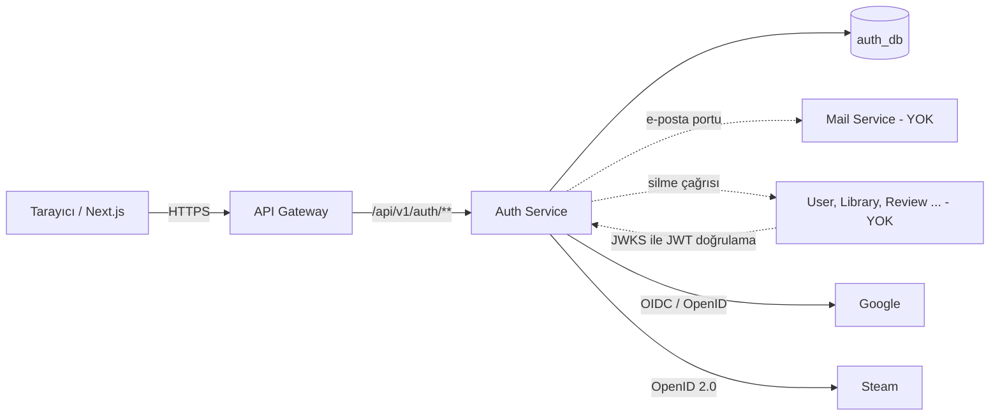
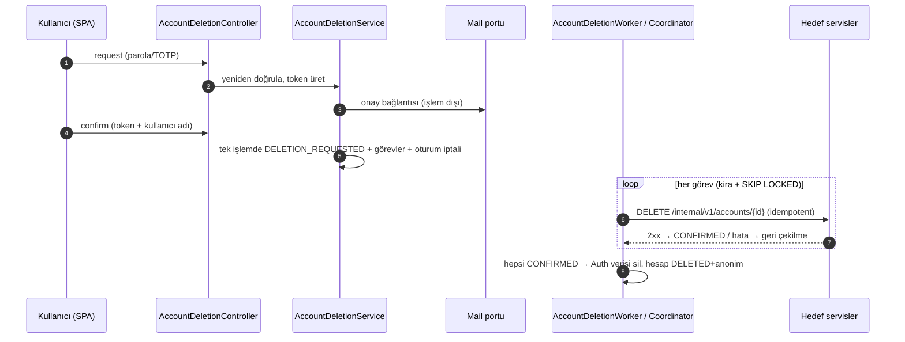
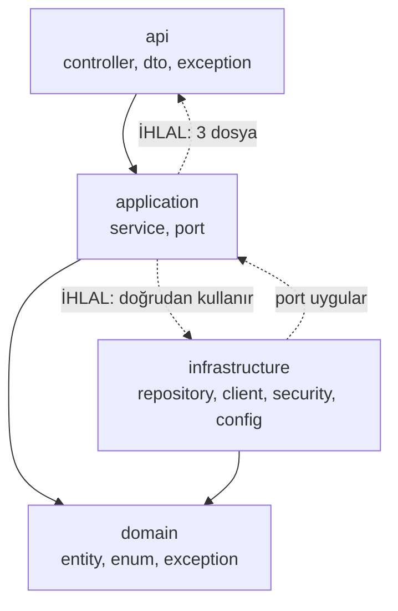
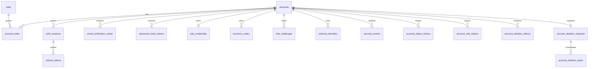

# LTZ Auth Service — Kapsamlı Teknik Rehber

> **Tarih:** 2026-10-21 · **Dal / commit:** `feature/auth-service` @ `a2d659d` · **Kapsam:** `backend/services/auth-service` (+ `docs/api.md` AUTH bölümü, `docs-auth/`, `docker-compose.yml`, `.env.example`)
> **Nitelik:** Salt-okunur teknik inceleme ve eğitim belgesi. Bu belge dışında hiçbir dosya değiştirilmedi; test ve tarama yeniden çalıştırılmadı.

## Nasıl okunur? Kanıt etiketleri

Belgede her önemli ifade şu etiketlerden biriyle ayrılır:

| Etiket | Anlamı |
| --- | --- |
| **[K]** | **Kod/yapılandırma ile doğrulandı.** Dosya veya sınıf yolu verilir; bu oturumda okundu. |
| **[B]** | **Belgeye dayanır** (`docs-auth/*.md` kapanış raporları). Önceki fazlarda ölçülmüştür; bu oturumda yeniden çalıştırılmamıştır. |
| **[Y]** | **Yorum / değerlendirme.** Benim mühendislik yargım; kesin gerçek değildir. |
| **[Ö]** | **Öneri.** Yapılması gereken veya düşünülmesi gereken iş. |
| **[D]** | **Dış kaynak** (bağlantı Kaynakça'da). |

Kodda olmayan bir özellik "varmış gibi" anlatılmaz; yoksa **YOK** denir.

Yol kısaltması: `…/` = `backend/services/auth-service/src/main/java/com/ltz/auth/`.

## İçindekiler

1. [Yönetici özeti ve en önemli 5 bulgu](#1-yönetici-özeti-ve-en-önemli-5-bulgu)
2. [Büyük resim: Auth Service nedir?](#2-büyük-resim-auth-service-nedir)
3. [Klasör ve dosya mimarisi](#3-klasör-ve-dosya-mimarisi)
4. [AUTH-01 … AUTH-17 gereksinim eşlemesi](#4-auth-01--auth-17-gereksinim-eşlemesi)
5. [ENV, yapılandırma ve hardcode denetimi](#5-env-yapılandırma-ve-hardcode-denetimi)
6. [Güvenlik mimarisi (eğitim)](#6-güvenlik-mimarisi-eğitim)
7. [Veritabanı ve Flyway](#7-veritabanı-ve-flyway)
8. [Kod kalitesi ve mimari değerlendirme](#8-kod-kalitesi-ve-mimari-değerlendirme)
9. [Açık güvenlik borçları ve production hazırlığı](#9-açık-güvenlik-borçları-ve-production-hazırlığı)
10. [Öğretici özetler, yol haritası ve 15 soru](#10-öğretici-özetler-yol-haritası-ve-15-soru)
11. [Doğrulanamayanlar ve sınırlar](#11-doğrulanamayanlar-ve-sınırlar)
12. [Kaynakça](#12-kaynakça)

---

## 1. Yönetici özeti ve en önemli 5 bulgu

**Genel durum [K][B].** Auth Service, kimlik doğrulamanın çekirdeğini uygular: kayıt + e-posta doğrulama, parola/Steam/Google ile giriş, TOTP 2FA, RS256 JWT + JWKS, refresh token rotasyonu, parola değiştirme/sıfırlama, rol/durum yönetimi, güvenlik olayı kaydı ve koordineli hesap silme. Üretim kodu ≈8.900 satır Java (katmanlı: `api` / `application` / `domain` / `infrastructure`), 4 Flyway dosyası (V61–V64), 52 test dosyası / 226 `@Test` metodu (son çalıştırma 244 test geçti, `a2d659d` öncesi). Docker'da çalışıyor, `/actuator/health` UP.

**Ancak "production'a hazır" değildir.** Dış bağımlılıkların çoğu (Mail Service, hedef servislerde silme uçları, servis kimliği, Gateway) henüz yok; `prod` profili bu yüzden bilerek açılmıyor [K: `infrastructure/config/MailDeliveryConfig.java`].

### En önemli 5 teknik/mimari sorun

| # | Bulgu | Neden önemli | Kanıt |
| --- | --- | --- | --- |
| 1 | **Anahtar rotasyonu yok.** JWKS'te tek anahtar; TOTP şifreleme anahtarı sürümü sabit `1`; tek HMAC anahtarı (`AUTH_OTP_HMAC_KEY`) OTP, brute-force sayacı, kurtarma kodu ve PKCE/nonce türetmesi için ortak kullanılıyor. | Sızıntı veya periyodik değişimde "eski+yeni birlikte geçerli" geçiş yapılamaz; JWT anahtarını değiştirmek tüm oturumları düşürür, HMAC anahtarını değiştirmek bekleyen kodları, kilitleri ve kurtarma kodlarını geçersiz kılar. | `infrastructure/security/JwtSigningKey.java` (tek `RSAKey`), `SecretCipher.CURRENT_KEY_VERSION = 1`, `application/service/OAuthFlowService.java` (`hasher.hash(PKCE_DOMAIN, state)`) |
| 2 | **Parola politikası NIST/OWASP güncel önerisinin altında.** En az 12 karakter, kara liste (sızmış/yaygın parola) kontrolü **yok**. | NIST SP 800-63B-4 [D]: yalnız parola ile tek faktör ise ≥15 karakter ve "yaygın/sızmış parola kara listesi" kontrolü zorunlu. Argon2id sağlam, ama zayıf parola seçimi engellenmiyor. | `domain/entity/Account.java` (`PASSWORD_MIN_LENGTH = 12`); kara liste kodu yok |
| 3 | **Güvenlik kritik ayarlar ortam değişkeniyle zayıflatılabilir.** Spring "relaxed binding" her `ltz.auth.*` anahtarını `LTZ_AUTH_…` ENV'iyle ezebilir. `two-factor.required-roles` boş kümeye çekilebilir (ADMIN/MODERATOR için 2FA zorunluluğu kalkar); `secure-cookies=false` koruması yalnız profil adı tam `prod` ise çalışır; birçok alt sınır çok düşük (`resend-cooldown` ≥1 sn vb.). | Yanlış/sabote edilmiş bir ENV, production'da koruma kapatabilir. | `infrastructure/config/TwoFactorProperties.java:31` (`@NotNull Set<RoleCode>`, boşluk kontrolü yok), `api/controller/SessionCookies.java` (yalnız `matchesProfiles("prod")`) |
| 4 | **Katman bağımlılığı: `application` → `api` ve `infrastructure`** (B16 genişledi). `PendingDeletionQueryService` doğrudan `api.dto.response.PendingDeletionTaskResponse` döndürüyor; `GoogleLoginService`/`SteamLoginService` `AuthApiPaths`'i import ediyor; 23+ servis Spring Data repository, `SecretCipher`, `AccessTokenIssuer` gibi altyapı tiplerini doğrudan kullanıyor. | Clean Architecture bağımlılık kuralı ihlali; Faz 5'te yapılan ArchUnit doğrulaması ("application → api yok") SEC-01'de eklenen sınıfla artık **geçerli değil**. Test edilebilirlik ve değiştirilebilirlik düşer. | `grep import com.ltz.auth.api` → 3 dosya (aşağıda §8.1) |
| 5 | **Gerçek entegrasyonlar yok** → kullanıcıya görünen bazı akışlar production'da tamamlanamaz: e-posta teslimi (Mail Service yok), hesap silme (hedef servislerde uç yok → hesap `DELETED` olmaz), Google/Steam (gerçek sağlayıcıyla hiç denenmedi), ilk ADMIN oluşturma yolu yok, Gateway'de CORS/cookie→Bearer yok. | Bunlar "kod hatası" değil, kapsam boşluğudur; ama production hazırlığının asıl engelidir. | `docs-auth/acik-guvenlik-borclari.md` B1–B17 |

**Diğer dikkate değer gözlemler [K]:** (a) Dockerfile'da `HEALTHCHECK` yok, konteyner "healthy" değil yalnız "running" görünür. (b) `docker-compose.yml` auth bloğundaki `JWT_ISSUER`, `JWT_ACCESS_TTL_SECONDS`, `JWT_REFRESH_TTL_SECONDS` satırları ortak `x-ltz-runtime-env` bloğunda zaten vardı; son commit'teki "compose aktarmıyordu" gerekçesi **yanlıştı**, eklenen satırlar yinelenen ama zararsızdır (§5.3). (c) `SecurityConfig` içindeki yorum "Rol token'dan değil … oturumdan gelir" der; oysa roller JWT `roles` claim'inden okunur, geçerlilik `token_version` ile sağlanır (§6.6).

---

## 2. Büyük resim: Auth Service nedir?

### 2.1 Basit anlatım

LTZ bir oyuncu platformu: 17 mikro servis + bir API Gateway. **Auth Service** bu sistemin "kapıdaki güvenlik görevlisi ve kimlik bürosu"dur:

- **"Sen kimsin?"** (kimlik doğrulama / *authentication*): e-posta+parola, Steam veya Google ile giriş.
- **"Ne yapabilirsin?"** (yetkilendirme / *authorization*): rol bilgisi (PLAYER, ADMIN …) imzalı bir **bilet** (JWT access token) içinde taşınır.
- **"Biletin hâlâ geçerli mi?"**: oturum, iptal, çıkış, parola değişince tüm oturumları kapatma.
- **"Hesabını sil"**: kişisel veriyi sorumlu servislerle birlikte, kayıt altında silme.

Auth, **profil bilgisi tutmaz** (User Service'in işi), **e-posta göndermez** (Mail Service'in işi). Parola, token, rol, hesap durumu ve harici kimlik (SteamID / Google `sub`) yalnız Auth'tadır [K: `docs-auth/servis-sozlesmeleri.md` §1].

### 2.2 Servis sorumlulukları

| Servis | Sahibi olduğu | Auth ile ilişkisi | Durum |
| --- | --- | --- | --- |
| **API Gateway** | Yönlendirme (`/api/v1/<ad>/**`), (ileride) CORS, cookie→Bearer, güvenilir IP | İstekleri Auth'a iletir | Spring Cloud Gateway WebMVC var; CORS/cookie→Bearer/trusted-proxy **YOK** (B1, B3) |
| **Auth** | Parola, token, 2FA, roller, hesap durumu, harici kimlik | — | Bu belge |
| **User** | Profil, tercihler | Auth `UserRegistered` olayı gönderecek (PLANNED) | Geliştirilmedi |
| **Mail** | E-posta teslimi | Auth 3 port ile çağırır: doğrulama kodu, parola sıfırlama, silme onayı | Port + dev (Mailpit) adaptörü var; **gerçek Mail Service YOK** |
| **Admin** | Yönetim orkestrasyonu | Auth'un `/admin/**` uçlarını çağıracak | Şimdilik kullanıcı token'lı; servis kimliği (D4) YOK |
| Diğer 14 servis | Kendi alan verisi | JWT'yi JWKS ile doğrular; silme çağrısı alır | Geliştirilmedi / doğrulayıcı yok |

Hiçbir servis Auth veritabanına doğrudan erişemez [K: `servis-sozlesmeleri.md` §1]; her servisin kendi `<ad>_db` veritabanı vardır.



### 2.3 Kullanıcıya sunulan özellikler [K]

Kayıt · e-posta doğrulama (6 haneli kod) · giriş (e-posta veya kullanıcı adı) · TOTP 2FA + kurtarma kodları · Steam ve Google ile giriş · oturum yenileme / çıkış / tüm cihazlardan çıkış · parola değiştirme · "şifremi unuttum" · hesap silme · (yönetici) rol ve hesap durumu yönetimi.

### 2.4 Uçtan uca senaryolar

Aşağıdaki akışlar kodla doğrulanmıştır (dosya adları parantezde).

#### Senaryo A — Ayşe kayıt olur ve hesabını doğrular

1. Ayşe `POST /api/v1/auth/register` ile e-posta, kullanıcı adı, parola gönderir (`RegistrationController` → `RegistrationService.register`).
2. Sunucu parolayı **Argon2id** ile özetler (`PasswordEncoderConfig`). E-posta zaten kayıtlıysa bile **aynı yanıt** (`202`) ve benzer süre döner — hesap var mı bilinmez (numaralandırma koruması).
3. Hesap `PENDING_VERIFICATION` durumunda, **yalnız `PLAYER` rolüyle** oluşur. İstemci rol/durum gönderemez (`RegisterAccountRequest` bu alanları içermez; bilinmeyen alan JSON'da reddedilir).
4. 6 haneli kod üretilir (`VerificationCodeGenerator`, `SecureRandom`); veritabanına **yalnız HMAC özeti** yazılır (`VerificationCodeHasher`). İşlem **commit edildikten sonra** kod, `VerificationCodeMailPort` ile (dev'de Mailpit) iletilir.
5. Ayşe kodu `POST /email-verification/confirm` ile **kayıt parolasıyla birlikte** gönderir (kayıt sahibi kanıtı: `RegistrantProofVerifier`). Kod doğruysa hesap `ACTIVE` olur; kod bir daha kullanılamaz (satır kilidi, atomik tüketim).
6. Giriş yapmadan önce hesap oturum alamaz (`LoginService.complete` yalnız `ACTIVE`).

#### Senaryo B — Ayşe giriş yapar, 2FA açıktır

1. `POST /login` → `LoginService.login`: önce **deneme hakkı ayrılır** (`AttemptThrottleService.reserve`), parola doğrulanır (hesap yoksa sahte hash ile aynı maliyet).
2. TOTP etkinse **oturum verilmez**; yalnız `mfa_required` + 256 bit `challenge` döner (5 dk, `MfaChallenge`).
3. `POST /login/2fa` → `TwoFactorService.completeLogin`: challenge + TOTP kodu (veya kurtarma kodu). Kod, daha önce kullanılmış zaman adımıysa reddedilir (replay).
4. Başarıda `SessionService.start`: `auth_sessions` kaydı, tek kullanımlık refresh token, RS256 access token. Token'lar **HttpOnly cookie** olarak yazılır (`SessionCookies.write`).

#### Senaryo C — Ayşe parolasını değiştirir

`POST /password/change` (CSRF + kimlik zorunlu): mevcut parola doğrulanır (hesap bazlı sınır), yeni parola eskisinden farklı olmalı; başarıda **tüm oturumlar iptal**, `token_version` artar (eski access token'lar düşer), bekleyen sıfırlama token'ları geçersiz olur, cookie'ler silinir → yeniden giriş gerekir (`PasswordService`).

#### Senaryo D — Ayşe hesabını siler

1. `POST /account/deletion/request`: yeniden kimlik doğrulama (parola; parolasızsa son 10 dk içinde açılmış oturum; TOTP varsa ikinci faktör). E-postaya 30 dk geçerli tek kullanımlık onay bağlantısı gider.
2. `POST /account/deletion/confirm`: token + **kullanıcı adını yazma**. Hesap `DELETION_REQUESTED` olur, oturumlar iptal edilir, her hedef servis için bir **silme görevi** açılır.
3. Arka planda `AccountDeletionWorker` görevleri kiralar, hedef servise idempotent silme çağrısı yapar (üstel geri çekilme). **Hepsi onaylayınca** Auth'un kendi kişisel verisi silinir, hesap anonim ve `DELETED` olur.
4. **Bugün:** hedef servislerde silme ucu yok → görevler `PENDING` kalır, hesap `DELETED` olmaz, "silindi" denmez [B: faz-6 raporu].



---

## 3. Klasör ve dosya mimarisi

### 3.1 Gerçek dosya ağacı [K]

```text
backend/services/auth-service/
├─ Dockerfile, pom.xml, mvnw*
└─ src/
   ├─ main/java/com/ltz/auth/
   │  ├─ AuthServiceApplication.java
   │  ├─ api/                         ← HTTP sınırı
   │  │  ├─ controller/  (AuthApiPaths, Registration/EmailVerification/Login/Session/TwoFactor/
   │  │  │                ExternalLogin/Password/AccountDeletion/AdminAccount/Jwks Controller, SessionCookies)
   │  │  ├─ dto/request/  (17 record)      dto/response/ (9 record)
   │  │  └─ exception/GlobalExceptionHandler.java
   │  ├─ application/                 ← iş akışları
   │  │  ├─ port/    (dış dünya arayüzleri: mail ×3, GoogleOidcPort, SteamAssertionVerifier, AccountDataEraserPort)
   │  │  └─ service/ (Registration, EmailVerification, Login, Session, TwoFactor, Password, OAuthFlow,
   │  │               GoogleLogin, SteamLogin, SteamAssertionValidator, AccountDeletion{Service,Coordinator,
   │  │               Dispatcher,Worker}, AccountAdministration, RetentionCleanup{Service,Worker},
   │  │               AttemptThrottle, SecurityEventRecorder, RegistrantProofVerifier, *Dispatcher …)
   │  ├─ domain/                      ← kurallar ve veri
   │  │  ├─ entity/ (19 JPA varlığı)  enums/ (14)   exception/ (AuthException, AuthErrorCode …)
   │  ├─ infrastructure/              ← teknik ayrıntılar
   │  │  ├─ client/ (GoogleOidcClient, SteamOpenIdClient, DevSmtp…, MailServiceUnavailableAdapter …)
   │  │  ├─ config/ (SecurityConfig, JwtConfig, OAuthConfig, *Properties ×13, *Config ×7)
   │  │  ├─ persistence/repository/ (Spring Data repository ×20, AuthDataEraser, OpenIdNonceStore)
   │  │  └─ security/ (JwtSigningKey, AccessTokenIssuer, SessionStateValidator, AccessTokenCookieFilter,
   │  │                AccessTokenResolver, RequestBodySizeLimitFilter, RequestIdFilter, SecretCipher,
   │  │                SecureTokens, TotpCodes, VerificationCode{Generator,Hasher}, BoundedPasswordEncoder …)
   │  └─ (boş yer tutucular: application/mapper, application/saga, domain/event, domain/enums/.gitkeep,
   │       infrastructure/messaging/{inbox,outbox}, infrastructure/client/dto — yalnız .gitkeep)
   ├─ main/resources/ application.properties, application-dev.properties, db/migration/V61…V64
   └─ test/java/com/ltz/auth/ (52 dosya; §3.7)
```

### 3.2 Katmanlar ve izin verilen bağımlılık yönü



**İdeal kural [Y]:** bağımlılık yönü içe doğrudur (`api → application → domain`; `infrastructure → application(port) + domain`). Bu projede ports (`application/port`) mail/Google/Steam/silme için kullanılmış; fakat veri erişimi ve güvenlik yardımcıları için kullanılmamıştır (bilinçli, `faz-1-kapanis-raporu.md` §10'da kayıtlı). Ayrıntı §8.1.

### 3.3 `api` katmanı

| Sınıf | Görev | Konuştuğu | Not [K] |
| --- | --- | --- | --- |
| `AuthApiPaths` | Tüm yol sabitleri (`/api/v1/auth/...`) | `SecurityConfig`, controller'lar, 2 servis | Güvenlik kuralı ve controller aynı sabiti kullanır (tutarlılık) — fakat `application` bu sınıfı da import ediyor (ihlal) |
| `RegistrationController` | `POST /register` → `RegistrationService` | application | İnce controller |
| `EmailVerificationController` | `confirm`, `resend` | `EmailVerificationService` | Cookiesiz, CSRF muaf |
| `LoginController` | `POST /login`, `/login/2fa` | `LoginService`, `TwoFactorService`, `SessionCookies` | Başarıda cookie yazar; MFA gerekiyorsa gövdede challenge |
| `SessionController` | `GET /csrf`, `refresh`, `logout`, `logout-all` | `SessionService` | Refresh cookie yalnız bu yola gider |
| `TwoFactorController` | TOTP `setup`, `activate`, `disable` | `TwoFactorService` | Kimlik zorunlu |
| `ExternalLoginController` | Google/Steam `start`, `callback`, Steam `complete` | `GoogleLoginService`, `SteamLoginService`, `SessionCookies` | Sonuç **sabit frontend adresine URL fragment'iyle**; open redirect yok |
| `PasswordController` | `change`, `forgot`, `reset` | `PasswordService` | |
| `AccountDeletionController` | `request`, `confirm` | `AccountDeletionService` | |
| `AdminAccountController` | Rol/durum yönetimi, bekleyen silme listesi | `AccountAdministrationService`, `PendingDeletionQueryService` | `SecurityConfig` yalnız ROLE_ADMIN'e açar; `limit` `Math.clamp` ile 1–200 |
| `JwksController` | `GET /.well-known/jwks.json` | `JwtSigningKey.publicJwkSet()` | Yalnız açık anahtar alanları |
| `SessionCookies` | Cookie adı/öznitelik üretimi, temizleme | `SecurityConfig`, controller'lar | §6.3 |
| `GlobalExceptionHandler` | Tüm hatalar → RFC 9457 `ProblemDetail` | — | Genel `Exception` yakalayıcısı 500'ü sızdırmadan döner |
| `dto/request/*` | Giriş sözleşmeleri | — | Bean Validation; `toString()` parola/e-postayı maskeler |
| `dto/response/*` | Çıkış sözleşmeleri | — | Domain varlığı doğrudan dönmez |

### 3.4 `application` katmanı (ana servisler)

| Servis | Sorumluluk | Kritik noktalar [K] |
| --- | --- | --- |
| `RegistrationService` | Hesap oluşturma | Tekillik DB constraint'ine dayanır (`handleUniqueViolation`); parola her durumda hash'lenir |
| `EmailVerificationService` | Kod üretimi, resend, atomik tüketim | Yanlış kanıt kod denemesini **tüketmez**; "günlük" sınır, bekleme süresi |
| `RegistrantProofVerifier` | Pre-hijacking savunması | Parola veya SteamID'ye bağlı tek kullanımlık kanıt; hesap yoksa da bir parola doğrulaması yapar |
| `LoginService` | Parola girişi + harici kimlik sonrası ortak akış (`loginVerifiedIdentity`) | Sahte hash; durum yalnız parola doğruysa bildirilir; 2FA atlanamaz |
| `SessionService` | Oturum başlat, `refresh` (rotasyon), `logout`, `logoutAll` | Sealed `RefreshOutcome`; reuse tespiti; satır kilidi |
| `TwoFactorService` | TOTP kurulum/aktivasyon/giriş/kapatma, kurtarma kodları | Replay: `TotpCredential.acceptsStep`; secret AES-GCM |
| `PasswordService` | Parola değiştirme ve sıfırlama | Her ikisi tüm oturumları iptal eder; 2FA kapatılmaz |
| `OAuthFlowService` | Harici akış `state` yönetimi | 256 bit state, yalnız SHA-256 özeti; tüketim atomik `UPDATE` |
| `GoogleLoginService` / `SteamLoginService` / `SteamAssertionValidator` | Google OIDC, Steam OpenID 2.0 | Eşleştirme yalnız `sub` / SteamID64; e-posta ile sessiz birleştirme yok |
| `AccountAdministrationService` | Rol/durum yönetimi | Kendini değiştiremez; ADMIN/MODERATOR yalnız ACTIVE+TOTP'li hesaba |
| `AccountDeletionService` / `Coordinator` / `Dispatcher` / `Worker` | Silme akışı | Kira + `SKIP LOCKED`, işlem dışı HTTP, üstel geri çekilme |
| `RetentionCleanupService` / `Worker` | Süresi dolan kayıt ve bekleyen hesap temizliği | Bekleyen hesaplar silinmez, **anonimleştirilir** |
| `AttemptThrottleService` | Brute-force sayacı | Anahtar HMAC özetidir; var olmayan kimlik de sayılır |
| `SecurityEventRecorder` | Denetim olayı | Hesapsız olay DB'ye yazılmaz (tablo şişmesi önlemi) |
| `application/port/*` | Dış dünya sözleşmeleri | Mail ×3, Google, Steam, silme; adaptörler `infrastructure/client` |

### 3.5 `domain` ve `infrastructure`

- **`domain/entity`** — 19 JPA varlığı (`Account`, `AuthSession`, `RefreshToken`, `EmailVerificationCode`, `TotpCredential`, `MfaChallenge`, `ExternalIdentity`, `AccountDeletion*` …). İş kuralları (örn. `Account.isActive`, `RefreshToken.wasRotatedWithin`, `AttemptThrottle.reserveAttempt`) varlık içindedir — "zengin domain" yaklaşımı. Yalnız 2 varlıkta `@Version` (iyimser kilit) var; geri kalan eşzamanlılık **satır kilidi** (`FOR UPDATE`) ve **DB kısıtlarıyla** yönetilir.
- **`domain/enums`** — `AccountStatus` (geçiş kuralı `canTransitionTo`), `RoleCode`, `SecurityEventType` (43 tür), `SessionRevokeReason` …
- **`domain/exception`** — `AuthException(AuthErrorCode)`: her hata kodunun HTTP durumu ve **sabit, güvenli** mesajı tek yerde (`AuthErrorCode`).
- **`infrastructure/persistence/repository`** — Spring Data arayüzleri + `@Query`/`@Lock` ile kilitli okumalar; `AuthDataEraser` yalnız **sabit SQL** ile kişisel veriyi siler; `RetentionCleanupRepository` partili silme; `OpenIdNonceStore` birincil anahtar çakışmasıyla replay engeller.
- **`infrastructure/security`** — kriptografi ve filtreler (§6).
- **`infrastructure/config`** — `@ConfigurationProperties` kayıtları (doğrulamalı) ve açılış tutarlılık denetimleri (`CleanupConfig`, `OAuthConfig`, `MailDeliveryConfig`).
- **`infrastructure/client`** — dış sağlayıcı istemcileri: yönlendirme izlemez, zaman aşımı vardır; Google id_token'ı JWKS ile doğrulanır.

### 3.6 Bir HTTP isteğinin yaşam döngüsü [K]

```mermaid
flowchart LR
  R[İstek] --> F1[RequestIdFilter<br/>X-Request-Id doğrula/üret]
  F1 --> F2[RequestBodySizeLimitFilter<br/>8 KB sınır, chunked dahil]
  F2 --> F3[CsrfFilter<br/>double-submit, spa]
  F3 --> F4[AccessTokenCookieFilter<br/>cookie → Bearer, CSRF'den SONRA]
  F4 --> F5[BearerTokenAuthenticationFilter<br/>AccessTokenResolver + JwtDecoder]
  F5 --> V[Doğrulayıcılar: RS256, iss, aud, exp, typ=at+jwt,<br/>SessionStateValidator]
  V --> AZ[authorizeHttpRequests<br/>public / authenticated / ADMIN / denyAll]
  AZ --> C[Controller → Service → Repository]
  C --> EH[GlobalExceptionHandler → ProblemDetail]
```



Kritik tasarım: `AccessTokenResolver` cookie **okumaz**, çünkü Spring Security, Bearer token bulan resolver'ın istekleri CSRF'den muaf tutar. Cookie, CSRF filtresinden **sonra** `AccessTokenCookieFilter` ile başlığa çevrilir; bu sayede cookie ile kimlik doğrulayan her istek CSRF denetiminden geçer [K: `AccessTokenResolver.java`, `faz-2-kapanis-raporu.md` §2].

### 3.7 Test yapısı (gruplanmış) [K]

| Grup | Dosyalar | Ne doğrular |
| --- | --- | --- |
| Uçtan uca (MockMvc + Testcontainers PostgreSQL 17) | `api/controller/*Test` (14) | Her uç, CSRF, 401/403, numaralandırma, eşzamanlılık (`ConcurrentRequests`), pre-hijacking (`AccountPreHijackingTest`) |
| Servis | `application/service/*Test` (9) | Silme koordinasyonu, temizlik, Steam doğrulama, teslim hataları, kimliksiz yazma sınırı |
| Güvenlik birimi | `infrastructure/security/*Test` (9) | JWT doğrulama, TOTP (RFC 6238), AES-GCM, token üretimi, gövde sınırı, Argon2 sınırlayıcı |
| Yapılandırma / migration | `infrastructure/config/*Test` (4), `FlywayMigrationTest` | Özellik doğrulama, prod fail-fast, şema kısıtları |
| İstemci | `infrastructure/client/*Test` (3) | Mailpit E2E, teslim hatası |
| Destek | `IntegrationTestSupport`, `*TestSupport`, sahte port yapılandırmaları | Ortak konteyner, sabit anahtarlar |

Son bilinen sonuç: 244 test, 0 hata (`a2d659d` öncesi). Kapsam: son ölçüm Faz 2'de **%95,30** [B]; sonraki fazlarda yeniden ölçüldüğüne dair kayıt **doğrulanamadı**.

### 3.8 Mimari değerlendirme (özet) [Y]

- Doğru yerde ve iyi: `JwtSigningKey` (domain'e bağımsız kripto), `AuthErrorCode` (merkezi hata sözleşmesi), port/adaptör ayrımı (mail/OAuth/silme), `AuthApiPaths` (tek yol kaynağı), `*Properties` (tip güvenli, doğrulamalı yapılandırma).
- İyileştirilmeli: `application` → `infrastructure/api` bağımlılıkları (§8.1); `SessionStateValidator` (güvenlik altyapısı) iki repository'ye doğrudan bağlı; boş yer tutucu paketler (`saga`, `mapper`, `inbox/outbox`) kafa karıştırabilir.

---

## 4. AUTH-01 … AUTH-17 gereksinim eşlemesi

> Not: Görev numaraları ve başlıkları `docs-auth/faz-*-kapanis-raporu.md` ile `docs/api.md` kayıtlarından alınmıştır. Orijinal görev dosyası (`docs/servis-gereksinimleri/LTZ_Servis_Icerikleri_Kerem.md`) bu oturumda yeniden okunmadı; "amaç" sütunları kapanış raporlarına dayanır **[B]**.

Durum anahtarı: **Tamam** = kodda var ve testle doğrulanmış · **Kısmi** = eksik parça belgelenmiş · **Eksik** · **Doğrulanamadı**.

| AUTH | Amaç | Kullanıcı davranışı | Ana uç / sınıf / tablo | Güvenlik önlemi | Test kanıtı | Durum |
| --- | --- | --- | --- | --- | --- | --- |
| **01** Kayıt | Güvenli hesap oluşturma | Form → "e-postanızı doğrulayın" | `POST /register` · `RegistrationService` · `accounts`, `account_roles` | Argon2id, tekil e-posta/kullanıcı adı (DB), numaralandırma yok, yalnız PLAYER, 8 KB sınır | `RegistrationControllerTest`, `FlywayMigrationTest` | **Tamam** |
| **02** E-posta doğrulama | Hesap sahipliği kanıtı | 6 haneli kod → hesap aktif | `confirm`/`resend` · `EmailVerificationService` · `email_verification_codes` | HMAC özet, TTL 10 dk, 5 deneme, bekleme 60 sn, günlük 5, tek aktif kod, **kayıt sahibi kanıtı (N1)** | `EmailVerificationControllerTest`, `AccountPreHijackingTest`, `MailpitEndToEndTest` | **Kısmi** — dev'de tam; production teslimi Mail Service yok |
| **03** Giriş | Parola ile giriş | E-posta veya kullanıcı adı | `POST /login` · `LoginService` | Sahte hash, eşit süre, brute-force sayacı, durum yalnız parola doğruysa | `LoginControllerTest` | **Tamam** |
| **04** 2FA | TOTP ikinci faktör | QR kur → kodla giriş; kurtarma kodları | `/2fa/totp/*`, `/login/2fa` · `TwoFactorService`, `TotpCodes`, `SecretCipher` · `totp_credentials`, `recovery_codes`, `mfa_challenges` | AES-256-GCM (AAD=hesap), replay (adım kaydı), challenge başına 5 deneme + hesap kilidi, ADMIN/MODERATOR zorunlu | `TwoFactorControllerTest`, `TotpCodesTest`, `SecretCipherTest` | **Tamam** (anahtar rotasyonu yok) |
| **05** Steam | Steam ile giriş/kayıt | Steam'e yönlen → dön | `/oauth/steam/*` · `SteamLoginService`, `SteamAssertionValidator`, `SteamOpenIdClient` · `external_identities`, `openid_nonces`, `steam_registrations` | `check_authentication`, `return_to`/nonce/`op_endpoint` denetimi, replay (PK), parametre kirliliği reddi | `SteamLoginTest`, `SteamAssertionValidatorTest` | **Tamam (sahte sağlayıcıyla)**; gerçek Steam **Doğrulanamadı** |
| **06** Google | Google OIDC | Google'a yönlen → dön | `/oauth/google/*` · `GoogleLoginService`, `GoogleOidcClient` · `oauth_flows` | Code+PKCE S256, state (tarayıcıya bağlı), nonce, id_token imza/iss/aud/exp, `sub` eşleştirme | `GoogleLoginTest`, `ProviderNotConfiguredTest` | **Tamam (sahte sağlayıcıyla)**; gerçek Google **Doğrulanamadı** (client id/secret yok) |
| **07** JWT | Doğrulanabilir oturum belgesi | Cookie içinde access+refresh | `JwtSigningKey`, `AccessTokenIssuer`, `SessionService` · `auth_sessions`, `refresh_tokens`; `GET /.well-known/jwks.json` | RS256 ≥3072 bit, `kid`=RFC 7638, yalnız RS256, `typ=at+jwt`, refresh rotasyonu + reuse tespiti, mutlak ömür | `JwtValidationTest`, `JwtSigningKeyTest`, `SessionControllerTest` | **Tamam** (anahtar rotasyonu yok) |
| **08** Logout | Çıkış | Tek cihaz / tüm cihazlar | `/session/logout`, `/logout-all` | Oturum iptali, `token_version` artışı (eski access düşer) | `SessionControllerTest` | **Tamam** |
| **09** Parola değiştirme | Güvenli değişim | Yeniden giriş gerekir | `POST /password/change` · `PasswordService` | Mevcut parola + hesap bazlı sınır, tüm oturum iptali | `PasswordChangeTest` | **Tamam** (kara liste yok) |
| **10** Şifremi unuttum | E-postayla sıfırlama | "Bağlantı gönderildi" (her durumda) | `/password/forgot`, `/reset` · `password_reset_tokens` | 256 bit tek kullanımlık token, özet, fragment bağlantı, numaralandırma yok, bekleme | `PasswordResetTest`, `PasswordResetDeliveryFailureTest` | **Kısmi** — production teslimi yok |
| **11** Rol yönetimi | Rol verme/alma | (Yönetici) | `/admin/accounts/{id}/roles/*` · `AccountAdministrationService` · `account_role_history` | Gerekçe + denetim, kendini değiştiremez, PLAYER alınamaz, ADMIN/MOD için TOTP şartı | `AdminAccountTest` | **Tamam** — ilk ADMIN yolu yok (B7) |
| **12** Hesap durumları | Askı/yasak/devre dışı | (Yönetici) | `/admin/accounts/{id}/status` · `account_status_history` | `canTransitionTo`, oturum iptali | `AdminAccountTest` | **Kısmi** — BANNED kaldırma ve süreli askı yok (B8) |
| **13** Hesap güvenliği | Brute-force / kilit | "Çok fazla deneme" | `AttemptThrottleService` · `attempt_throttles` | Kimlik+hesap bazlı sınır | `LoginControllerTest`, `UnauthenticatedWriteBoundTest` | **Kısmi** — **IP bazlı limit yok** (B1) |
| **14** RBAC | Rol bazlı erişim | 401/403 ayrımı | `SecurityConfig` | `/admin/**` → ROLE_ADMIN, `anyRequest().denyAll()` | `SecurityRulesTest`, `AdminAccountTest` | **Tamam** (yalnız Auth; diğer servislerin RBAC'i kendi işleri) |
| **15** Güvenlik olayları | Denetim kaydı | — | `SecurityEventRecorder` · `security_events` | Yalnız tür+hesap+istek kimliği; PII yok | birçok test | **Tamam** — saklama süresi kararı yok (B9) |
| **16** Hesap silme | Güvenli silme | İki adımlı onay | `/account/deletion/*` · koordinasyon sınıfları · `account_deletion_*` | Yeniden doğrulama, e-posta token'ı, açık onay, idempotent görevler, KVKK ayrımı | `AccountDeletionTest`, `AccountDeletionCoordinatorTest` | **Kısmi** — Auth tarafı tam; diğer servislerde silme ucu yok → hesap `DELETED` olmaz |
| **17** Servis sınırları | Sözleşmeler | — | `docs-auth/servis-sozlesmeleri.md` | Sahiplik, JWKS, servis kimliği sözleşmesi | (belge) | **Kısmi** — sözleşme hazır; karşı servisler ve D4 yok |

**LTZ-KER-AUTH görev grupları:** 01 (AUTH-01/02) · 02 (03/04/07/08/13/15) · 03 (05/06) · 04 (09/10) · 05 (11/12/14) · 06 (16/17) — her biri ayrı commit (`faeb0c5` … `28d343d`) [K: `git log`].

---

## 5. ENV, yapılandırma ve hardcode denetimi

> Bu bölümde **hiçbir secret değeri okunmadı veya yazılmadı**; yalnız değişken adları, kod ve Compose tanımları incelendi. `.env`/`.env.dev` içeriğine bakılmadı.

### 5.1 Yapılandırma envanteri [K]

Kod: `…/infrastructure/config/*Properties.java`; varsayılanlar: `src/main/resources/application.properties`; Docker: `docker-compose.yml` (ortak `x-ltz-runtime-env` + `auth-service` bloğu); örnek: `.env.example`.

**Sütun "Docker?"**: ✔ ENV konteynere geçiyor · ✘ geçmiyor (yalnız varsayılan veya relaxed-binding yolu) · ◐ ortak blok.

| Yapılandırma | ENV değişkeni | Kodda | Varsayılan | Sınırlar | Docker? | Durum |
| --- | --- | --- | --- | --- | --- | --- |
| JWT özel anahtar | `AUTH_JWT_PRIVATE_KEY` | `JwtProperties.privateKey` → `JwtSigningKey.fromBase64Pkcs8` | **yok** (zorunlu) | Base64 PKCS#8 RSA ≥3072 bit | ✔ (`:?`) | İyi, fail-fast |
| JWT açık anahtar | — (özelden türetilir) | `JwtSigningKey.publicKey()` / JWKS | — | — | — | İyi |
| JWT issuer | `JWT_ISSUER` | `JwtProperties.issuer` | `ltz-auth` | `@NotBlank` | ◐ + ✔ (yinelenen) | İyi |
| JWT audience | `JWT_AUDIENCE` | `JwtProperties.audience` | `ltz-api` | `@NotBlank` | ✔ | Giderildi (entegrasyon turunda Compose'a eklendi) |
| Access TTL | `JWT_ACCESS_TTL_SECONDS` | `JwtProperties.accessTokenTtl` | 300 sn | 1–15 dk | ◐ + ✔ | İyi |
| Refresh TTL | `JWT_REFRESH_TTL_SECONDS` | `SessionProperties.refreshTokenTtl` | 604800 sn | 1 sa–30 gün | ◐ + ✔ | İyi |
| Mutlak oturum ömrü | `AUTH_SESSION_ABSOLUTE_TTL` | `SessionProperties.absoluteTtl` | P30D | 1 sa–90 gün | ✔ | İyi (bu tur eklendi) |
| Refresh yeniden kullanım toleransı | — | `SessionProperties.refreshReuseGrace` | PT10S | 1 sn–1 dk | ✘ | Kodda kalması makul |
| Cookie `Secure` | — (bilinçli yok) | `SessionProperties.secureCookies`, `SessionCookies` | `true` | `prod`'da false → başlamaz | ✘ | **Bilinçli**; ancak koruma yalnız profil adı `prod` ise (§5.4) |
| E-posta OTP HMAC anahtarı | `AUTH_OTP_HMAC_KEY` | `VerificationProperties.hmacKey` → `VerificationCodeHasher` | **yok** | ≥32 bayt | ✔ (`:?`) | İyi; ama çok amaçlı (§6.11) |
| OTP TTL | `AUTH_OTP_TTL` | `VerificationProperties.codeTtl` | PT10M | 1–30 dk | ✔ | İyi |
| OTP deneme | `AUTH_OTP_MAX_ATTEMPTS` | `maxAttempts` | 5 | 1–10 | ✔ | İyi |
| OTP bekleme / günlük sınır | — | `resendCooldown`, `dailyLimit` | PT60S / 5 | ≥1 sn / ≥1 (üst sınır yok) | ✘ | Alt sınır zayıf (§5.4) |
| TOTP şifreleme anahtarı | `AUTH_TOTP_ENCRYPTION_KEY` | `TwoFactorProperties.encryptionKey` → `SecretCipher` | **yok** | 32 bayt (AES-256) | ✔ (`:?`) | İyi; sürümleme yok |
| 2FA challenge TTL | `AUTH_MFA_CHALLENGE_TTL` | `challengeTtl` | PT5M | 1–15 dk | ✔ | İyi |
| 2FA deneme / kurtarma sayısı / saat sapması | — | `maxChallengeAttempts`, `recoveryCodeCount`, `allowedClockSkewSteps` | 5 / 10 / 1 | 1–10 / 5–20 / 0–2 | ✘ | Kodda makul |
| **2FA zorunlu roller** | — | `TwoFactorProperties.requiredRoles` | `ADMIN,MODERATOR` | `@NotNull` + **ADMIN içermeli** (açılışta doğrulanır) | ✘ | ADMIN için giderildi; MODERATOR hâlâ ENV ile çıkarılabilir |
| Brute-force eşiği / pencere / kilit | `AUTH_LOGIN_MAX_FAILURES`, `AUTH_LOGIN_ATTEMPT_WINDOW`, `AUTH_LOGIN_LOCK_DURATION` | `AttemptProperties` | 5 / PT15M / PT15M | 1–20 / 1 dk–24 sa / 1 dk–24 sa | ✔ | İyi (bu tur eklendi) |
| OAuth akış TTL | `AUTH_OAUTH_FLOW_TTL` | `OAuthProperties.flowTtl` | PT10M | 1–30 dk | ✔ | İyi |
| OAuth genel URL / frontend URL | `AUTH_PUBLIC_BASE_URL`, `FRONTEND_PUBLIC_URL` | `OAuthProperties` | localhost değerleri | `prod`'da https zorunlu | ✔ | İyi (prod koruması profil adına bağlı) |
| Google client id / secret | `GOOGLE_CLIENT_ID`, `GOOGLE_CLIENT_SECRET` | `OAuthProperties.google` | boş | ikisi birlikte olmalı | ✔ | İyi; boşsa Google kapalı (503) |
| Google/Steam adresleri, zaman aşımı | — | `OAuthProperties` | resmi adresler | `prod`'da https | ✘ | Kodda doğru (sağlayıcı sabiti) |
| Steam nonce yaşı / kayıt TTL / kanıt TTL | — | `assertionMaxAge` (PT5M, ≥30 sn), `registrationTtl` (PT15M), `verificationProofTtl` (PT30M) | | | ✘ | Üst sınır yok (`assertionMaxAge`) |
| Parola sıfırlama TTL | `AUTH_PASSWORD_RESET_TTL` | `PasswordResetProperties.tokenTtl` | PT30M | 5 dk–2 sa | ✔ | İyi |
| Sıfırlama isteği beklemesi, bağlantı tabanı | — / `FRONTEND_PUBLIC_URL` | `requestCooldown` (≥1 sn), `linkBaseUrl` | PT60S | | ◐ | Alt sınır zayıf |
| Hesap silme (token TTL, bekleme, worker, geri çekilme, hedefler) | — | `DeletionProperties` | 30 dk, 60 sn, 30 sn, 1 dk→6 sa, 14 hedef | doğrulamalı | ✘ | Kodda makul |
| Temizlik (`ltz.auth.cleanup.*`) | — | `CleanupProperties` | `pending-account-ttl` PT24H … | doğrulamalı + açılış tutarlılık denetimi | ✘ | İyi |
| Argon2 eşzamanlılık / bekleme | — | `PasswordHashingProperties` | 4 / PT0.5S | ≥1 / ≥1 ms | ✘ | Bilinçli (S7) |
| İstek gövdesi sınırı | — | `RequestLimitProperties` | 8KB | | ✘ | İyi |
| PostgreSQL | `POSTGRES_HOST/PORT/USER/PASSWORD`, `DB_AUTH_NAME`, `DB_POOL_*` | `spring.datasource.*` | host/port/kullanıcı varsayılanlı; **parola yok** | | ✔ | İyi (tek superuser rolü: dev) |
| Mail adaptörü | — | `ltz.auth.mail.adapter` | `unavailable` (dev profil: `dev-smtp`) | `prod` hazır adaptör olmadan başlamaz | ✘ | Bilinçli |
| Dev SMTP | `REST_CLIENT_*_TIMEOUT_MS` + dosya | `DevSmtpProperties` (yalnız dev) | `mailpit:1025` | | ◐ | İyi |
| Log seviyesi / Swagger / port | `LOG_LEVEL`, `SWAGGER_ENABLED`, `BACKEND_INTERNAL_PORT` | `application.properties` | INFO / false / 8080 | | ◐ | İyi (Swagger varsayılan kapalı) |
| **CORS izinli origin** | `CORS_ALLOWED_ORIGINS` (Compose'ta tüm servislere veriliyor) | **Auth kodunda kullanılmıyor** | — | — | ◐ | **Auth'ta CORS yok**; Gateway sorumluluğu (B3) |
| **Trusted proxy / istemci IP** | — | Yok (`server.forward-headers-strategy` ayarsız) | — | — | — | **YOK** (B1, Gateway) |
| **Rate limit (IP/uç bazlı)** | — | Yok; yalnız kimlik/hesap bazlı sayaç | — | — | — | **YOK** (B1) |
| Cookie `Domain` | — | Hiç ayarlanmaz | — | — | — | Bilinçli: `__Host-` öneki `Domain` yasaklar |
| Cookie `Path` / `SameSite` / `HttpOnly` | — | `SessionCookies`, `SecurityConfig` | sabit | — | — | Kodda sabit (bilinçli, §6.3) |

### 5.2 Hardcode / magic number-string taraması [K]

Kodda dolaşılan sayısal ve metin sabitleri büyük ölçüde **adlandırılmış sabit**tir. Gerçek ve potansiyel bulgular:

| # | Konum | Mevcut | Problem mi? | Doğru yer | Öncelik / öneri |
| --- | --- | --- | --- | --- | --- |
| 1 | `PasswordEncoderConfig` (`MEMORY_KIB=19*1024`, `ITERATIONS=2`, `PARALLELISM=1`, `HASH_LENGTH_BYTES=32`) | Argon2id parametreleri | Hayır — OWASP minimumu [D]; algoritma parametresi | **Kodda sabit kalsın** (hash önekine yazılmaz; sürüm geçişi `DelegatingPasswordEncoder` ile) | Düşük. Sadece ileride artırılacaksa `upgradeEncoding` akışı tasarlanmalı |
| 2 | `SecureTokens` (`OPAQUE_TOKEN_BYTES=32`, kurtarma alfabesi, 5+5 karakter) | Protokol/biçim sabiti | Hayır | Kodda | — |
| 3 | `TotpCodes` (6 hane, 30 sn adım, SHA-1) | RFC 6238 sabiti | Hayır — authenticator uyumluluğu için SHA-1 gerekli | Kodda | — |
| 4 | `SecretCipher` (12 bayt nonce, 128 bit tag, AES-GCM) | Algoritma sabiti | Hayır | Kodda | — |
| 5 | `JwtSigningKey.MIN_KEY_BITS=3072` | Güvenlik tabanı | Hayır — **ENV'e taşınmamalı** (düşürülebilir olurdu) | Kodda | — |
| 6 | `SecurityConfig` (`CSRF_COOKIE_SAME_SITE="Strict"`, `CSRF_COOKIE_PATH="/"`) | Cookie öznitelikleri | Hayır — güvenlik sabiti | Kodda | — |
| 7 | `SessionCookies` (adlar, `Lax`/`Strict`, `Path`) | Aynı | Hayır | Kodda | — |
| 8 | `AdminAccountController.MAX_PENDING_LIMIT=200`, `AdminReason.MAX_LENGTH=500` | API sınırı | Hayır | Kodda (adlandırılmış) | — |
| 9 | `SteamAssertionValidator.MAX_NONCE_LENGTH=255` | Protokol | Hayır | Kodda | — |
| 10 | `SecurityEventRecorder` / `AttemptThrottleService` log mesajları | İngilizce sabit metin | Hayır | Kodda | — |
| 11 | `Account.PASSWORD_MIN_LENGTH=12`, `PASSWORD_MAX_LENGTH=128`, `USERNAME_PATTERN`, `EMAIL_MAX_LENGTH=254` | İş kuralı | **Politika sorunu**, hardcode sorunu değil (§6.2) | Kodda sabit (iş kuralı); ama **değer** güncellenmeli | Orta: min 15 + kara liste önerilir |
| 12 | `ltz.auth.deletion.targets` (14 servis adı) | Varsayılan liste `application.properties`'te | Hayır — doğrulamalı (`@Pattern`), ENV'siz ayar | `application.properties` kalsın | Düşük: servis ekleme/çıkarma PR'la yapılır, bu doğru |
| 13 | `application.properties` Google/Steam URL'leri | Sağlayıcı sabiti | Hayır | Properties'te (test için ezilebilir) | — |
| 14 | `docker-compose.yml` auth bloğu JWT satırları | Ortak bloğun yinelemesi | Küçük tutarsızlık | Yinelenenleri kaldır | Düşük (§5.3) |
| 15 | `JWT_AUDIENCE` Compose'ta yok | Konfigürasyonun yarısı | Gerçek eksik | `JWT_AUDIENCE: ${JWT_AUDIENCE:-ltz-api}` | Düşük–Orta: ileride audience değişirse sessizce yok sayılır |

**Sonuç [Y]:** "Her sabiti ENV'ye taşıma" ilkesine uygun davranılmış: kriptografi, cookie öznitelikleri, protokol sabitleri ve güvenlik tabanları kodda; süre/eşik gibi operasyonel ayarlar `@ConfigurationProperties` + doğrulamayla.

### 5.3 Compose / ENV tutarlılık bulguları [K]

1. **Yinelenen JWT satırları.** `JWT_ISSUER`, `JWT_ACCESS_TTL_SECONDS`, `JWT_REFRESH_TTL_SECONDS` hem `x-ltz-runtime-env` (satır 12–14) hem `auth-service` bloğunda tanımlı. Son commit mesajı "konteynere aktarılmıyordu" demişti; bu **doğru değildi** — ortak blok bunları zaten aktarıyordu. Davranış değişmedi; yinelenenleri kaldırmak yeterli **[Ö]**.
2. **`JWT_AUDIENCE` aktarımı giderildi** (entegrasyon turunda Compose'a eklendi; yinelenen JWT satırları da kaldırıldı).
3. **`CORS_ALLOWED_ORIGINS`** tüm servislere veriliyor, Auth kullanmıyor (Gateway için anlamlı).
4. **`.env.example`'daki üretim komutu** `openssl genpkey -algorithm RSA -pkeyopt rsa_keygen_bits:3072 -outform DER | base64 -w0` doğru (PKCS#8 DER üretir); yerel `.env` anahtarının PKCS#1 olması muhtemelen `openssl genrsa` kullanımından kaynaklandı (bu turda PKCS#8'e çevrildi).

### 5.4 Üretimde yanlış ENV ile zayıflatılabilirlik [K][Y]

| Risk | Nasıl | Öneri |
| --- | --- | --- |
| 2FA zorunluluğunun kalkması | `LTZ_AUTH_TWOFACTOR_REQUIREDROLES=` (boş) → `isRequiredFor` hep `false` | `TwoFactorProperties`: `ADMIN` içermiyorsa `prod`'da başlama (veya sabit kod) |
| `prod` koruması profil adına bağlı | Profil `production` / `prd` gibi başka adla çalıştırılırsa `secure-cookies=false`, http URL ve dev-smtp korumaları atlanır | Çoğu korumayı "profil `dev` değilse" mantığına çevir (güvenli taraf = kısıtlayıcı) veya `ltz.auth.environment=production` açık anahtarı |
| Düşük alt sınırlar | `resend-cooldown`/`request-cooldown` ≥1 sn; `dailyLimit` üst sınırsız; `steam.assertionMaxAge` üst sınırsız; `max-failures` ≤20 | Anlamlı alt/üst sınırlar ekle (örn. cooldown ≥30 sn, günlük ≤20) |

---

## 6. Güvenlik mimarisi (eğitim)

Her başlık: **kavram → bizim kod → ne kadar güvenli → yetersiz kalabileceği senaryo**.

### 6.1 Argon2id ile parola saklama

- **Kavram.** Parola asla saklanmaz; yavaş ve bellek yoğun bir "özet" saklanır. Argon2id hem GPU/ASIC saldırılarına (bellek-sert) hem yan kanallara karşı dayanıklıdır; OWASP "Password Storage Cheat Sheet" [D] için asgari: m=19 MiB, t=2, p=1 (doğrulandı).
- **Bizde [K].** `PasswordEncoderConfig`: m=19·1024 KiB, t=2, p=1, 32 bayt hash; `DelegatingPasswordEncoder` ile hash'in başına algoritma kimliği yazılır (ileride yeniden hash). `BoundedPasswordEncoder` aynı anda en çok 4 hash'e izin verir; slot 0,5 sn içinde bulunamazsa `503 SERVICE_BUSY`.
- **Güvenlik.** OWASP asgarisini karşılar. Parola alanı dönüştürülmez/kırpılmaz (12–128 karakter).
- **Yetersiz kaldığı yer.** (1) **Kapasite:** her hash ≈19 MiB; 4 eşzamanlı ≈76 MiB. Yoğun meşru girişte ya da bir saldırgan yüzlerce kimliksiz `login` isteği yolladığında 503 görülebilir — hizmet reddi **hafifletilmiş**, ama IP sınırı olmadığı için tamamen çözülmemiştir (S7, B1). (2) **Kara liste yok** (§6.2).

### 6.2 Parola politikası

- NIST SP 800-63B-4 [D]: tek faktör parola ≥15 karakter, bileşim kuralı **yok**, ≥64 karakter üst sınır, yaygın/sızmış parola kara listesi kontrolü zorunlu. Bizde min 12 / max 128, bileşim kuralı yok (iyi), **kara liste yok**.
- **Öneri [Ö]:** min 15 (veya 2FA zorunluluğu olan hesaplarda 8–12 kabul edilebilir bir politika kararı) + yerel yaygın-parola listesi veya k-anonimlik tabanlı HIBP sorgusu (dış çağrı = yeni port). Önce ürün kararı.

### 6.3 Cookie'ler: HttpOnly, Secure, SameSite, `__Host-`

| Cookie | Ad (Secure açıkken) | HttpOnly | SameSite | Path | Max-Age | Neden |
| --- | --- | --- | --- | --- | --- | --- |
| Access | `__Host-ltz_access` | Evet | **Lax** | `/` | token ömrü (300 sn) | OAuth dönüşü gibi üst düzey GET gezinmelerinde de gönderilmeli |
| Refresh | `__Secure-ltz_refresh` | Evet | **Strict** | `/api/v1/auth/session` | refresh ömrü | Yalnız yenileme/çıkış uçlarına gider; `__Host-` Path kısıtıyla uyumsuz olduğu için `__Secure-` |
| CSRF | `__Host-XSRF-TOKEN` | **Hayır** (SPA okumalı) | **Strict** | `/` | oturum cookie'si | Double-submit; gizli değil |
| OAuth state | `__Host-ltz_oauth` | Evet | **Lax** | `/` | akış TTL | Google/Steam dönüşü cross-site üst düzey **GET**'tir; `Strict` cookie'yi düşürür ve girişi kırar |

- **Neden `HttpOnly`?** XSS ile bile JavaScript token'ı okuyamaz. **`Secure`:** yalnız HTTPS. **`__Host-` öneki:** tarayıcı; `Secure`, `Path=/`, `Domain` yok kurallarını zorlar → alt alan adından cookie yerleştirme (cookie tossing) engellenir [D: OWASP CSRF cheat sheet].
- **Logout/temizleme [K].** `SessionCookies.clear` aynı öznitelikle `Max-Age=0` yazar (özniteliği farklı bir silme cookie'si tarayıcıda eşleşmez; burada aynıdır).
- **Çevre bağımlılığı.** `Secure` cookie `localhost` http'de de çalışır (modern tarayıcılar); ama gerçek http host'ta çalışmaz → dev için `secure-cookies=false` ayarı vardır, `prod`'da yasak.
- **Yetersiz kalabileceği yer.** Cookie öznitelikleri ENV'den değiştirilemez (iyi), ancak Gateway farklı site/alan adında olursa SameSite/Path varsayımları yeniden gözden geçirilmeli (B3).

### 6.4 CSRF ve XSS: fark ve koruma düzeyi

- **XSS**: saldırgan JavaScript'inin sizin sayfanızda çalışması. Okuyabileceği her şeyi çalar. **Savunma:** çıktı kodlama, CSP, `HttpOnly` cookie (token çalınamaz). **Auth Service XSS'ten korumaz** (frontend işidir); yalnız etkisini azaltır (HttpOnly).
- **CSRF**: saldırganın sitesi, tarayıcının **otomatik gönderdiği cookie** ile sizin adınıza istek yaptırır. **Savunma:** token (double-submit), SameSite, özel başlık.
- **Bizde [K].** `csrf.spa()` + `CookieCsrfTokenRepository.withHttpOnlyFalse()` (çalıştırılan Spring Security önerisi [D]); cookie→Bearer çevirisi CSRF'den **sonra**; muaf yalnız (a) cookie kullanmayan kayıt/doğrulama/Steam-complete/forgot/reset uçları, (b) `Authorization` başlığı taşıyan istekler (tarayıcı bunu otomatik göndermez). Login ve refresh **CSRF korumalıdır** (login CSRF'ye karşı, OWASP [D]).
- **Geliştirmede bulunan açık [B].** Spring, Bearer bulan resolver'ın isteklerini CSRF'den muaf tutar; cookie okuyan resolver CSRF'yi fiilen kapatıyordu. Çözüm yukarıdaki filtre sırası. `SecurityRulesTest` ile doğrulanmıştır.
- **Kalan.** CSRF doğrulama hatası `400` döner (`GlobalExceptionHandler.CsrfException`), REST'te yaygın `403` değil — işlevsel sorun değil, sadece sözleşme notu.

### 6.5 JWT, RS256 ve JWKS

- **Kavram.** JWT, "imzalı bilet"tir. **HS256** (ortak sır) kullanılsaydı doğrulayan her servis bileti sahteleyebilirdi. **RS256** (özel/açık anahtar): yalnız Auth imzalar; diğer servisler JWKS'ten **açık anahtarla** doğrular, sır paylaşılmaz. RFC 8725 (JWT BCP) ve RFC 9068 (JWT access token profili) [D: standartlar; bu oturumda yeniden getirilmedi].
- **Bizde [K].** `JwtSigningKey`: RSA ≥3072 bit, `kid`=açık anahtarın RFC 7638 parmak izi; `JwtConfig.jwtDecoder`: yalnız RS256, `iss`, `aud=ltz-api`, `exp`, `typ=at+jwt` doğrulaması; `AccessTokenIssuer`: `sub`, `sid`, `ver`, `roles`, `amr`, `jti`; roller **yalnız DB'den**, istemci girdisi claim'e girmez. Süre 5 dk. JWKS yalnız açık alanları yayınlar (`publicJwkSet`).
- **Güvenlik.** `alg=none`/HS256 karışıklığı yok; access token kısa ömürlü; Auth uçlarında her istekte oturum+`ver` denetimi → **anında iptal** (§6.6).
- **Yetersiz kalabileceği yer.** (1) **Anahtar rotasyonu yok:** JWKS'te tek anahtar; anahtar değişince `kid` değişir ve tüm bilet geçersizleşir; "eski anahtar yayınlanmaya devam" desteği yok. (2) **JWKS `Cache-Control: no-store`**: tüketiciler her seferinde çekebilir → Auth'a yük; ileride `max-age` + `ETag` düşünülmeli. (3) **Diğer servislerde doğrulayıcı henüz yok** (Security güncellemesi bekliyor).

### 6.6 Token/oturum iptali ve yetki claim'i

- **Bizde [K].** `SessionStateValidator` (her kimlikli Auth isteğinde): oturum aktif mi + hesap `ACTIVE` mi + `ver` (token_version) eşleşiyor mu. Parola değişimi, rol/durum değişimi, "tüm cihazlardan çıkış" `token_version`'ı artırır → eski access token'lar düşer.
- **Yorum tutarsızlığı.** `SecurityConfig` yorumu "rol token'dan değil" der; gerçekte `jwtAuthenticationConverter` `roles` claim'inden okur. Güvenlik şu mekanizmayla sağlanır: rol değişince `ver` artar → eski claim'li token reddedilir. **Davranış doğru, yorum yanlış** [Ö: düzelt].
- **Diğer servisler.** Onlar `SessionStateValidator`'a sahip değil; iptal gecikmesi ≤ access TTL (5 dk) — B2/D3 olarak bilinçli kabul.
- **Performans [Y].** Her kimlikli istek için 2 birincil anahtar sorgusu; yük altında önbellek (kısa TTL) düşünülebilir, ama anında iptal ilkesini zayıflatır.

### 6.7 Refresh token rotasyonu

- **Neden?** Refresh token uzun ömürlü olduğundan çalınırsa sürekli yeni bilet üretilir. **Rotasyon:** her yenilemede eski refresh token geçersiz, yenisi verilir. Kullanılmış token'ın tekrar gelmesi çalıntı belirtisidir. RFC 9700 [D]: halka açık istemciler için refresh token ya gönderen-kısıtlı (DPoP/mTLS) ya da rotasyonlu olmalı (doğrulandı).
- **Bizde [K].** `SessionService.rotate`: token satırı + oturum satırı kilitli; eşzamanlı iki yenilemeden biri başarılı; döndürülmüş token **10 sn içinde** gelirse `409 REFRESH_CONFLICT` (çoklu sekme), sonrası `REFRESH_TOKEN_REUSE_DETECTED` → **tüm oturum iptal**. Refresh token 256 bit opak, DB'de yalnız SHA-256. Mutlak oturum ömrü 30 gün.
- **Yetersiz kalabileceği yer.** Gönderen kısıtlama (DPoP) yok; çalınan token rotasyon penceresi içinde kullanılırsa saldırgan ilk gelendir ve meşru kullanıcı reuse tetikler (oturum kapanır — fark edilir, güvenli taraf).

### 6.8 OAuth/OIDC: state, nonce, PKCE, OpenID 2.0

| Kontrol | Google (OIDC Authorization Code) | Steam (OpenID 2.0) |
| --- | --- | --- |
| **state** (login-CSRF) | 256 bit, DB'de SHA-256, tek kullanımlık (atomik `UPDATE`), aynı değer HttpOnly cookie'de (tarayıcıya bağlı) | Aynı `OAuthFlowService` |
| **PKCE (S256)** | Verifier `HMAC(state)`'ten türetilir (saklanmaz); `code_challenge` gönderilir [K: `GoogleLoginService`] | Uygulanamaz (OpenID 2.0'da PKCE kavramı yok) |
| **nonce** | `HMAC(state)`'ten türetilir, id_token'daki nonce ile eşleşir | `response_nonce` + zaman penceresi (`openid_nonces`, PK çakışması = replay) |
| **İmza/kimlik** | id_token Google JWKS ile doğrulanır; yalnız RS256; `iss`, `aud`, `exp/iat`, `nonce`, `sub` | Steam'e `check_authentication` doğrudan çağrısı; `return_to` state dahil birebir, `op_endpoint`, `claimed_id/identity` tutarlılığı, imzalı alan kapsamı |
| **Hesap eşleştirme** | Yalnız `sub`; e-posta ile sessiz birleştirme **yok** | Yalnız SteamID64 |

- RFC 9700 [D]: PKCE zorunlu/önerilen, state tarayıcıya bağlı olmalı — uyumlu.
- **Dikkat edilecek nokta [Y].** PKCE verifier'ı `HMAC(state)`: saldırgan `state`'i yönlendirme adresinde görür ama sunucu anahtarını bilmeden verifier'ı üretemez → PKCE korunur. Ancak aynı HMAC anahtarı başka amaçlarla da kullanılıyor (§6.11).
- **Yetersiz kalabileceği yer.** Gerçek sağlayıcıyla **hiç denenmedi** (B14); sahte sağlayıcılı testler sağlayıcının gerçek davranışını kanıtlamaz. Google'da `ACCOUNT_LINK_REQUIRED` yanıtı, e-postanın kayıtlı olduğunu söyler — ancak çağıran e-posta sahipliğini Google üzerinden kanıtlamış olduğundan kabul edilebilir bir ifşadır **[Y]**.

### 6.9 TOTP, kurtarma kodları ve replay

- **Kavram.** TOTP (RFC 6238): paylaşılan sır + zaman → 30 sn'de bir değişen 6 hane. **Replay:** aynı kod pencere içinde ikinci kez kullanılmamalı.
- **Bizde [K].** `TotpCodes` (HMAC-SHA1, 6 hane, ±1 adım sapma, sabit zamanlı karşılaştırma `MessageDigest.isEqual`); sır `SecretCipher` ile AES-256-GCM (AAD=hesap kimliği, nonce 12 bayt, DB `CHECK octet_length=12`); **replay:** `TotpCredential.acceptsStep` son kullanılan adımdan küçük/eşit adımları reddeder (satır kilidiyle); kurtarma kodları ~50 bit, DB'de HMAC özeti, tek kullanımlık; 5 deneme/challenge + hesap bazlı kilit; ADMIN/MODERATOR için 2FA zorunlu; kapatma için parola + kod.
- **Yetersiz kalabileceği yer.** (1) Şifreleme anahtarı sürümü sabit 1 → rotasyon için yeniden şifreleme göçü tasarlanmamış. (2) Kurtarma kodları ~50 bit; HMAC + hız sınırı ile yeterli, ama çevrimdışı saldırı için anahtar sızıntısı senaryosunda zayıf olabilir **[Y]**. (3) E-posta OTP bir 2FA yöntemi değildir (bilinçli). (4) SMS/WebAuthn/passkey yok.

### 6.10 RBAC, IDOR/BOLA ve yetki yükseltme

- **RBAC [K].** `SecurityConfig`: `/admin/**` → `ROLE_ADMIN`; kimlik gerektiren uçlar `authenticated()`; `anyRequest().denyAll()` ("varsayılan reddet"). 401/403 ayrımı `ProblemDetailSecurityHandler`.
- **IDOR/BOLA.** Auth'ta kullanıcı tarafından verilen hesap kimliği yalnız admin uçlarında (`{accountId}`) ve bunlar ADMIN'e kilitli. Diğer uçlar hesabı **token'dan** (`sub`) alır; başka hesabın kimliğini kabul eden kullanıcı ucu yoktur. `grep @PathVariable` yalnız `AdminAccountController`.
- **Yetki yükseltme önlemleri [K].** `RegisterAccountRequest`'te rol/durum alanı yok; kayıt yalnız PLAYER; yönetici kendi rolünü/durumunu değiştiremez (`SELF_MODIFICATION_FORBIDDEN`); ADMIN/MODERATOR yalnız ACTIVE+TOTP'li hesaba; ADMIN hesabı silinemez; her değişiklik gerekçeli ve `account_role_history`/`account_status_history`'ye yazılır.
- **Yetersiz.** İlk ADMIN oluşturma yolu yok (B7: elle SQL gerekir); servisler arası yetki (D4) yok.

### 6.11 Hesap numaralandırma ve brute-force

- **Numaralandırma [K].** Kayıt (aynı yanıt), şifre sıfırlama (`202 CHECK_EMAIL` her durumda), e-posta doğrulama (tek hata), giriş (hesap yoksa sahte hash + aynı 401). **Bilinçli istisnalar:** kullanıcı adı çakışması `409` (kullanıcı adı zaten herkese açık); doğru parolayla askıya/yasağa dair durum bildirilir (parolayı bilen sahiptir).
- **Brute-force [K].** `AttemptThrottleService`: giriş kimliği HMAC'i anahtar, `max-failures`/`window`/`lock` (5/15 dk/15 dk). **Var olmayan kimlik de sayılır** → 429 hesap varlığını sızdırmaz. 2FA: challenge başına 5 + hesap bazlı kilit.
- **Yetersiz.** (1) **IP bazlı sınır yok** (B1): dağıtık saldırı çok sayıda kimliği denerken her kimlik ayrı sayılır. (2) **Hedefli kilitleme (DoS)**: saldırgan bir kullanıcının kimliğine 5 yanlış deneme yaparak 15 dk kilitleyebilir — bu bilinen ödünleşimdir **[Y]**. (3) Zamanlama: parola sıfırlama isteğinde bilinmeyen hesapta DB yazısı yok → ms farkı (B15).

### 6.12 Secret yönetimi ve anahtar rotasyonu

- **Bizde.** Sırlar ENV ile (Compose `:?` zorunlu), kodda varsayılan yok, loglarda yok (`toString` maskeleme: `AccessTokenIssuer.IssuedAccessToken`, `Candidate`, DTO'lar; `logServerErrorDetail=false`), Gitleaks geçmişte temiz [B]. `.env*` git dışı (`git check-ignore` doğrulandı).
- **Eksik.** Sır yöneticisi (Vault/KMS) entegrasyonu yok; **rotasyon prosedürü yok:** (a) JWT: tek anahtar, (b) TOTP: sürüm alanı var ama çoklu sürüm desteği yok, (c) HMAC: tek anahtar, çok amaçlı (OTP, brute-force, kurtarma kodu, PKCE/nonce) — alan ayrımı var (`*_DOMAIN`), anahtar ayrımı yok.
- **Öneri [Ö].** (1) JWKS'e "yeni+eski" anahtar kümesi ve aktif imza anahtarı seçimi; (2) `SecretCipher` anahtar kümesi (`keyVersion`→anahtar) + arka plan yeniden şifreleme; (3) HMAC anahtarını amaç başına türet (HKDF) veya en azından ayrı ENV'lere böl; (4) üretimde KMS/sır yöneticisi.

### 6.13 Denetim günlüğü ve hassas veri koruması

- **Olay kaydı [K].** `security_events`: tür + hesap + `request_id`; parola, kod, token, e-posta **yok**. Hesapsız olay (bilinmeyen kimlik, geçersiz state) **veritabanına yazılmaz** (kimliksiz uçtan sınırsız tablo büyümesi engellenir), yalnız `debug` log. Silme/anonimleştirme: güvenlik olayları ve geçmiş **korunur** (hukuki saklama süresi kararı yok → silinmez, B9).
- **Veri minimizasyonu.** Silmede e-posta, kullanıcı adı, parola özeti, harici kimlikler, TOTP, kurtarma kodları, oturumlar ve token'lar silinir; olay/geçmiş/talep/görev kayıtları ve anonim hesap iskeleti kalır (KVKK ayrımı).
- **Eksik.** PII anonimleştirmenin tam zamanı kararı (S1/B17); olay kayıtlarının dışa aktarımı/izleme (SIEM) yok.

### 6.14 Girdi doğrulama, hata yönetimi, DoS yüzeyi

- Bean Validation + `fail-on-unknown-properties=true` (mass assignment yok), 8 KB gövde sınırı (chunked dahil, `RequestBodySizeLimitFilter`), `ProblemDetail` ile sabit hata mesajları (`AuthErrorCode`), genel `Exception` → 500 detay sızdırmaz, `X-Request-Id` doğrulaması `[A-Za-z0-9-]{8,64}`. Actuator yalnız `health` açık; Swagger varsayılan kapalı.
- Dış çağrılar: yönlendirme izlemez, zaman aşımı; `prod`'da https şart.

### 6.15 OWASP ASVS karşılaştırması [D][Y]

OWASP ASVS **5.0.0** güncel kararlı sürümdür (resmi sayfa, doğrulandı). Aşağıdaki karşılaştırma ASVS bölümlerinin **konularına** göredir; madde numarası eşlemesi yapılmadı (5.0 maddelerinin tamamı bu oturumda okunmadı):

| ASVS konusu | Durum | Not |
| --- | --- | --- |
| Parola güvenliği / depolama | ✔ Argon2id (OWASP asgarisi) · ✘ kara liste, ≥15 | §6.1–6.2 |
| Oturum yönetimi | ✔ HttpOnly/Secure/prefix, rotasyon, mutlak ömür, iptal · ◐ boşta kalma zaman aşımı = refresh TTL (7 gün, kayan pencere; mutlak üst sınır 30 gün) | §6.3, 6.7 |
| Token (JWT) | ✔ RS256, typ, aud/iss · ✘ rotasyon | §6.5 |
| Çok faktörlü kimlik doğrulama | ✔ TOTP+kurtarma, zorunlu roller · ✘ WebAuthn/passkey | §6.9 |
| Hesap kurtarma | ✔ tek kullanımlık özetli token, numaralandırma yok | §6.11 |
| OAuth/OIDC | ✔ state/nonce/PKCE · ? gerçek sağlayıcı | §6.8 |
| Erişim kontrolü | ✔ varsayılan reddet, rol, self-yükseltme yok | §6.10 |
| Brute-force / hız sınırı | ◐ kimlik bazlı var, IP yok | §6.11 |
| Günlükleme / veri koruma | ✔ PII'siz olay · ◐ saklama süresi kararı yok | §6.13 |
| Yapılandırma | ◐ fail-fast iyi, prod koruma profil adına bağlı | §5.4 |
| Bağımlılık güvenliği | ◐ auth-service pom'unda yamalı (Tomcat 11.0.25, Jackson), diğer 17 servis değil (B13) | |

---

## 7. Veritabanı ve Flyway

### 7.1 Şema ve ilişkiler [K: `db/migration/V61…V64`]



| Dosya | Tablolar |
| --- | --- |
| `V61__accounts_roles_and_audit.sql` | `accounts` (token_version dahil), `roles` (5 kanonik seed), `account_roles`; denetim: `security_events` (request_id), `account_status_history`, `account_role_history` |
| `V62__sessions_and_credentials.sql` | oturum: `auth_sessions`, `refresh_tokens`, `attempt_throttles`; e-posta/parola: `email_verification_codes` (EMAIL_CHANGE dahil), `password_reset_tokens`; 2FA: `totp_credentials`, `recovery_codes`, `mfa_challenges`; cihaz: `device_credentials` |
| `V63__external_identities.sql` | `external_identities`, `oauth_flows`, `openid_nonces`, `steam_registrations` |
| `V64__account_deletion_and_event_outbox.sql` | silme: `account_deletion_tokens`, `account_deletion_requests` (geri alma süresi dahil), `account_deletion_tasks`; olay: `auth_event_outbox` |
| `V65__external_identity_linking.sql` | `oauth_link_flows` (Steam bağlama akışı); `auth_event_outbox` olay türü listesine `ExternalIdentityLinked/Unlinked` (AUTH-20) |

**Tasarım ilkeleri [K].** PK `uuid`; zamanlar `timestamptz`; durum kolonları `varchar + CHECK`; token/kod özetleri `CHECK (… ~ '^[0-9a-f]{64}$')` (açık kod biçimi kolona girilemez — `FlywayMigrationTest.acikKodBicimindekiDegerOzetSutunundaReddedilir`); `email_normalized = lower(…)` ve kullanıcı adı deseni DB'de zorlanır; hesap başına **tek aktif kod/token** kısmi benzersiz indeks (`uq_*_active … WHERE consumed_at IS NULL AND invalidated_at IS NULL`); çok sütunlu `CHECK`lar durum tutarlılığını sağlar (örn. `(revoked_at IS NULL) = (revoke_reason IS NULL)`).

### 7.2 Veri yaşam döngüleri

| Veri | Oluşum | Kullanım | Bitiş |
| --- | --- | --- | --- |
| `accounts` | Kayıt (`PENDING_VERIFICATION`) | Doğrulama → `ACTIVE`; askı/yasak | Silme: anonimleştirilir, satır kalır (`DELETED`); doğrulanmamış hesap 24 sa sonra anonimleştirilir |
| `email_verification_codes` | Kayıt/resend | Tek kullanım | Tüketilir/geçersizlenir; temizlik 2 gün sonra |
| `auth_sessions` + `refresh_tokens` | Giriş | Her yenilemede token döner | İptal veya süre; temizlik 7 gün sonra |
| `attempt_throttles` | İlk deneme | Pencere/kilit | 1 saat sonra temizlik |
| `oauth_flows`, `openid_nonces`, `steam_registrations` | Akış başlangıcı | Tek kullanım | TTL + 1 sa sonra temizlik |
| `security_events`, `*_history` | Olay | Denetim | **Süresiz** (karar bekliyor) |
| `account_deletion_*` | Silme onayı | Koordinasyon | Kalıcı kayıt |

### 7.3 Transaction ve eşzamanlılık kararları [K]

- **Satır kilidi** (`FOR UPDATE`): kod/token tüketimi, refresh rotasyonu, parola/rol değişimi, TOTP adımı. Sonuç: aynı kodla 2 eşzamanlı onaydan biri başarılı (testle doğrulanmış).
- **Atomik `UPDATE`**: OAuth `state` tüketimi (`consume` etkilenen satır = 1).
- **Birincil anahtar çakışması = replay koruması**: `OpenIdNonceStore`.
- **`SKIP LOCKED`**: silme görevleri ve bekleyen hesap temizliği çoklu örnekte güvenli.
- **İşlem dışı I/O**: HTTP/SMTP çağrıları transaction dışında (`TransactionTemplate`), commit sonrası; Argon2 gibi pahalı işlemler kısa DB işleminin dışında.
- **Bilinen risk**: iyimser kilit yalnız 2 varlıkta; diğer varlıklarda çakışma, kilit disiplinine bağlıdır (kod incelemesi gerektirir).

### 7.4 V61–V64 düzeninin değerlendirmesi [Y]

- **Artı:** ALTER içermeyen 4 temiz dosya; her dosya tek bir alan (hesap / oturum+kimlik bilgisi / harici kimlik / silme); aralık V65–V70 boş.
- **Not:** `V62` en büyük dosya (9 tablo, 4 bölüm). Her dosyanın başında içindekiler ve bölüm başlıkları vardır. İleride yeni tablo eklemek yeni dosya (V65+) gerektirir — bu doğru kullanım.
- **2026-10-31 sadeleştirme.** V61–V68 (8 dosya, 2'si yalnız `ALTER`) konuya göre 4 dosyaya (V61–V64) indirildi; V65–V70 yeni işler için boş. Şema birebir aynı: iki boş PostgreSQL 17'ye eski 8 ve yeni 4 dosya uygulanıp `pg_dump -s` çıktıları karşılaştırıldı (23 tablo, 61 indeks, 127 kısıt, fark yok). Proje sahibi onayıyla yapıldı; bu bir istisnadır, kural aşağıda geçerlidir.
- **Önemli tarihçe.** SEC-02'de (`30121eb`) V61–V69 (9 dosya) bu 4 dosyaya **içerik değiştirilerek** birleştirildi. Henüz push edilmediği için bu kabul edilebilir bir karardı (proje sahibi onayı var); yerel DB'de Flyway sağlama toplamı uyuşmazlığı oluştu ve yalnız yerel DEV `auth_db` yeniden oluşturularak çözüldü. `flyway repair` kullanılmadı.

### 7.5 Değişmezlik kuralı ve ortamlara uygulama

- **Kural.** Bir migration **başka bir ortamda uygulandıktan sonra** değiştirilmez; her değişiklik yeni sürümdür (`V65__…`). Flyway her migration'ın sağlama toplamını `flyway_schema_history`'ye yazar ve açılışta `validate` ile karşılaştırır; uyuşmazlıkta uygulama açılmaz. `flyway repair` sağlama toplamlarını mevcut dosyalara **eşitler** [D: Flyway belgesi, doğrulandı] — yani uyuşmazlığı sessizce gizler; bu yüzden yalnız bilinçli ve belgelenmiş durumlarda kullanılır.
- **Mevcut durum.** **V61–V64 bundan sonra donuktur.** Sonraki her şema değişikliği V65+ olmalıdır (`docs-auth/migration-yazim-kurallari.md`). Bu, ekip politikası olarak `AGENTS.md` §4 ve `docs-auth/acik-guvenlik-borclari.md` S5'te kayıtlıdır.
- **Ortamlar.** Test: Testcontainers (her çalıştırmada boş PG17 + Flyway); DEV: Compose'taki `auth_db` (servis açılışında `spring.flyway.enabled=true`); production: aynı mekanizma, **farklı veritabanı kullanıcısı** gerekir (şu an tek `ltz_dev` superuser rolü kullanılıyor — production öncesi servis başına rol zorunlu, Faz 1 raporunda kayıtlı).
- **Hibernate** `ddl-auto=validate`: entity ile şema uyuşmazlığı açılışta hata verir (doğru).

---

## 8. Kod kalitesi ve mimari değerlendirme

### 8.1 B16 — `application` → `infrastructure` / `api` bağımlılığı [K]

`grep` sonuçları:

- `application` → `infrastructure`: en sık `AccountRepository` (12 import), `SecureTokens` (7), `VerificationCodeHasher` (6), `OAuthProperties` (5), `AuthSessionRepository`, `RoleRepository` … ayrıca `SecretCipher`, `TotpCodes`, `AccessTokenIssuer`, **`RequestIdFilter`** (SecurityEventRecorder'da MDC anahtarı için).
- `application` → `api`: **3 dosya** (`GoogleLoginService`, `SteamLoginService`, `PendingDeletionQueryService`):
  - `GoogleLoginService`, `SteamLoginService` → `AuthApiPaths` (yol sabiti: redirect URI üretimi),
  - **`PendingDeletionQueryService` → `api.dto.response.PendingDeletionTaskResponse`** (servis, controller DTO'su döndürüyor).

**Değerlendirme [Y].**

| Madde | Ciddiyet | Gerekçe |
| --- | --- | --- |
| Repository'leri doğrudan kullanmak | Düşük–Orta | Spring Data bu projede fiilen "port"; her repository için arayüz üretmek "gereksiz abstraction" olurdu (Faz 1 kararı). Ama domain kuralları ile JPA birleşmiş; birim test için Testcontainers gerekiyor |
| `application` → `api.dto` | **Orta (net ihlal)** | Servis katmanı HTTP sözleşmesine bağımlı; DTO değişince servis değişir. `PendingDeletionQueryService` domain/uygulama sonucu (örn. `PendingDeletionTask` record) dönmeli, controller DTO'ya çevirmeli |
| `application` → `AuthApiPaths` | Düşük | Sabit; yol bilgisi `OAuthProperties`/yapılandırmadan gelebilir |
| `application` → `RequestIdFilter.MDC_KEY` | Düşük | Sabit; ortak `RequestContext` sabitine taşınabilir |
| Güvenlik yardımcıları (`SecureTokens`, `VerificationCodeHasher`, `SecretCipher`) | Düşük | Saf, durumsuz yardımcılar; `domain/service` veya `application/port` arayüzüyle soyutlanabilir ama zorunlu değil |

**Faz 5 ArchUnit sonucu güncel değil:** "application → api bayt kodunda yok" önermesi SEC-01'de eklenen `PendingDeletionQueryService` ile artık yanlıştır (ArchUnit repoda kalıcı değil, geçici projede koşuldu). **[Ö]** Kalıcı ArchUnit testi (test kapsamında) eklemek tekrar kaymayı önler.

### 8.2 SOLID / Clean Architecture / DRY / KISS [Y]

- **S**: Çoğu sınıf tek sorumlu (`SteamAssertionValidator` yalnız yerel doğrulama; `RegistrantProofVerifier` yalnız kanıt). Geniş: `TwoFactorService` (271 satır: kurulum, giriş, kapatma, yeniden doğrulama), `SteamLoginService` (231) — hâlâ okunabilir, bölme zorunlu değil.
- **O/D**: Dış bağımlılıklar port arkasında (mail ×3, Google, Steam, silme) → yeni adaptör eklemek mevcut kodu değiştirmez (`MailAdapter` + `MailDeliveryConfig`).
- **L/I**: Küçük, amaca özel portlar.
- **DRY**: Üç mail portu/adaptörü benzer yapıda (`*Mail`, `*Port`, `*Dispatcher`) — bilinçli ayrım (bağlam farkı); CPD yalnız 2 küçük tekrar buldu (entity yaşam döngüsü, 11–15 satır) [B].
- **KISS**: `sealed interface RefreshOutcome` ve `TransactionTemplate` kullanımı net.
- **Magic number**: §5.2 — pratikte yok.

### 8.3 Hata yönetimi, N+1, performans, test edilebilirlik

| Konu | Gözlem [K] |
| --- | --- |
| **Hata yönetimi** | Merkezi `AuthErrorCode` + `GlobalExceptionHandler`; mesajlar sabit/güvenli; `Exception` yakalayıcısı; doğrulama hatası alan bazlı. Sağlam. |
| **N+1** | `Account.roles` LAZY, ancak giriş/oturum yollarında `@EntityGraph(attributePaths="roles")` (`AccountRepository`) kullanılıyor; yönetici liste uçları için ayrıca doğrulanmadı **[Doğrulanamadı]**. |
| **Transaction** | HTTP/SMTP/Argon2 transaction dışında; `SecurityEventRecorder` açık işleme katılır (olay ve iş verisi birlikte geri alınır) — doğru. `login` içinde `reserve` ayrı işlemde, `complete` ayrı işlemde: arada kopma halinde deneme sayısı artmış kalır (güvenli taraf). |
| **Race condition** | Kilit + DB kısıtı + atomik `UPDATE` stratejisi tutarlı; eşzamanlılık testleri mevcut. Tek zayıf nokta: iyimser kilitsiz varlıklarda disipline bağımlılık. |
| **Performans** | (1) Her kimlikli istekte 2 sorgu (`SessionStateValidator`); (2) Argon2 4 eşzamanlı sınır — kapasite tavanı; (3) JWKS `no-store`; (4) `security_events` indeksleri var (`account_id`, `created_at`), sınırsız büyüme saklama kararına bağlı. |
| **Dead code / boş paketler** | `application/mapper`, `application/saga`, `domain/event`, `infrastructure/messaging/{inbox,outbox}`, `infrastructure/client/dto/*`: yalnız `.gitkeep` (gelecek için yer tutucu, davranış etkisi yok). Kullanılmayan jjwt kaldırılmıştı [B]. |
| **Test edilebilirlik** | Entegrasyon testleri güçlü (Testcontainers, eşzamanlılık); servis birim testleri azdır çünkü servisler repository'ye doğrudan bağlı (B16'nın bedeli). |
| **Docker** | Çok aşamalı derleme, `USER ltz` (root değil); **`HEALTHCHECK` yok** → orkestratör sağlık ölçemez. |

### 8.4 Önceden yapılan taramalar [B]

| Araç | Sonuç (Faz 5/6, SEC-01) | Bu oturumda |
| --- | --- | --- |
| Gitleaks 8.30.1 | Git geçmişi temiz | Yeniden çalıştırılmadı |
| PMD 7.17 + CPD | 0 ihlal; 2 küçük tekrar kabul | Yeniden çalıştırılmadı |
| SpotBugs 4.9.8 + FindSecBugs | Açık yok; kalanlar belgelenmiş yanlış pozitif | Yeniden çalıştırılmadı |
| Semgrep 1.181 | 1 yanlış pozitif | Yeniden çalıştırılmadı |
| Trivy 0.76 | auth-service bağımlılıkları 0 HIGH/CRITICAL (yamalı); **diğer 17 servis hâlâ CVE'li** | Yeniden çalıştırılmadı |
| ArchUnit (geçici) | 4/4 geçti | **Bugünkü kodla geçerli değil** (§8.1) |
| OWASP Dependency-Check | Hiç çalışmadı | — |

> **Not:** Bu tarama sonuçları kapanış raporlarındaki kayıtlardır; raporların kendisi `a2d659d`'den önceki kodlara aittir. Güncel kodda yeniden çalıştırma yapılmadığı için "şu an temiz" iddiası **doğrulanamadı**.

---

## 9. Açık güvenlik borçları ve production hazırlığı

Kaynak: `docs-auth/acik-guvenlik-borclari.md` (B1–B17, S1–S8). Öncelik: **C**ritical · **H**igh · **M**edium · **L**ow. "Production öncesi zorunlu" = Evet/Hayır/Koşullu.

| ID | Risk / etkilenen bileşen | Öncelik | Kim çözer? | Önerilen çözüm | Prod. öncesi zorunlu? |
| --- | --- | --- | --- | --- | --- |
| **B1** Güvenilir IP yok | IP bazlı limit ve `ip_hash` yok; dağıtık brute-force/toplu kayıt | **H** | **Gateway** (+Auth tüketir) | Gateway `trusted-proxies`, IP başlığı sözleşmesi; Auth'ta IP+uç bazlı limit | **Evet** |
| **B2** Diğer servislerde iptal ≤5 dk | Askıdaki hesap kısa süre erişir | M | Auth + ortak Security / olay altyapısı | Kısa access TTL (şu an 5 dk) + `AccountStatusChanged` olayı veya introspection | Koşullu (risk kabulüne bağlı) |
| **B3** Gateway CORS ve cookie→Bearer yok | Tarayıcı entegrasyonu çalışmaz | **H** | **Gateway / ortak Security** | Gateway'de CORS, cookie→Authorization çevirisi | **Evet** (işlevsel) |
| **B4** Servis kimliği (D4) yok | İç çağrılar (Admin→Auth, Auth→servis) kullanıcı token'ına/yok | **H** | Auth + ortak Security | `servis-sozlesmeleri.md` §3'teki `svc+jwt`; `/internal/**` uçları | **Evet** (silme ve admin için) |
| **B5** Production Mail Service yok | E-posta akışlarının hiçbiri production'da çalışmaz; `prod` açılmaz | **C** (işlevsel) | **Mail Service** (+Auth adaptörü) | MAIL-01..03; Auth'ta yeni `*MailPort` adaptörü, `productionReady=true` | **Evet** |
| **B6** Hedef servislerde silme ucu yok | Hesap `DELETED` olmaz; PII Auth'ta kalır (KVKK riski) | **H** | **Diğer servisler** + D4 | Her servise `DELETE /internal/v1/accounts/{id}` (idempotent) | **Evet** |
| **B7** İlk ADMIN yolu yok | Yönetici uçları elle SQL ile verilmiş ADMIN gerektirir | M | Proje sahibi + Auth | Tek seferlik CLI/başlangıç komutu veya imzalı bootstrap | **Evet** |
| **B8** BANNED kaldırma/süreli askı yok | Yasak kalıcı; askı otomatik bitmez | L–M | Ürün + Auth | Karar sonrası `canTransitionTo` ve zamanlayıcı | Hayır |
| **B9** `security_events`/geçmiş saklama süresi yok | Tablo büyür; hukuki süre belirsiz | M | Hukuk/ürün + Auth | `security-event-retention` değeri (min 30 gün koruma kodda) | Koşullu |
| **B10** Hesap bağlama/ayırma ucu yok | Kayıtlı e-postalı Google girişi `ACCOUNT_LINK_REQUIRED`'da kalır | M | Auth | Giriş yapmış kullanıcı için bağla/ayır uçları (yeniden doğrulamalı) | Hayır (UX) |
| **B11** Parolasız hesap parola belirleyemez | Sosyal hesaplar parola ile giremez | L | Ürün + Auth | "Parola ekle" akışı | Hayır |
| **B12** Bildirim e-postaları yok | Parola/silme değişikliğini kullanıcı e-postadan öğrenemez | M | Mail + Auth | MAIL-03 | **Evet** (hesap ele geçirme tespiti) |
| **B13** Bağımlılık yamaları yalnız auth pom'unda | Diğer 17 servis CVE'li Tomcat/Jackson | **H** | **Parent POM / Boot yama sürümü** | Parent'ta sürüm property'leri veya Boot yama sürümü | **Evet** |
| **B14** Gerçek Google/Steam ile uçtan uca yok | Sahte test, gerçek davranışı kanıtlamaz | M | Auth + OAuth kimlik bilgileri | Gerçek client ile staging denemesi | **Evet** |
| **B15** Zamanlama farkı (sıfırlama isteği) | ms mertebesinde ifşa | L | Auth | Sabit gecikme (isteğe bağlı) | Hayır |
| **B16** Katman bağımlılığı | Bakım/test maliyeti | M | Auth | §8.1 | Hayır (kalite) |
| **B17** Silme sonrası geri alma süresi yok | Yanlışlıkla silme geri alınamaz | M | Hukuk/ürün | Karar sonrası bekleme süresi | Koşullu |
| **S1** PII anonimleştirme zamanı | PII servisler onaylayana kadar Auth'ta kalır | M–H | Hukuk/ürün + Auth | B6/B17 ile birlikte karar | Koşullu |
| **S2** Silme hedef servis listesi/"uygulanamaz" yolu | Verisi olmayan servis görevi sonsuza PENDING | M | Auth + servis sahipleri | `NOT_APPLICABLE` durumu veya liste | **Evet** (silmenin tamamlanması için) |
| **S4** Bekleyen hesap e-postayı 24 sa meşgul eder | Kısa süreli e-posta "squatting" | L | Auth | Kısa TTL / sahip-kanıtlı yeniden kayıt | Hayır |
| **S5** Migration değişmezliği | Push sonrası V61–V64 değişirse başka ortamlar bozulur | M (süreç) | Ekip | İlk push sonrası dondurma kuralı | **Evet** (süreç) |
| **S7** Argon2 aşırı yük (503) | Yükte meşru kullanıcı 503 görebilir | M | Auth + Gateway | Yük ölçümü, kapasite ayarı, `Retry-After`, Gateway hız sınırı | Koşullu |
| **S8** SameSite notu | Bilinen sorun yok | — | — | Gerçek OAuth denemesiyle doğrula | — |

**Kullanıcı özellikle sorduğu başlıklar:**

- **Gerçek Google/Steam:** kod hazır, sahte sağlayıcıyla doğrulandı; client id/secret ve gerçek deneme yok → B14, **Evet**.
- **Hesap bağlama:** B10, UX; güvenlik açısından e-posta ile sessiz birleştirmenin **olmaması doğru** karar.
- **Mail Service:** B5/B12 — en büyük işlevsel engel.
- **Gateway:** B1/B3 — Auth tek başına çözemez.
- **Token iptali:** Auth içinde anında; diğer servislerde ≤5 dk (B2).
- **Trusted IP:** B1.
- **Argon2 kapasitesi:** S7; ölçüm yapılmadan ayarlanmamalı.
- **Tablo temizliği:** `RetentionCleanupService` çalışıyor (SEC-01); `security_events` kararı bekliyor (B9).
- **İlk ADMIN:** B7.

Yeni bulgular (bu rehberin eklediği, `acik-guvenlik-borclari.md`'de **henüz yok**) **[Ö: kayda geçir]**:

| Yeni ID | Konu | Öncelik |
| --- | --- | --- |
| N-1 | Anahtar rotasyonu (JWT/TOTP/HMAC) | M–H |
| N-2 | Parola politikası: ≥15 + kara liste | M |
| N-3 | Güvenlik ayarlarının ENV ile zayıflatılabilmesi (`required-roles`, profil adı koruması, alt sınırlar) | M |
| N-4 | `PendingDeletionQueryService` → `api.dto` ihlali (B16 genişlemesi) + kalıcı ArchUnit testi | M |
| N-5 | Dockerfile `HEALTHCHECK` yok | L–M |
| N-6 | Compose yinelenen JWT satırları, `JWT_AUDIENCE` eksik | L |
| N-7 | `SecurityConfig` yorum tutarsızlığı (rol claim) | L |

---

## 10. Öğretici özetler, yol haritası ve 15 soru

### A. Son kullanıcı olarak beni ne koruyor?

- Parolam **asla düz saklanmıyor**; çalınsa bile kırılması çok pahalı (Argon2id).
- Aynı e-postayla başkası adıma hesap açıp ele geçiremiyor: e-posta doğrulaması **kayıt yapanın da kendisi olduğunu** kanıtlıyor.
- Giriş yaparken hesabın var olup olmadığı dışarıdan anlaşılmıyor; yanlış parolada çok denemeyi sistem kilitliyor.
- İsteğe bağlı **2FA** ve kurtarma kodlarım var; yönetici/moderatör hesaplarında 2FA zorunlu.
- Oturumum **tarayıcıdan okunamayan** (HttpOnly) cookie'de; başka bir site benim adıma işlem yaptıramıyor (CSRF koruması).
- Parolamı değiştirir veya unutup sıfırlarsam **tüm cihazlardaki oturumlar kapanıyor**.
- Çalınmış bir yenileme anahtarı tekrar kullanılırsa sistem bunu fark edip oturumu kapatıyor.
- Hesabımı silmek için yeniden doğrulama + e-posta onayı + kullanıcı adımı yazma gerekiyor; kişisel verim silinip yalnız anonim denetim kaydı kalıyor (tüm servisler onaylayınca).
- **Henüz olmayanlar:** parola değişti/silme uyarı e-postası (MAIL-03), gerçek e-posta teslimi, tüm servislerde silmenin fiilen tamamlanması.

### B. Yazılım mühendisi olarak ne uyguladım? (Teknik görüşme anlatımı)

- **Mimari:** katmanlı mimari (`api/application/domain/infrastructure`), port-adaptör (mail, OAuth, silme), mikroservis sınırı (veritabanı sahipliği, JWKS ile bağımsız doğrulama).
- **Kimlik doğrulama:** Argon2id, RS256+JWKS, kısa ömürlü access + rotasyonlu refresh + reuse tespiti, TOTP (RFC 6238) + replay koruması, OAuth2/OIDC (PKCE, state, nonce) ve OpenID 2.0.
- **Web güvenliği:** HttpOnly/Secure/SameSite/`__Host-` cookie stratejisi; Spring Security'nin Bearer-CSRF muafiyetini fark edip filtre sırasıyla kapattım; double-submit CSRF.
- **Saldırı farkındalığı:** pre-hijacking (N1), hesap numaralandırma, zamanlama kanalı, replay, session fixation (yeni oturum her girişte), brute-force, DoS yüzeyi (gövde sınırı, Argon2 sınırlayıcı, kimliksiz yazma azaltma).
- **Veri bütünlüğü:** DB kısıtları ile "olmaması gereken durumu şemada imkânsız kılma", satır kilidi/`SKIP LOCKED`/atomik `UPDATE`, idempotent işçi (silme koordinatörü), transaction dışı I/O.
- **Yapılandırma disiplini:** `@ConfigurationProperties` + Bean Validation, fail-fast (anahtar uzunluğu, prod profili korumaları), protokol/güvenlik sabitlerini ENV'ye taşımama kararı.
- **Mühendislik süreci:** fazlı teslim, kapanış raporları, açık borç kaydı, Testcontainers ile gerçek PostgreSQL testi, statik analiz (PMD, SpotBugs, Semgrep, Trivy, Gitleaks), migration sadeleştirme + değişmezlik kuralı.
- **Anlatırken dürüst ol:** "Gateway, Mail ve diğer servisler yok; Auth tarafını sözleşme + port ile hazırladım, entegrasyonu tamamlanmış göstermedim." Bu olgunluk sinyalidir.

### C. Teknik yol haritası

**Production öncesi kesin yapılacaklar**
1. Mail Service (MAIL-01..03) + Auth adaptörü + bildirim e-postaları (B5, B12).
2. Gateway: trusted proxy/IP, CORS, cookie→Bearer (B1, B3) — onayla ortak değişiklik.
3. Servis kimliği (D4) ve hedef servis silme uçları (+ `NOT_APPLICABLE` yolu) (B4, B6, S2).
4. İlk ADMIN bootstrap yolu (B7).
5. Gerçek Google/Steam denemesi (B14).
6. Bağımlılık yamalarının parent POM'a taşınması (B13).
7. Servis başına DB rolü (superuser'dan çıkış); sır yöneticisi.
8. Prod koruma sağlamlaştırma (N-3): `required-roles` zorunlu `ADMIN`, profil adına bağlı olmayan fail-fast.
9. İlk push sonrası migration dondurma (S5).

**Önemli iyileştirmeler**
- Anahtar rotasyonu (JWKS çoklu anahtar, TOTP anahtar sürümleri, HMAC anahtar ayrımı) (N-1).
- Parola politikası (≥15 + kara liste) (N-2).
- `PendingDeletionQueryService` düzeltmesi + kalıcı ArchUnit testi (N-4).
- Dockerfile `HEALTHCHECK`, Compose yinelenenlerini temizleme, `JWT_AUDIENCE` aktarımı (N-5, N-6).
- Saklama süresi kararı (B9) ve PII anonimleştirme zamanı (S1/B17).
- Argon2 kapasitesi için yük testi (S7).
- JaCoCo kapsamını güncel kodla yeniden ölç; Trivy/PMD/SpotBugs'ı güncel commit'te tekrar koş.

**İsteğe bağlı**
- WebAuthn/passkey, DPoP, idle timeout, HIBP kontrolü, hesap bağlama/ayırma (B10), parola ekleme (B11), BANNED kaldırma/süreli askı (B8), `Retry-After` ve istemci yeniden deneme, JWKS önbellek başlıkları, SIEM entegrasyonu.

### 10.1 Kendimi sınayayım — 15 soru ve cevap

**1. Neden JWT'yi HS256 yerine RS256 ile imzalıyoruz?**
HS256'da imzalayan ve doğrulayan aynı sırrı paylaşır; 17 servis doğrulayıcı olursa her biri bilet sahteleyebilir. RS256'da yalnız Auth özel anahtarı tutar (`AUTH_JWT_PRIVATE_KEY`), diğerleri JWKS'ten açık anahtarla doğrular (`JwtSigningKey`, `JwksController`).

**2. Access token 5 dk ise "anında iptal" nasıl çalışıyor?**
Auth uçlarında `SessionStateValidator` her istekte oturumun aktif ve hesabın `ACTIVE` olduğunu, `token_version`'ın tokendaki `ver` ile eşleştiğini kontrol eder. Parola/rol/durum değişince `token_version` artar. Diğer servislerde bu denetim yoktur; gecikme ≤ 5 dk (B2).

**3. Refresh token rotasyonu hangi saldırıyı engeller?**
Çalınan uzun ömürlü refresh token'ın sessizce sürekli kullanılmasını. Her yenilemede token değişir; kullanılmış token tekrar gelirse (10 sn tolerans sonrası) oturum ailesi iptal edilir (`SessionService.rotate`).

**4. Neden `AccessTokenResolver` cookie okumuyor?**
Spring Security, Bearer token bulan resolver'ın isteklerini CSRF'den muaf tutar. Cookie resolver'da okunsaydı CSRF fiilen kapanırdı. Bu yüzden cookie, `CsrfFilter`'dan sonra `AccessTokenCookieFilter` ile başlığa çevrilir.

**5. OAuth state neden hem URL'de hem HttpOnly cookie'de?**
Callback'i başlatan tarayıcıya bağlamak için (login CSRF): saldırgan kendi code'unu kurbanın tarayıcısına yedirse, kurbanın cookie'sindeki state eşleşmez. DB'de yalnız SHA-256 özeti tutulur, tüketim atomik `UPDATE` ile tek kullanımlıktır (`OAuthFlowService`).

**6. OAuth state cookie neden `Lax`, CSRF cookie neden `Strict`?**
Google/Steam dönüşü cross-site üst düzey GET'tir; `Strict` cookie'yi göndermez ve giriş kırılır. CSRF cookie yalnız aynı site SPA isteklerinde okunur, `Strict` yeterli. Karıştırılmamalıdır.

**7. Kayıt akışında hesap numaralandırma nasıl engelleniyor?**
Kayıtlı e-posta için de aynı `202` yanıtı, parola her durumda hash'lenir (eşit süre); sıfırlama isteği her durumda `202`; giriş bilinmeyen hesapta sahte hash ile aynı 401 verir (`RegistrationService`, `LoginService`, `PasswordService`).

**8. "Pre-hijacking" nedir ve N1 nasıl çözdü?**
Saldırgan, kurbanın e-postasıyla kendi parolası/SteamID'siyle bekleyen hesap açar; kurban e-postadaki kodu doğrulayınca hesap saldırganın kontrolünde aktifleşir. Çözüm: doğrulama, kayıt yapanın kanıtını (kayıt parolası veya SteamID'ye bağlı tek kullanımlık kanıt) da ister; kimlik bilgisi asla ezilmez (`RegistrantProofVerifier`).

**9. TOTP replay'i nasıl önleniyor?**
`TotpCredential` son kullanılan zaman adımını saklar; eşleşen adım bundan büyük değilse reddedilir. Eşleşme/işaretleme tek satır kilidi altında yapılır (`TwoFactorService.matchingUnusedStep`).

**10. TOTP sırrı DB'de nasıl saklanıyor?**
AES-256-GCM ile, hesap kimliği AAD olarak bağlı; 12 baytlık rastgele nonce ve anahtar sürümü ile (`SecretCipher`). Başka hesabın şifreli sırrı kopyalanıp yapıştırılsa AAD uyuşmadığı için çözülmez.

**11. Neden Argon2 için eşzamanlılık sınırı var ve riski nedir?**
Her hash ≈19 MiB bellek tüketir; sınırsız eşzamanlılık belleği tüketip servisi düşürür. `BoundedPasswordEncoder` 4 eşzamanlı hash'e izin verir, 0,5 sn içinde slot yoksa `503`. Risk: yoğun veya kötü niyetli trafikte meşru kullanıcı da 503 görür (S7).

**12. Flyway sağlama toplamı uyuşmazlığı neden oldu, `repair` neden kullanmadık?**
SEC-02'de V61/V62 içerikleri değiştirildi; Faz 1'de eski içeriği uygulamış yerel DB'nin kayıtlı sağlama toplamı farklıydı. `repair` bu kayıtları yeni dosyalara eşitleyip uyuşmazlığı gizlerdi, şemanın gerçekten aynı olduğunu garanti etmezdi. Veri olmadığı doğrulanarak yalnız yerel `auth_db` yeniden oluşturuldu.

**13. Neden bazı ayarlar ENV'ye taşındı, bazıları taşınmadı?**
Ortama göre değişen operasyonel ayarlar (süreler, eşikler) `@ConfigurationProperties` + sınırlarla ENV'den yönetilir. Protokol/kripto sabitleri (Argon2 parametreleri, TOTP 30 sn/6 hane) ve güvenlik tabanları (`MIN_KEY_BITS=3072`, cookie öznitelikleri) kodda kalır; ENV'den düşürülebilirse üretimde yanlışlıkla zayıflayabilirler. (Yine de `required-roles` gibi bir istisna var — N-3.)

**14. Hesap silme neden anında "silindi" demiyor?**
Kişisel veri birden çok serviste; Auth yalnız kendi verisini tüm hedef servisler silmeyi onaylayınca siler. Aksi halde "silindi" iddiası yalan olurdu. Görevler `account_deletion_tasks`'ta idempotent ve kiralama + `SKIP LOCKED` ile işlenir; hesap `DELETION_REQUESTED`'ta kalır (B6).

**15. B16 nedir ve en net ihlal hangisidir?**
`application` katmanının `infrastructure`/`api` tiplerine bağımlılığıdır. En net ihlal: `PendingDeletionQueryService`'in controller DTO'su (`api.dto.response.PendingDeletionTaskResponse`) döndürmesi; servis uygulama sonucu dönmeli, DTO'ya çevirme controller'da olmalıdır.

---

## 11. Doğrulanamayanlar ve sınırlar

- **Orijinal görev dosyası** (`docs/servis-gereksinimleri/LTZ_Servis_Icerikleri_Kerem.md`) ve `docs/gereksinimler/*.docx` bu oturumda okunmadı; AUTH-01…17 başlık/kapsamı kapanış raporları ve `docs/api.md` kayıtlarından alındı.
- **Tarama araçları ve JaCoCo** bu oturumda çalıştırılmadı; sonuçlar kapanış raporlarındandır, güncel commit'le yeniden doğrulanmadı.
- **Gerçek Google/Steam** ve **gerçek Mail Service** ile hiçbir deneme yapılmadı (yok/yapılandırılmadı).
- **`docs/SECURITY.md`, `docs/architecture.md`, `docs/database.md`** ile Auth'un çelişkisi ayrıca incelenmedi (yalnız kapanış raporlarındaki farklar kaydedildi).
- **Yönetici liste uçlarında N+1** (`AdminAccountController`/`AccountAdministrationService`) sorgu planı doğrulanmadı.
- **Dış kaynak içeriği:** OWASP Password Storage, Spring Security CSRF, RFC 9700, Flyway `repair`, OWASP ASVS proje sayfası, NIST SP 800-63B-4, OWASP CSRF Cheat Sheet bu oturumda getirilip özetlendi. OWASP JWT Cheat Sheet adresi `404` döndü, kullanılmadı. RFC 7519/7636/7638/8725/9068/6238/9457, OpenID Connect Core ve Steam OpenID 2.0 bağlantıları **bilinen standartlar olarak** verilmiştir; bu oturumda yeniden getirilmedi. Spring Security belgesinin SameSite'a değinmediği görüldü; SameSite için OWASP CSRF Cheat Sheet kullanıldı.
- **Çalışma ortamı:** `docker` konteyner durumu, canlı veritabanı içeriği ve `.env*` değerleri bu rapor için incelenmedi.

---

## 12. Kaynakça

**Bu oturumda getirilip doğrulananlar**

1. OWASP — Password Storage Cheat Sheet (Argon2id asgari: m=19 MiB, t=2, p=1): <https://cheatsheetseries.owasp.org/cheatsheets/Password_Storage_Cheat_Sheet.html>
2. Spring Security — CSRF (SPA, `CookieCsrfTokenRepository`, `csrf.spa()`): <https://docs.spring.io/spring-security/reference/servlet/exploits/csrf.html>
3. RFC 9700 — OAuth 2.0 Security Best Current Practice (PKCE, state, refresh token rotasyonu/sender-constraining): <https://www.rfc-editor.org/rfc/rfc9700.html>
4. Flyway — `repair` komutu: <https://documentation.red-gate.com/flyway/reference/commands/repair>
5. OWASP — Application Security Verification Standard (güncel sürüm 5.0.0): <https://owasp.org/www-project-application-security-verification-standard/>
6. NIST SP 800-63B-4 — Authentication and Authenticator Management (parola uzunluğu, kara liste, hız sınırlama): <https://pages.nist.gov/800-63-4/sp800-63b.html>
7. OWASP — Cross-Site Request Forgery Prevention Cheat Sheet (SameSite, `__Host-` prefix, login CSRF): <https://cheatsheetseries.owasp.org/cheatsheets/Cross-Site_Request_Forgery_Prevention_Cheat_Sheet.html>

**Standartlar (atıf; bu oturumda yeniden getirilmedi)**

8. RFC 7519 JWT · RFC 7517 JWK · RFC 7638 JWK Thumbprint · RFC 8725 JWT BCP · RFC 9068 JWT Access Token Profile — <https://www.rfc-editor.org/>
9. RFC 7636 PKCE · RFC 6238 TOTP · RFC 9457 Problem Details for HTTP APIs — <https://www.rfc-editor.org/>
10. OpenID Connect Core 1.0 — <https://openid.net/specs/openid-connect-core-1_0.html> · OpenID Authentication 2.0 — <https://openid.net/specs/openid-authentication-2_0.html>
11. OWASP Cheat Sheet Series (Session Management, Authentication, Forgot Password) — <https://cheatsheetseries.owasp.org/>
12. Spring Security reference, Spring Boot reference, Flyway documentation — <https://docs.spring.io/> · <https://documentation.red-gate.com/flyway>

**Proje içi kaynaklar:** `docs-auth/faz-1…6-kapanis-raporu.md`, `docs-auth/sec-01-kapanis-raporu.md`, `docs-auth/acik-guvenlik-borclari.md`, `docs-auth/servis-sozlesmeleri.md`, `docs/api.md` (AUTH bölümü), `AGENTS.md`.
