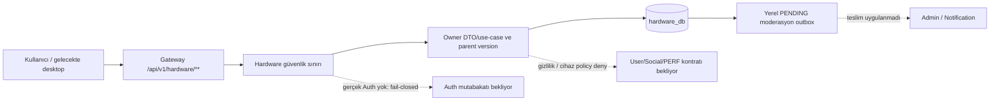

# LTZ Hardware Service — Final Servis Raporu

Tarih 2026-10-21; sorumlu Alper; sürüm 0.0.1-SNAPSHOT.
Durum: **yerel 17/17 alt görev TESTED, beşinci ana görev READY_FOR_PDA —
DEFERRED_AUTH / DEFERRED_CONTRACT**. Kullanıcı PDA kapanışı 4/5; HW-05 ana kutusu
henüz `[ ]`. Bu rapor üretim hazırlığı veya gerçek dış servis/desktop E2E onayı değildir.

HW-05 sonrası kullanıcı onaylı migration temizliği: güncel şema §4'teki 7 ilişkili
CREATE dosyasıdır. Önceki görev teslimleri ve §7 kalite sonuçları tarihsel snapshot'tır;
bu bakımın yeniden doğrulaması [ayrı kalite kaydında](../testing/hardware-migration-cleanup-quality.md).
Bakım COMPLETE: hardware 295 PASS/%98,75; full dev 313 PASS/%96,51/18 HTTP PASS,
SAFE TO COMMIT; Sonar A/A/A + gate PASS, açık issue/hotspot 0/0.

## 1. Servis özeti ve mimari sınır

Kod backend/services/hardware-service, paket com.ltz.hardware, veri sahibi
hardware_db, tam HTTP prefix /api/v1/hardware/**. Java 25 / Spring Boot 4.1.1 /
Maven, PostgreSQL 17 / Flyway / JPA, Spring Security, DTO record ve ProblemDetail.
api → application → domain/repository katmanları kullanılır; controller repository/
client çağırmaz ve entity dönmez. Başka servisin DB'sine erişim yoktur.

46 business endpoint: profil/bileşen ve istatistik 9, katalog/kampanya 15,
gizlilik/karşılaştırma/batch 7, yorum/rapor/moderasyon 10, preview/izin/sync 5.
Profiller owner'a ait birden fazla bilgisayardır. Genel model marka bağımsız,
üretici opsiyonel; katalog dışı manuel kayıt desteklenir. Eksik teknik değer null
kalır. FPS/sıcaklık/ölçüm geçmişi hardware'de tutulmaz; Performance sahibidir.
Uyumluluk/FPS tahmini veya yapay benchmark üretilmez; Recommendation kapsamı ayrıdır.



## 2. PDA kapsam matrisi

Yerel DONE, kod/DB/API/test kabulünü anlatır. Gerçek Auth tüm satırlarda
DEFERRED_AUTH / NOT_VERIFIED; ek dış bağımlılıklar aşağıda ve §6'da ayrıdır.

| Ana task | PDA/commit durumu | Alt görevler | Kanıt |
|---|---|---|---|
| LTZ-ALP-HW-01 | DONE; kullanıcı kapattı, fc23563 | 7/7 | [Teslim 01](LTZ-ALP-HW-01-delivery.md) |
| LTZ-ALP-HW-02 | DONE; kullanıcı kapattı, 6756210 | 3/3 | [Teslim 02](LTZ-ALP-HW-02-delivery.md) |
| LTZ-ALP-HW-03 | DONE; kullanıcı kapattı, 104524a | 3/3 | [Teslim 03](LTZ-ALP-HW-03-delivery.md) |
| LTZ-ALP-HW-04 | DONE; kullanıcı kapattı, f558a69 | 2/2 | [Teslim 04](LTZ-ALP-HW-04-delivery.md) |
| LTZ-ALP-HW-05 | READY_FOR_PDA; kullanıcı kapanışı/commit bekleniyor | 2/2 | [Teslim 05](LTZ-ALP-HW-05-delivery.md) |

| Alt görev | Yerel sonuç ve davranış | Dış katman / kanıt |
|---|---|---|
| HW-01 | DONE: owner profil oluşturma | Profil testleri, teslim 01 |
| HW-02 | DONE: manuel/katalog bileşen, opsiyonel marka | Component testleri, güncel V2/V3 |
| HW-03 | DONE: owner profil/bileşen düzenleme ve sürüm | Paralel writer/rollback testleri |
| HW-04 | DONE: bağımsız birden fazla bilgisayar | Owner izolasyonu ve sayfalama |
| HW-05 | DONE: detay ve nullable teknik DTO | Component detay/IDOR testleri |
| HW-15 | DONE: kayıt/adet ve bilinen kapasite istatistiği | Owner SQL özet testleri |
| HW-16 | DONE: owner/version profil silme, CASCADE | Profil ve sync CASCADE testleri |
| HW-10 | DONE: genel model/marka yönetimi ve arşiv | Güncel V2; catalog testleri |
| HW-11 | DONE: parametrik teknik/model/marka filtreleri | Güncel V2; search testleri |
| HW-14 | DONE: yerel kaynak/gözlem/fiyat kampanyası | Güncel V4; campaign testleri; scraping/harici fiyat yok |
| HW-08 | DONE: PRIVATE varsayılan, profil/alan/kategori izinleri | Güncel V1; User/Social gerçek kararı DEFERRED_CONTRACT |
| HW-09 | DONE: owner profil/bileşen, aktif genel model karşılaştırması | Comparison testleri; tahmin üretilmez |
| HW-17 | DONE: owner batch teknik sözleşmesi | Batch testleri; Performance/Recommendation tüketici E2E NOT_VERIFIED |
| HW-12 | DONE: ürün yorumu, puan/tekillik/owner/soft-delete | Güncel V5; UGC User/Social policy DEFERRED_CONTRACT |
| HW-13 | DONE: rapor, kaynak HIDE/RESTORE, immutable audit/outbox | Güncel V5/V6; gerçek Admin/Notification teslimi DEFERRED_CONTRACT |
| HW-06 | DONE: açık onaylı stateless scan preview | 30 yeni test; gerçek scanner yazılmadı |
| HW-07 | DONE: cihaz/izin/generation/sequence/idempotency | Güncel V3/V7, önceki HW-07 24 yeni test; gerçek cihaz ve desktop E2E DEFERRED_CONTRACT |

Auth dışındaki HW-03/HW-04/HW-05 ertelemeleri kullanıcı tarafından açıkça onaylandı.
Kanonik durum [kök master](../../LTZ_HARDWARE_SERVICE.md); servis gereksinim dosyası
iş tanımıdır. LTZ_PDA_Alper.md repoda yoktur; root 5/17 checklist'i esas alınır.

## 3. Eksiksiz API envanteri

Aşağıdaki 46 kayıt gerçek controller mapping'leriyle sayısal olarak eşleştirilir.
Tam input/range/JSON ve HTTP sözleşmesinin sahibi [docs/api.md HARDWARE](../../docs/api.md#hardware).
Tablo teslim snapshot'ıdır; bütün satırlar yerel UNIT + INTEGRATION TESTED,
gerçek üretim Auth/E2E NOT_VERIFIED. Mutasyonlarda CSRF ve body varsa 16 KiB;
özel yanıtlar no-store/private, hatalar ProblemDetail. Aktör yalnız güvenilir
typed principal'dır; kullanıcı kimliği request'ten alınmaz. Yeni public business uç yoktur.

| HW | Method ve tam path | Erişim / sahiplik | Request DTO | Başarı / response DTO | Hata HTTP | Test kanıtı | Gerçek Auth/E2E |
|---|---|---|---|---|---|---|---|
| HW-01 | POST /api/v1/hardware/profiles | Owner. Yalnız güvenilir AuthenticatedActor üzerinden owner alınır; body/header kimliği kabul edilmez. Gerçek Auth adapter'ı yokken üretim HTTP istekleri reddedilir (DEFERRED_AUTH). CSRF etkin; gerçek cookie/JWT taşıma protokolü henüz uygulanmadı. Yeni public API yok. | CreateHardwareProfileRequest | 201 HardwareProfileResponse | 400/401/403/409/500 | HardwareProfileControllerTest, HardwareProfileTest; final regresyon PASS | NOT_VERIFIED |
| HW-02 | POST /api/v1/hardware/profiles/{profileId}/components | Owner; HW-01 ile aynı onaylı güvenlik sınırı/CSRF/DEFERRED_AUTH. Başkasına ait profil ile olmayan profil aynı 404 yanıtını verir. | SaveHardwareComponentRequest | 201 ComponentMutationResponse, HardwareComponentResponse | 400/401/403/404/409/500 | HardwareComponentControllerTest; final regresyon PASS | NOT_VERIFIED |
| HW-03 | PUT /api/v1/hardware/profiles/{profileId} | Owner; HW-01 ile aynı CSRF/DEFERRED_AUTH sınırı. Başka owner kaynağı 404 ile gizlenir. | UpdateHardwareProfileRequest | 200 HardwareProfileResponse | 400/401/403/404/409/500 | HardwareProfileControllerTest; final regresyon PASS | NOT_VERIFIED |
| HW-03 | PUT /api/v1/hardware/profiles/{profileId}/components/{componentId} | Owner; CSRF ve HW-01 güvenlik sınırı. Bileşenin URL'deki profile ait olması ayrıca doğrulanır. | SaveHardwareComponentRequest | 200 ComponentMutationResponse | 400/401/403/404/409/500 | HardwareComponentControllerTest; final regresyon PASS | NOT_VERIFIED |
| HW-03 | DELETE /api/v1/hardware/profiles/{profileId}/components/{componentId} | Owner; CSRF ve HW-01 güvenlik sınırı. | Gövde yok; path/query | 204 Gövdesiz | 400/401/403/404/409/500 | HardwareComponentControllerTest; final regresyon PASS | NOT_VERIFIED |
| HW-04 | GET /api/v1/hardware/profiles | Owner; yalnız doğrulanmış aktörün profilleri. HW-01 güvenlik sınırı/DEFERRED_AUTH. | Gövde yok; path/query | 200 HardwareProfilePageResponse, HardwareProfileResponse | 400/401/403/500 | HardwareProfileControllerTest; final regresyon PASS | NOT_VERIFIED |
| HW-05 | GET /api/v1/hardware/profiles/{profileId} | Owner; HW-01 güvenlik sınırı/DEFERRED_AUTH. Diğer kullanıcıların profilleri 404. | Gövde yok; path/query | 200 HardwareProfileDetailResponse | 400/401/403/404/500 | HardwareComponentControllerTest; final regresyon PASS | NOT_VERIFIED |
| HW-15 | GET /api/v1/hardware/profiles/statistics | Owner; HW-01 güvenlik sınırı/DEFERRED_AUTH. Kullanıcı kimliği parametre alınmaz. | Gövde yok; path/query | 200 HardwareStatisticsResponse | 401/403/500 | HardwareComponentControllerTest; final regresyon PASS | NOT_VERIFIED |
| HW-16 | DELETE /api/v1/hardware/profiles/{profileId} | Owner; CSRF ve HW-01 güvenlik sınırı/DEFERRED_AUTH. Admin/header bypass yoktur. | Gövde yok; path/query | 204 Gövdesiz | 400/401/403/404/409/500 | HardwareComponentControllerTest; final regresyon PASS | NOT_VERIFIED |
| HW-10 | POST /api/v1/hardware/catalog/brands | Admin — doğrulanmış typed actor + hardware:catalog:write uygulama izni; normal kullanıcı yazamaz. CSRF zorunlu; gerekçeli audit aynı transaction'da. Gerçek Auth rol/claim eşlemesi DEFERRED_AUTH; üretim istekleri fail-closed reddedilir. Public iş endpoint'i yok. Tüm yanıtlar private/no-store. | CreateHardwareBrandRequest | 201 HardwareBrandResponse | 400/401/403/404/409/413/429/500 | HardwareCatalogControllerTest; final regresyon PASS | NOT_VERIFIED |
| HW-10 | PUT /api/v1/hardware/catalog/brands/{id} | Admin — doğrulanmış typed actor + hardware:catalog:write uygulama izni; normal kullanıcı yazamaz. CSRF zorunlu; gerekçeli audit aynı transaction'da. Gerçek Auth rol/claim eşlemesi DEFERRED_AUTH; üretim istekleri fail-closed reddedilir. Public iş endpoint'i yok. Tüm yanıtlar private/no-store. | UpdateHardwareBrandRequest | 200 HardwareBrandResponse | 400/401/403/404/409/413/429/500 | HardwareCatalogControllerTest; final regresyon PASS | NOT_VERIFIED |
| HW-10 | DELETE /api/v1/hardware/catalog/brands/{id} | Admin — doğrulanmış typed actor + hardware:catalog:write uygulama izni; normal kullanıcı yazamaz. CSRF zorunlu; gerekçeli audit aynı transaction'da. Gerçek Auth rol/claim eşlemesi DEFERRED_AUTH; üretim istekleri fail-closed reddedilir. Public iş endpoint'i yok. Tüm yanıtlar private/no-store. | ArchiveCatalogEntryRequest | 204 Gövdesiz | 400/401/403/404/409/413/429/500 | HardwareCatalogControllerTest; final regresyon PASS | NOT_VERIFIED |
| HW-10 | GET /api/v1/hardware/catalog/brands/{id} | Authenticated — doğrulanmış typed AuthenticatedActor. Gerçek Auth rol/claim eşlemesi DEFERRED_AUTH; üretim istekleri fail-closed reddedilir. Public iş endpoint'i yok. Tüm yanıtlar private/no-store. | Gövde yok; path/query | 200 HardwareBrandResponse | 400/401/403/404/409/500 | HardwareCatalogControllerTest; final regresyon PASS | NOT_VERIFIED |
| HW-10 | GET /api/v1/hardware/catalog/brands | Authenticated — doğrulanmış typed AuthenticatedActor. Gerçek Auth rol/claim eşlemesi DEFERRED_AUTH; üretim istekleri fail-closed reddedilir. Public iş endpoint'i yok. Tüm yanıtlar private/no-store. | Gövde yok; path/query | 200 HardwareCatalogPageResponse, HardwareBrandResponse | 400/401/403/404/409/500 | HardwareCatalogControllerTest; final regresyon PASS | NOT_VERIFIED |
| HW-10 | POST /api/v1/hardware/catalog/products | Admin — doğrulanmış typed actor + hardware:catalog:write uygulama izni; normal kullanıcı yazamaz. CSRF zorunlu; gerekçeli audit aynı transaction'da. Gerçek Auth rol/claim eşlemesi DEFERRED_AUTH; üretim istekleri fail-closed reddedilir. Public iş endpoint'i yok. Tüm yanıtlar private/no-store. | CreateHardwareProductRequest, SpecificationsRequest | 201 HardwareProductResponse | 400/401/403/404/409/413/429/500 | HardwareCatalogControllerTest; final regresyon PASS | NOT_VERIFIED |
| HW-10 | PUT /api/v1/hardware/catalog/products/{id} | Admin — doğrulanmış typed actor + hardware:catalog:write uygulama izni; normal kullanıcı yazamaz. CSRF zorunlu; gerekçeli audit aynı transaction'da. Gerçek Auth rol/claim eşlemesi DEFERRED_AUTH; üretim istekleri fail-closed reddedilir. Public iş endpoint'i yok. Tüm yanıtlar private/no-store. | UpdateHardwareProductRequest | 200 HardwareProductResponse | 400/401/403/404/409/413/429/500 | HardwareCatalogControllerTest; final regresyon PASS | NOT_VERIFIED |
| HW-10 | DELETE /api/v1/hardware/catalog/products/{id} | Admin — doğrulanmış typed actor + hardware:catalog:write uygulama izni; normal kullanıcı yazamaz. CSRF zorunlu; gerekçeli audit aynı transaction'da. Gerçek Auth rol/claim eşlemesi DEFERRED_AUTH; üretim istekleri fail-closed reddedilir. Public iş endpoint'i yok. Tüm yanıtlar private/no-store. | ArchiveCatalogEntryRequest | 204 Gövdesiz | 400/401/403/404/409/413/429/500 | HardwareCatalogControllerTest; final regresyon PASS | NOT_VERIFIED |
| HW-10 | GET /api/v1/hardware/catalog/products/{id} | Authenticated — doğrulanmış typed AuthenticatedActor. Gerçek Auth rol/claim eşlemesi DEFERRED_AUTH; üretim istekleri fail-closed reddedilir. Public iş endpoint'i yok. Tüm yanıtlar private/no-store. | Gövde yok; path/query | 200 HardwareProductResponse | 400/401/403/404/409/500 | HardwareCatalogControllerTest; final regresyon PASS | NOT_VERIFIED |
| HW-10/HW-11 | GET /api/v1/hardware/catalog/products | Authenticated — doğrulanmış typed AuthenticatedActor. Gerçek Auth rol/claim eşlemesi DEFERRED_AUTH; üretim istekleri fail-closed reddedilir. Public iş endpoint'i yok. Tüm yanıtlar private/no-store. | Gövde yok; path/query | 200 HardwareCatalogPageResponse, HardwareProductResponse | 400/401/403/404/409/500 | HardwareCatalogControllerTest; final regresyon PASS | NOT_VERIFIED |
| HW-14 | POST /api/v1/hardware/campaigns | Admin — typed actor + hardware:catalog:write uygulama izni; CSRF ve gerekçeli atomik audit zorunlu. Gerçek Auth/JWT rol/claim eşlemesi DEFERRED_AUTH; üretimde fail-closed. Public uç yok. | SaveHardwareCampaignRequest | 201 HardwareCampaignResponse | 400/401/403/404/409/413/429/500 | HardwareCampaignControllerTest; final regresyon PASS | NOT_VERIFIED |
| HW-14 | PUT /api/v1/hardware/campaigns/{id} | Admin — typed actor + hardware:catalog:write uygulama izni; CSRF ve gerekçeli atomik audit zorunlu. Gerçek Auth/JWT rol/claim eşlemesi DEFERRED_AUTH; üretimde fail-closed. Public uç yok. | SaveHardwareCampaignRequest | 200 HardwareCampaignResponse | 400/401/403/404/409/413/429/500 | HardwareCampaignControllerTest; final regresyon PASS | NOT_VERIFIED |
| HW-14 | DELETE /api/v1/hardware/campaigns/{id} | Admin — typed actor + hardware:catalog:write uygulama izni; CSRF ve gerekçeli atomik audit zorunlu. Gerçek Auth/JWT rol/claim eşlemesi DEFERRED_AUTH; üretimde fail-closed. Public uç yok. | ArchiveCatalogEntryRequest | 204 Gövdesiz | 400/401/403/404/409/413/429/500 | HardwareCampaignControllerTest; final regresyon PASS | NOT_VERIFIED |
| HW-14 | GET /api/v1/hardware/campaigns/{id} | Authenticated — doğrulanmış typed actor. Gerçek Auth/JWT rol/claim eşlemesi DEFERRED_AUTH; üretimde fail-closed. Public uç yok. | Gövde yok; path/query | 200 HardwareCampaignResponse | 400/401/403/404/409/500 | HardwareCampaignControllerTest; final regresyon PASS | NOT_VERIFIED |
| HW-14 | GET /api/v1/hardware/campaigns | Authenticated — doğrulanmış typed actor. Gerçek Auth/JWT rol/claim eşlemesi DEFERRED_AUTH; üretimde fail-closed. Public uç yok. | Gövde yok; path/query | 200 HardwareCatalogPageResponse, HardwareCampaignResponse | 400/401/403/404/409/500 | HardwareCampaignControllerTest; final regresyon PASS | NOT_VERIFIED |
| HW-08 | GET /api/v1/hardware/profiles/{profileId}/privacy | Typed actor ve owner-only; katalog yazma izni başka profil için erişim sağlamaz. DEFERRED_AUTH; gerçek token doğrulaması yokken üretimde fail-closed. | Gövde yok; path/query | 200 HardwarePrivacyResponse | 400/401/403/404/500 | HardwarePrivacyControllerTest; final regresyon PASS | NOT_VERIFIED |
| HW-08 | PUT /api/v1/hardware/profiles/{profileId}/privacy | Owner-only typed actor; CSRF zorunlu. DEFERRED_AUTH / fail-closed. | UpdateHardwarePrivacyRequest | 200 HardwarePrivacyResponse | 400/401/403/404/409/413/500 | HardwarePrivacyControllerTest; final regresyon PASS | NOT_VERIFIED |
| HW-08 | GET /api/v1/hardware/profiles/{profileId}/shared | Anonim erişim yok. Owner kendi önizlemesinde bütün kayıtlı alanlarını görür. Non-owner için profile visibility, alan ve kategori kurallarının hepsi izin vermelidir. PUBLIC yalnız doğrulanmış kullanıcı; FRIENDS güvenilir arkadaşlık kararı gerektirir. HardwareVisibilityPolicy ayrıca global User görünürlüğü ve Social ilişki/engel kararını onaylamalıdır. Engelli, bilinmeyen, null veya erişilemeyen dış karar 404. Üretim UnavailableHardwareVisibilityPolicy daima deny döndürür. Test mock'u gerçek entegrasyon değildir. Owner detail/mutation uçları owner-only kalır. | Gövde yok; path/query | 200 SharedHardwareProfileResponse | 400/401/403/404/500 | HardwarePrivacyControllerTest; final regresyon PASS | NOT_VERIFIED |
| HW-09 | POST /api/v1/hardware/comparisons/profiles | Typed actor; iki profil de aynı aktöre ait olmalı. PUBLIC paylaşım veya katalog yazma izni başka owner'ın profilini karşılaştırma hakkı vermez. CSRF zorunlu; DEFERRED_AUTH, üretimde fail-closed. Read-only REPEATABLE_READ transaction. | CompareHardwareIdsRequest | 200 HardwareComparisonResponse | 400/401/403/404/413/500 | HardwareComparisonControllerTest; final regresyon PASS | NOT_VERIFIED |
| HW-09 | POST /api/v1/hardware/comparisons/components | Typed actor, iki profil ve iki bileşen owner-only; her componentId belirtilen profileId'ye ait olmalı. CSRF, no-store ve DEFERRED_AUTH korunur. | CompareHardwareComponentsRequest | 200 HardwareComparisonResponse, SpecificationsResponse | 400/401/403/404/413/500 | HardwareComparisonControllerTest; final regresyon PASS | NOT_VERIFIED |
| HW-09 | POST /api/v1/hardware/comparisons/catalog-products | Typed actor; katalog yazma izni gerekmez. İki model ACTIVE ve aynı kategoride olmalı. Kullanıcı profili paylaşım yolu değildir. CSRF, DEFERRED_AUTH korunur. | CompareHardwareIdsRequest | 200 HardwareComparisonResponse | 400/401/403/404/413/500 | HardwareComparisonControllerTest; final regresyon PASS | NOT_VERIFIED |
| HW-17 | POST /api/v1/hardware/profiles/batch | Kullanıcı adına doğrulanmış typed actor, owner-only. Kullanıcı bağlamı olmayan yeni servis-token erişimi açılmaz. userId/rol/servis kimliği body/header'dan alınmaz. Her profil aynı aktöre ait olmalıdır; bir tane yanlış/olmayan kaynak bütün batch'i 404 yapar. Paylaşılan PUBLIC profil de başka owner ise reddedilir. CSRF korunur; DEFERRED_AUTH, üretimde gerçek Auth adapter'ı yokken fail-closed. | HardwareBatchRequest | 200 HardwareBatchResponse, HardwareComponentResponse | 400/401/403/404/413/500 | HardwareBatchControllerTest; final regresyon PASS | NOT_VERIFIED |
| HW-12 | POST /api/v1/hardware/catalog/products/{productId}/reviews | Typed actor; aktif genel ürün. Katalog yazma izni gerekmez; yazar UUID'si yalnız CurrentActor'dan gelir. Ortak HW-12 güvenlik sözleşmesi geçerlidir. | CreateHardwareReviewRequest | 201 HardwareReviewResponse | 400/401/403/404/409/413/429/500 | HardwareReviewControllerTest, HardwareReviewTextTest; final regresyon PASS | NOT_VERIFIED |
| HW-12 | GET /api/v1/hardware/catalog/products/{productId}/reviews | Typed actor; aktif ürün. VISIBLE yorumlar, owner veya güvenilir global UGC/iki yönlü engel kararıyla filtrelenir. Production policy başkalarını deny eder. Ortak HW-12 güvenlik sözleşmesi geçerlidir. | Gövde yok; path/query | 200 HardwareReviewPageResponse | 400/401/403/404/500 | HardwareReviewControllerTest, HardwareReviewTextTest; final regresyon PASS | NOT_VERIFIED |
| HW-12 | GET /api/v1/hardware/reviews/mine | Owner typed actor; yalnız CurrentActor'ın silinmemiş VISIBLE/HIDDEN yorumları. Arşivli ürün geçmişi korunur; dış audience kararı gerekmez. Ortak HW-12 güvenlik sözleşmesi geçerlidir. | Gövde yok; path/query | 200 HardwareOwnReviewPageResponse | 400/401/403/500 | HardwareReviewControllerTest, HardwareReviewTextTest; final regresyon PASS | NOT_VERIFIED |
| HW-12 | GET /api/v1/hardware/reviews/{reviewId} | Typed actor. Owner HIDDEN/arşivli geçmişini görebilir; non-owner yalnız VISIBLE + aktif ürün + güvenilir audience izinli ise. DELETED her durumda 404. Ortak HW-12 güvenlik sözleşmesi geçerlidir. | Gövde yok; path/query | 200 HardwareReviewResponse | 400/401/403/404/500 | HardwareReviewControllerTest, HardwareReviewTextTest; final regresyon PASS | NOT_VERIFIED |
| HW-12 | PUT /api/v1/hardware/reviews/{reviewId} | Owner typed actor + CSRF; yalnız VISIBLE ve aktif ürüne bağlı yorum. HIDDEN sahibi bile metin güncellemesiyle moderasyonu aşamaz. Ortak HW-12 güvenlik sözleşmesi geçerlidir. | UpdateHardwareReviewRequest | 200 HardwareReviewResponse | 400/401/403/404/409/413/429/500 | HardwareReviewControllerTest, HardwareReviewTextTest; final regresyon PASS | NOT_VERIFIED |
| HW-12 | DELETE /api/v1/hardware/reviews/{reviewId} | Owner typed actor + CSRF; VISIBLE/HIDDEN ve arşivli ürün geçmişi silinebilir. Yabancı hedef 404. Ortak HW-12 güvenlik sözleşmesi geçerlidir. | Gövde yok; path/query | 204 Gövdesiz | 400/401/403/404/409/429/500 | HardwareReviewControllerTest, HardwareReviewTextTest; final regresyon PASS | NOT_VERIFIED |
| HW-13 | POST /api/v1/hardware/reviews/{reviewId}/reports | Typed actor + CSRF; yalnız okunabilen, VISIBLE/aktif ürüne bağlı yabancı yorum. Owner kendi yorumunu raporlayamaz; global UGC/engel kararı bilinmiyorsa yabancı hedef 404. | CreateHardwareReviewReportRequest | 201 HardwareReviewReportResponse | 400/401/403/404/409/413/429/500/503 | HardwareReviewModerationControllerTest, SecurityContextHardwareReviewModerationAccessTest; final regresyon PASS | NOT_VERIFIED |
| HW-13 | GET /api/v1/hardware/review-reports/{reportId} | Yalnız reporter typed actor; hedef yorumun yazarı veya katalog yöneticisi olması erişim vermez. Yabancı/olmayan rapor aynı 404. | Gövde yok; path/query | 200 HardwareReviewReportResponse | 400/401/403/404/500 | HardwareReviewModerationControllerTest, SecurityContextHardwareReviewModerationAccessTest; final regresyon PASS | NOT_VERIFIED |
| HW-13 | GET /api/v1/hardware/moderation/reviews/{reviewId} | Typed actor + hardware:reviews:moderate uygulama izni hem HTTP hem service sınırında zorunlu. Katalog izni/ROLE_ADMIN/X-Role tek başına kabul edilmez. Gerçek Auth rol/claim eşlemesi DEFERRED_AUTH. | Gövde yok; path/query | 200 HardwareReviewModerationDetailResponse | 400/401/403/404/500 | HardwareReviewModerationControllerTest, SecurityContextHardwareReviewModerationAccessTest; final regresyon PASS | NOT_VERIFIED |
| HW-13 | POST /api/v1/hardware/moderation/reviews/{reviewId}/actions | Typed actor + hardware:reviews:moderate; service recheck + CSRF. Bu kaynak servis komutudur; merkezi Admin case/rol/hesap yönetimi burada kurulmaz. | ModerateHardwareReviewRequest | 200 HardwareReviewModerationResponse | 400/401/403/404/409/413/429/500/503 | HardwareReviewModerationControllerTest, SecurityContextHardwareReviewModerationAccessTest; final regresyon PASS | NOT_VERIFIED |
| HW-06 | POST /api/v1/hardware/profiles/{profileId}/sync/preview | Owner typed actor + CSRF; processingConsent=true bu tek isteğin açık onayıdır. Sürekli sync izni vermez. Donanım/consent/source/profileVersion değiştirmez; yalnız kısa ömürlü rate bucket'ları kaydedilir. Gerçek Auth DEFERRED_AUTH; üretim doğrulayıcı yokken istekler reddedilir. Bu uç cihaz doğrulamaz. | PreviewHardwareScanRequest, HardwareScanRequest, ScannedHardwareComponentRequest, SpecificationsRequest | 200 HardwareScanPreviewResponse | 120/400/401/403/404/413/429/500 | HardwareScanControllerTest, HardwareScanTest; final regresyon PASS | NOT_VERIFIED |
| HW-07 | GET /api/v1/hardware/profiles/{profileId}/sync-consent | Owner typed actor; yalnız kendi profili. Cihaz principal'ı kontrol API'sine giremez. | Gövde yok; path/query | 200 HardwareSyncConsentResponse | 400/401/403/404 | HardwareSyncControllerTest, HardwareSyncDomainTest, SecurityContextHardwareSyncDeviceAccessTest; final regresyon PASS | NOT_VERIFIED |
| HW-07 | PUT /api/v1/hardware/profiles/{profileId}/sync-consent | Owner + CSRF; dış policy cihazın aktif ve owner'a bağlı olduğunu doğrulamalıdır. Client deviceId yalnız seçimdir. Production policy deny. | GrantHardwareSyncRequest | 200 HardwareSyncConsentResponse | 400/401/403/404/409/413/429 | HardwareSyncControllerTest, HardwareSyncDomainTest, SecurityContextHardwareSyncDeviceAccessTest; final regresyon PASS | NOT_VERIFIED |
| HW-07 | DELETE /api/v1/hardware/profiles/{profileId}/sync-consent | Owner + CSRF; iptal için dış cihazın online/aktif olması gerekmez. | Gövde yok; path/query | 200 HardwareSyncConsentResponse | 400/401/403/404/409/429 | HardwareSyncControllerTest, HardwareSyncDomainTest, SecurityContextHardwareSyncDeviceAccessTest; final regresyon PASS | NOT_VERIFIED |
| HW-07 | POST /api/v1/hardware/profiles/{profileId}/sync/snapshots | Yalnız AuthenticatedHardwareDevice + hardware:sync:write, aktif cihaz sahipliği policy'si ve aynı owner/device/generation için GRANTED yerel izin. Browser actor bu authority'ye sahip olsa da reddedilir. CSRF korunur; üretimde cihaz doğrulaması yok ve policy deny. | ApplyHardwareSyncRequest | 200 HardwareSyncReceiptResponse | 400/401/403/404/409/413/429 | HardwareSyncControllerTest, HardwareSyncDomainTest, SecurityContextHardwareSyncDeviceAccessTest; final regresyon PASS | NOT_VERIFIED |

Teknik istisna mevcut GET /actuator/health ve alt probe yollarıdır; business veri
taşımaz. /actuator/info ve diğer yollar mevcut güvenlikte deny-by-default'tır.
SWAGGER_ENABLED flag'i tek başına güvenlik filtresini açmaz.

### Henüz uygulanmayanlar

- Gerçek kullanıcı ve cihaz token verifier/issuer/audience/JWKS/claim/rol eşlemesi,
  cookie/CSRF transport E2E; yerel typed actor testi bunların yerine geçmez.
- PERF-01 gerçek pairing/credential/revocation API'si ve çalışan masaüstü scanner/
  istemci. Web tarayıcısı donanım sensörü veya FPS ölçmez.
- User/Social gerçek görünürlük/arkadaşlık/iki yönlü engel adapter'ları.
- Admin gerçek report kabul/case orkestrasyonu, Notification teslimi ve relay/inbox/
  broker. Yerel outbox PENDING, gerçek SENT/teslim garantisi yoktur.
- Performance/Recommendation gerçek consumer E2E ve önerilen HardwareProfileChanged
  event akışı. Owner batch DTO'su testlidir; consumer bağlamı hazır sayılmaz.
- Game sistem gereksinimleri için hardware'den doğrudan client; mevcut use-case'ler
  oyun gereksinimi tüketmez, bu girdi Recommendation uyumluluk akışında birleşecektir.
- Frontend ve masaüstü indirme/UI geliştirmesi bu backend kapsamına dahil değildir.

## 4. Veri modeli ve migration envanteri

Kaynak migration'larda 16 tablo tanımı vardır (Flyway history hariç); bu, canlı DB
envanteri iddiası değildir. Kullanıcı onaylı geliştirme temizliğiyle eski V1–V10
yerine V1–V7 uygulanır. İzole PostgreSQL 17.11 eski/yeni şema eşdeğerliği PASS.
UTC timestamptz, UUID, snake_case, named CHECK/unique/index, gereken aggregate/
entity version ve servis içi FK kullanılır. User/device/actor dış UUID'leri REF'tir.

| Migration | Amaç / tablolar |
|---|---|
| V1__create_hardware_profiles_and_privacy.sql | Profil ve iki gizlilik tablosu; PRIVATE default, named enum/FK/PK |
| V2__create_hardware_catalog.sql | Marka, genel ürün, opsiyonel ürün/marka bağı, katalog audit; status/version, arama indeksleri, immutable trigger |
| V3__create_hardware_profile_components.sql | Bileşenler; teknik alanlar, composite FK, MANUAL/DESKTOP_SYNC/key CHECK ve partial unique |
| V4__create_hardware_campaigns.sql | Kampanya; ürün FK, fiyat/kaynak/UTC/geçerlilik CHECK ve indeksleri |
| V5__create_hardware_reviews.sql | Yorum, review audit, write limits; nihai action CHECK, partial unique, immutable trigger ve TTL indeksi |
| V6__create_hardware_review_reports_and_outbox.sql | Outbox ve raporlar; payload/check, event/reporter tekilliği ve SET NULL |
| V7__create_hardware_desktop_sync.sql | Consent/receipt; CASCADE, sequence/status/expiry/hash/JSON CHECK ve indeksler |

Profil→bileşen/gizlilik/consent/receipt CASCADE; ürün→yorum/kampanya ve ürün/marka
seçimleri gerçek servis içi FK'dir. Arşivleme katalog referanslarını korur.
Review→report FK, report→outbox ON DELETE SET NULL; event purge raporu silmez.
Audit append-only'dir; collection/bucket/immutable teknik kayıtların lifecycle'ı
ayrıdır. Profil hard-delete, yorum soft-delete ile metin/puan/hash temizlenmesi
birbirinden farklı ve testlidir. DTO kaynak ayrımı MANUAL/DESKTOP_SYNC; profilin
MANUAL oluşturulma kökeni değişmez. Gizlilik eksik kuralı PRIVATE'tır.

Her tablo son alan/constraint'leriyle doğrudan CREATE TABLE içinde tanımlıdır;
ALTER TABLE/INDEX, DROP veya rename adımı yoktur. 16 tablo / 145 sütun / 93 constraint /
51 indeks / 2 trigger / 2 fonksiyon eski zincirle eşdeğerdir. V8–V10 kullanılmıyor;
sonraki değişiklikler normal ileri migration kuralına tabidir.
Bu yeniden düzenleme yalnız boş geliştirme DB'si içindir; eski history ile yerinde
yükseltme sağlamaz. DB/volume resetini kullanıcı yapar. Ajan uygulama DB'sinde
reset, Flyway clean/repair/baseline, deploy veya image rebuild yapmadı.
[Kullanıcı kararı ve yöntem](../progress/hardware-migration-cleanup.md).
Ayrıntılar [database](../../docs/database.md#313-hardware_db--hardware-service-alper)
ve [ER](../../docs/er-diagram.md#14-hardware_db) hardware bölümlerindedir.

## 5. Güvenlik ve veri mahremiyeti

Production'da gerçek Auth doğrulayıcı yoktur; HTTP Basic/form login kapalı,
header/cookie/bearer kullanıcı/cihaz principal'ı yaratmaz, protected iş istekleri
reddedilir. AuthenticatedActor owner bağlamı ve AuthenticatedHardwareDevice ayrı
tiplerdir. Katalog hardware:catalog:write, moderasyon hardware:reviews:moderate,
cihaz apply hardware:sync:write yerel uygulama izinleridir; gerçek Auth claim/rol
mapping'i uydurulmaz. Scope sahibi browser actor cihaz API'sine geçemez.
İmza/expiry/issuer/audience/iptal negatiflerinin gerçek JWT/E2E doğrulaması henüz yoktur.

Owner, IDOR, yanlış principal/izin, CSRF, body limit ve bilinmeyen alan testleri
vardır. Gizlilik ve UGC kararları bilinmiyor/hata ise başkalarının verisi deny;
owner kendi verisine erişir. PUBLIC enum değeri anonim endpoint anlamına gelmez.
User/Social filtresi sayfalama/COUNT/AVG'den önce uygulanır; özel alan/kimlik/key/
gizli sayaç dış DTO'ya sızmaz. NFKC ve typed range doğrulamaları raw payload'a eklenir.

Rate limit DB'de actor/device/socket-peer bazındadır; ham IP tutulmaz, XFF'a
güvenilmez. Proxy zincirindeki gerçek istemci IP doğrulaması NOT_VERIFIED.
Başarılı transaction kotaları ve kısa TTL bucket temizliği vardır; rollback
denemeleri kotayı tüketmez. Batch 20 profil/toplam 200 satır; scan en fazla 32
bileşen/16 KiB, apply sonrası toplam 200 kayıt; receipt profil başına 500/24 saat.
Moderasyon outbox olay başına 4 KiB, PENDING/FAILED toplamı 10.000; doluysa 503.

Sync açık onaylı profil/cihaz grant–revoke ve generation/sequence ile korunur.
Retry receipt'i döndürmeden önce güncel cihaz ve izin tekrar kontrol edilir;
expiry sonrası lastSequence eski paketi yeniden uygulamaz. Source DESKTOP_SYNC
doğrulanmış kabul kanalını ifade eder; fiziksel donanım attestation'ı değildir.
Seri/MAC/hostname/FPS/telemetri alınmaz, ham scan/UGC/token/parola loga kopyalanmaz.
Gerçek hesap silme event tüketimi ve cross-service veri imha mutabakatı ayrıca
Auth entegrasyonu gerektirir; yerel owner profil silme CASCADE davranışı testlidir.

## 6. Entegrasyon matrisi: kontrat, adapter, mock ve E2E

| Servis / sahip | Yerel kontrat / port | Üretim adapter / gerçek bağlantı | Test katmanı | Gerçek E2E ve sonraki aksiyon |
|---|---|---|---|---|
| auth-service / Kerem | CurrentActor, AuthenticatedActor, AuthenticatedHardwareDevice; yerel uygulama izinleri | JWT/credential verifier NOT_IMPLEMENTED; fail-closed | SecurityContext test actor/device, HTTP/service negatifleri | DEFERRED_AUTH / NOT_VERIFIED; issuer/audience/JWKS/claim/rol/account revocation ve CSRF transport mutabakatı |
| user-service / Kerem | HardwareVisibilityPolicy ve HardwareReviewAudiencePolicy | Unavailable adapter deny; gerçek RestClient yok | Global visibility/UGC karar mock'ları | DEFERRED_CONTRACT / NOT_VERIFIED; güvenilir karar kontratı ve timeout/error adapter testleri |
| social-service / Umut | Aynı visibility/audience portlarında arkadaşlık ve çift yönlü block kararı | Gerçek adapter yok, non-owner default deny | Allow/deny/friend/block/null/error senaryoları | DEFERRED_CONTRACT / NOT_VERIFIED; actual relation/block kimlik sözleşmesi |
| game-service / Hamza | Mevcut hardware use-case'lerinde doğrudan oyun gereksinimi tüketimi yok | Hardware game client NOT_IMPLEMENTED; DB erişimi yok | Hardware oyun sağlayıcısı mock'u kurulmadı | NOT_VERIFIED; ihtiyaç olursa sözleşme; oyun+hardware uyumluluk birleşimi Recommendation kapsamı |
| performance-service / Alper | Owner batch teknik API provider; HW-05 HardwareSyncDevicePolicy aktif cihaz sınırı | Consumer bağlantısı/PERF-01 aktif cihaz API'si yok; cihaz adapter deny | Hardware batch MockMvc ve test-only device policy | DEFERRED_CONTRACT / NOT_VERIFIED; pairing/iptal/cihaz-owner güven sözleşmesi ve consumer E2E |
| recommendation-service / Alper | Owner batch ve teknik comparison provider DTO'ları | Gerçek Recommendation consumer yok; HardwareProfileChanged önerisi uygulanmadı | Batch/comparison hardware testleri | Onaylı consumer E2E NOT_VERIFIED; gerçek actor bağlamı ve DESKTOP_SYNC kaynak desteği |
| admin-service / ortak, sorumlu atanmadı | Yerel ContentReported v1 + kaynak HIDE/RESTORE | PENDING outbox; kabul/case/relay yok | Yerel atomiklik/tekillik/izin testleri | DEFERRED_CONTRACT / NOT_VERIFIED; sahip ve event/receipt/kimlik/idempotency mutabakatı |
| notification-service / ortak, sorumlu atanmadı | Yerel HardwareReviewModerated v1 owner notice | PENDING outbox; teslim/relay yok | Yerel notice rollback/teslim durum doğruluğu | DEFERRED_CONTRACT / NOT_VERIFIED; sahip, delivery/receipt/retention sözleşmesi |
| Gelecek desktop istemci | Scan v1 + preview + consent + idempotent snapshot | Çalışan scanner/istemci yok; MVP sonrası | Yalnız sentetik payload ve test-only cihaz | NOT_VERIFIED / onaylı erteleme; gerçek cihaz kimliği, consent, retry/revoke E2E |

Hiçbir mock gerçek dış servis veya uçtan uca teslim olarak sayılmaz. Ortak Admin/
Notification ve başka ekip servislerinde kod/DB/migration değiştirilmedi.

## 7. Nihai test ve kalite snapshot'ı

| Kontrol | Sonuç |
|---|---|
| Hardware toplamı | 293 PASS, failure/error/skipped 0; HW-05 54 yeni |
| Hardware JaCoCo line | 1420 covered / 18 missed = %98,75; exclusion yok |
| Tam backend | 18 modül / 311 test PASS; ağırlıklı line coverage %96,51 |
| Pre-push full dev | PASS / exit 0; SAFE TO COMMIT; Git/secret filename/whitespace/build/test/coverage PASS |
| Compose / runtime | Configuration PASS; 18/18 HTTP health PASS |
| Sonar scan dev | PASS / exit 0; SONAR SCAN PASSED |
| Sonar notları | Security A / Reliability A / Maintainability A; overall ve new |
| Sonar kapsamı | Overall %93,4 / new %95,0; overall/new duplication %0 |
| Sunucu kalite kapısı | Sonar way VERIFIED; OK/PASS, new violations 0 |
| Açık issue / hotspot | 0/0; analysisId bazında gate ve güncel proje bulguları API'den doğrulandı |

Nihai pre-push log kapanışı 2026-10-21 20:49:04 +03, Sonar 20:53:34 +03.
Analysis 5494a478-d3da-4e12-9703-c6fdc06e5817 (20:53:05 +03), CE task
749310d1-c50b-443c-94dd-cec5eac1a95e SUCCESS (20:53:31 +03); API kanıtı 20:53:53 +03.
Yerel Git feature/hardware-service; scanner ayrı Sonar branch parametresi vermediği
için proje ltz-backend/main. Revision f558a69 önceki HEAD'dir; test edilen HW-05
kaynakları çalışma ağacındadır, yeni commit SHA'sı değildir.

İlk HW-05 Sonar koşusu dokuz bakım/test bulgusuyla FAIL oldu: S1192 CRITICAL kod
bakımı ve sekiz S5778 MAJOR test assertion bulgusu. Sabit/fixture düzenlemeleriyle
giderildi, ardından iki tam kapı yeniden PASS aldı. Severity güvenlik açığıyla
karıştırılmaz; hiçbir gate/eşik/skip/suppression veya auth kuralı gevşetilmedi.
Tüm log/komut geçmişi [HW-05 kalite kaydında](../testing/LTZ-ALP-HW-05-quality.md).

HW-05 testleri preview, typed cihaz/service guard, grant/revoke/generation,
normalleştirilmiş retry, stale sequence/time/version, manuel override,
snapshot farkı, receipt kapasitesi/TTL, DB constraints/CASCADE ve concurrency'yi
kapsar. Önceki profil/katalog/kampanya/gizlilik/karşılaştırma/batch/yorum/moderasyon
regresyonları son 293 testte yeniden geçti. Diğer servislerin testlerinin geçmesi
bu servislerin tüm iş gereksinimlerinin tamamlandığı anlamına gelmez.
HTTP health mevcut container image'larını sınar; yeni kaynağın deploy/E2E kanıtı
değildir. Frontend yoktur; frontend lint/typecheck/test/e2e uygulanmadı.
Yeni bağımlılık eklenmedi; ayrı CVE/penetrasyon denetimi bu kalite kapısının kapsamı değildir.

## 8. Yerel kullanım ve doğrulama rehberi

Repository kökünden gerçek komutlar:

```powershell
mvn -f backend/pom.xml -pl services/hardware-service -am clean verify -B -ntp
.\pre-push\pre-push.cmd full dev
.\sonarqube\sonar.cmd scan dev
```

Modül testleri disposable PostgreSQL 17/Testcontainers ile gerçek Flyway/JPA
çalıştırır; gerçek uygulama ENV dosyasını test fixture'ı yüklemez. Full/Sonar
runner'ları mevcut profildeki DB/token ayarlarını yalnız onaylı alt süreçlerde
kullanır, gizli değerleri yazdırmaz. Token veya parola rapora/koda konmaz.
İki kalite komutunu çalıştırma yetkisi kullanıcı tarafından verilmiştir.

Yerel application başlatma komutu, gerekli mevcut ENV kullanıcı ortamında doğru
tanımlandıktan sonra şöyledir; bu görevde deploy/başlatma amacıyla çalıştırılmadı:

```powershell
mvn -f backend/services/hardware-service/pom.xml spring-boot:run
```

application.properties sistem ENV referanslarını kullanır; gerçek .env dosyasını
kendiliğinden yüklediği varsayılmaz. Host DB adresi/portu mevcut profille uyumlu
hazırlanmalıdır. Kullanıcı ortam dosyalarını yönetir; ajan gizli dosyaları açmaz
ve ENV değiştirmez. Host Maven portu BACKEND_INTERNAL_PORT (varsayılan 8080),
mevcut Compose hardware host portu 5093 ve Gateway 5080'dir. Uygulama başlangıcında
Flyway yalnız boş hardware_db'ye güncel V1–V7 dosyalarını uygular ve JPA validate
yapar. Eski history önce kullanıcının geliştirme DB sıfırlamasıyla kaldırılmalıdır;
ajan clean/repair/reset çalıştırmadı. Canlı kurulum/backup-restore NOT_VERIFIED.

Gerçek Auth gelmeden business API'lerini production'da kullanıma açmak mümkün
değildir. Kullanım örnekleri/test actor'ları yalnız test-scope içindir. Canonical
istek/yanıtlar [API kataloğunda](../../docs/api.md#hardware), yapı
[folder-structure](../../docs/folder-structure.md), güvenlik
[SECURITY.md](../../docs/SECURITY.md), kararlar [docs-hardware](../README.md) altındadır.

## 9. Açık kalanlar ve doğrulama checklist'i

| Öncelik | Kalan / sahip | Gerçek durum | Gerekli doğrulama |
|---|---|---|---|
| P0 | Auth / Kerem + kaynak servis | DEFERRED_AUTH, production-ready değil | İmza/issuer/audience/expiry/revocation, principal/permission mapping, cookie/CSRF E2E |
| P1 | Cihaz güveni / Alper + Auth | DEFERRED_CONTRACT, production deny | PERF-01 pairing/credential/iptal ve aktif owner cihaz kararı; gerçek desktop retry/revoke E2E |
| P1 | User/Social / Kerem-Umut | DEFERRED_CONTRACT, paylaşım deny | Global visibility/friend/block contract, adapter timeout/error ve gerçek kullanıcılar arası E2E |
| P1 | Admin/Notification / ortak sahip atanmalı | PENDING, NOT_DELIVERED | Gerçek kabul/notice/relay/receipt/idempotency, outbox retention ve delivery E2E |
| P1 | Performance/Recommendation / Alper | Yerel provider TESTED, consumer NOT_VERIFIED | Gerçek actor bağlamı, batch sayfaları, MANUAL/DESKTOP_SYNC ve nullable değer tüketimi |
| P1 | Hesap silme / Auth + veri sahipleri | Cross-service event akışı NOT_IMPLEMENTED | AccountDeleted, audit mahremiyet/anonimleştirme ve saklama/imha mutabakatı |
| P2 | DB/operasyon / Alper-ekip | Kullanıcının boş DB kurulumu ve backup-restore NOT_VERIFIED | Güncel V1–V7 ile temiz kurulum; eski migration history ile yükseltme desteklenmez |
| P2 | Gateway/proxy / ekip | Gerçek client-IP zinciri NOT_VERIFIED | Güvenilir proxy forwarding/kimlik sınırı; socket peer limiti son kullanıcı IP doğrulaması değildir |
| P2 | Üretim/frontend/desktop / ekip | Kapsam dışında veya henüz yok | Gerçek deployment, UI source etiketleri, TLS/CORS/CSRF ve istemci testleri |

Bu açık kalanlar yerel task kabulünü production güvenliğine eşitlememek için
görünür tutulur. Gerçek adapter/istemci/başka servis işi yeni açık talimat ister.
Tüketici bağlanmazsa moderasyon outbox'ı 10.000'de 503 ile güvenli kapanır;
sync receipt bütçesi 500/profil/24 saat dolduğunda yeni apply 429 olur.

## 10. Değişiklik izi ve kapanış sınırı

| Ana task | Önerilen kanonik feature başlığı | Kullanıcının doğrulanan commit'i |
|---|---|---|
| 01 | feature: LTZ-ALP-HW-01 — Bilgisayar Profili Oluştur, Düzenle ve Sil | fc23563 |
| 02 | feature: LTZ-ALP-HW-02 — Donanım Model Kataloğu, Arama ve Kampanyalar | 6756210 |
| 03 | feature: LTZ-ALP-HW-03 — Donanım Gizliliği, Karşılaştırma ve Servis API'leri | 104524a |
| 04 | feature: LTZ-ALP-HW-04 — Donanım Yorumları ve Moderasyon | f558a69 |
| 05 | feature: LTZ-ALP-HW-05 — Masaüstü Donanım Tanıma ve İzinli Senkronizasyon Sözleşmesi | Henüz yok; bu teslimde yalnız mesaj önerilir |

HW-05 kapsamında 37 hardware kaynak dosyası ve ilgili rapor/API/şema belgeleri
değişti; başka servis, gateway, dependency, runner veya gerçek ENV/Compose kaynağı
değiştirilmedi. Git add/commit/push/branch işlemi veya PDA kapatma ajan tarafından
yapılmadı. Beşinci feature mesajı kullanıcıya sunulur; kullanıcı HW-05'i PDA'da
kapatabilir. Ana kutu kullanıcı kapanışını bekler, yeni çalışma başlatılmaz; STOP.
