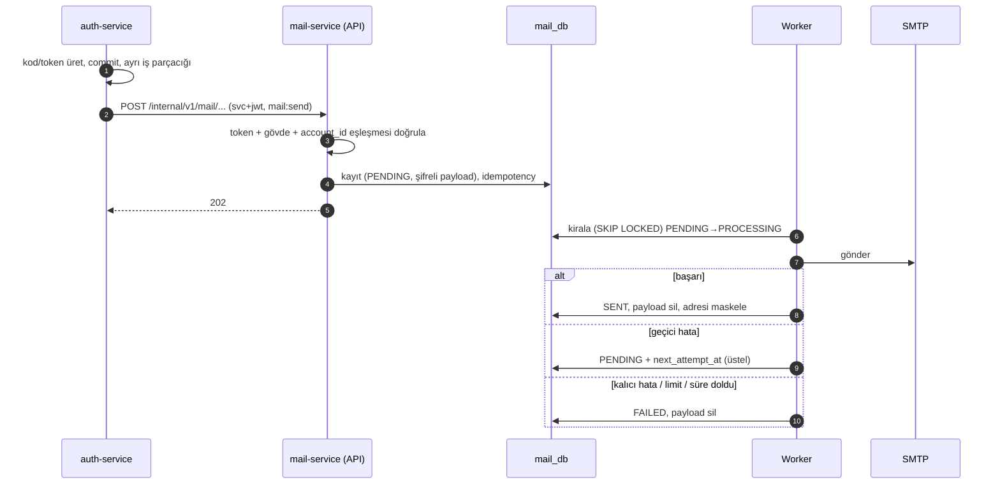

# Mail Service — Teknik Spesifikasyon (kesinleşmiş plan)

Tarih: 2026-10-31. Durum: **onay bekleyen 3 madde dışında kesin** (bkz. [decisions/kararlar.md](decisions/kararlar.md)). Kodlamadan önce bu belge esastır.
Dayanak: Auth'un gerçek kodu (`origin/main` af6e1cc + `feature/auth-service` 4450435), `docs/api.md`, `docs-auth/servis-sozlesmeleri.md`, `docs/SECURITY.md`.

## 1. Amaç ve sınır

Mail Service **yalnız Auth'tan** istek alır. E-postayı kalıcı kuyruğa yazar, `202` döner, arka plan işçisi SMTP ile gönderir.
Yapmaz: kod/token üretmez, parola değiştirmez, kimseyi çağırmaz, olay üretmez/tüketmez (outbox/inbox yok), kullanıcıya açık uç sunmaz, bildirim tercihi tutmaz, uygulama içi bildirim üretmez.



Auth yan etkisi (koddan): `202` dışı her yanıt/istisna → Auth kodu `DELIVERY_FAILED` yapar. Bu yüzden `202` yalnız kayıt DB'ye yazıldıysa döner.

## 2. Uçlar (hepsi Internal; `/internal/**` Gateway'e açılmaz)

Ortak: `Authorization: Bearer <svc+jwt>`; gövde en fazla 16 KB (`413`); bilinmeyen alan `400`; yanıt `202` gövdesiz; hata `ProblemDetail` + `code`.

| Uç | Gövde | Yetki | Not |
| --- | --- | --- | --- |
| `POST /internal/v1/mail/verification-codes` | `idempotencyKey` UUID, `accountId` UUID, `recipientEmail`, `code` `^[0-9]{6}$`, `validitySeconds` 60–3600, `locale?` | `SCOPE_mail:send` | Kayıt kodu ve e-posta değişikliği kodu |
| `POST /internal/v1/mail/password-resets` | `idempotencyKey`, `accountId`, `recipientEmail`, `resetLink`, `validitySeconds`, `locale?` | `SCOPE_mail:send` | |
| `POST /internal/v1/mail/account-deletions` | `idempotencyKey`, `accountId`, `recipientEmail`, `confirmationLink`, `validitySeconds`, `locale?` | `SCOPE_mail:send` | |
| `POST /internal/v1/mail/security-notifications` | `idempotencyKey`, `accountId`, `recipientEmail`, `type`, `occurredAt`, `locale?` | `SCOPE_mail:send` | `type`: `PASSWORD_CHANGED, PASSWORD_RESET, EMAIL_CHANGED, ACCOUNT_SUSPENDED, ACCOUNT_BANNED, ACCOUNT_DISABLED, ACCOUNT_REACTIVATED` (Auth `SecurityNotificationType` ile birebir). Sonra: `WELCOME`, `SUSPICIOUS_LOGIN` |
| `DELETE /internal/v1/accounts/{accountId}` | — | `SCOPE_account:erase` | `204`, idempotent; `sub=svc:auth-service` ve `account_id`=yol şart, aksi `403` |

Hatalar: `400` doğrulama; `401` token yok/geçersiz; `403` kapsam, `sub`, `account_id`≠gövde `accountId` ya da `locale` dışı; `409` aynı `idempotencyKey` farklı içerik (`IDEMPOTENCY_CONFLICT`); `413`; `500`.
Aynı anahtar + aynı içerik: `202` (yeni kayıt açılmaz). Gateway'de `/api/v1/mail/**` rotası vardır ama bu serviste hiçbir kullanıcı ucu yoktur → `denyAll`.

## 3. Kimlik doğrulama (User'ın `JwtConfig` + `SecurityConfig` deseni)

- Auth tarafı: `ServiceTokenIssuer.issue("mail-service", "mail:send", accountId)` → `typ=svc+jwt`, RS256, `iss=ltz-auth`, `aud=mail-service`, `sub=svc:auth-service`, `scope=mail:send`, `account_id=<accountId>`, `jti`, `iat/nbf/exp` (ömür 30 sn).
- Mail doğrular: JWKS (`AUTH_SERVICE_URL/api/v1/auth/.well-known/jwks.json`), yalnız RS256, `typ`, `iss`, `aud=mail-service`, `sub` önek `svc:` **ve tam `svc:auth-service`**, `jti`, `iat` zorunlu, ömür ≤ 60 sn, `scope`. Kullanıcı token'ı (`at+jwt`) hiçbir uçta kabul edilmez (tek token türü: servis).
- Mail uçları için `account_id` claim'i gövdedeki `accountId` ile eşit olmalı (çalınan token başka hesap için e-posta tetikleyemez). Auth bu bağı zaten üretir.
- Ek ENV yok (Mail ENV'leri §7'de): `AUTH_SERVICE_URL`, `JWT_ISSUER` mevcut. `ltz.mail.auth.service-audience=mail-service` (sabit).
- CSRF kapalı, stateless, çerez okunmaz (User gibi); `denyAll` varsayılan.

## 4. Veri modeli — `V81__create_mail_tables.sql` (V81–V90 aralığı; başka numara yok)

Kural: `uuid` PK, `timestamptz`, kısıt adları `pk_/uq_/ck_/ix_/fk_`, durum `varchar`+`CHECK`.

| Tablo | Sütunlar | Kısıtlar |
| --- | --- | --- |
| `mail_templates` | `id`, `code varchar(48)`, `locale varchar(2)` (tr/en), `subject varchar(200)`, `body_html text`, `body_text text`, `version int`, `active bool`, `created_at`, `updated_at` | `uq_mail_templates_code_locale_version`; CHECK locale; seed V82 |
| `mail_messages` | `id`, `idempotency_key uuid`, `request_hash varchar(64)`, `type varchar(32)`, `recipient_user_id uuid` (REF), `recipient_email varchar(254)` **null olabilir**, `recipient_masked varchar(254)`, `locale varchar(2)` null = TR+EN, `payload_encrypted bytea` null, `payload_key_version smallint`, `status varchar(16)`, `attempts int`, `next_attempt_at`, `lease_until`, `expires_at`, `last_error_code varchar(64)`, `created_at`, `updated_at`, `sent_at`, `version bigint` | `uq_mail_messages_idempotency_key`; CHECK status IN (PENDING,PROCESSING,SENT,FAILED), CHECK type; `ix_mail_messages_status_next_attempt` (status, next_attempt_at); `ix_mail_messages_recipient_user_id`; `ix_mail_messages_created_at` |
| `mail_delivery_attempts` | `id`, `message_id` FK `ON DELETE CASCADE`, `attempt_no`, `attempted_at`, `result` (SENT/TRANSIENT_FAILURE/PERMANENT_FAILURE/EXPIRED), `smtp_code int` null, `error_code varchar(64)` null, `duration_ms int` | `ix_mail_delivery_attempts_message_id`; hata metni/adres saklanmaz |

Gizlilik: tam adres yalnız `PENDING/PROCESSING` iken tutulur; terminal durumda `recipient_email=NULL`, geriye `recipient_masked` (`k***@g***.com`) kalır. Payload (kod/bağlantı) terminal durumda `NULL`.
Taslaktaki `inbox_events` bu serviste **yok** (olay tüketilmez); `database.md` §3.3'e karşılık notu işlenecek. `idempotency_records` yok: tekillik `uq_mail_messages_idempotency_key` ile.

## 5. Kuyruk, durumlar, retry

- Durumlar: `PENDING → PROCESSING → SENT`; `PROCESSING → PENDING` (geçici hata); `→ FAILED` (kalıcı hata, limit, süre).
- Kiralama: native `UPDATE ... WHERE id IN (SELECT id FROM mail_messages WHERE status='PENDING' AND next_attempt_at <= now() ORDER BY next_attempt_at LIMIT :n FOR UPDATE SKIP LOCKED) RETURNING`; `lease_until = now()+2 dk`. Süresi geçmiş `PROCESSING` yeniden kiralanır (çökme kurtarma).
- Zamanlayıcı: her 5 sn, parti 10; çok örnekli çalışmada güvenli.
- Üstel geri çekilme: `min(1 dk × 2^(deneme-1), 6 sa)` + %20 jitter; en çok 8 deneme.
- Son geçerlilik `expires_at`: kod/bağlantı türlerinde `created_at + validitySeconds` (süresi dolmuş kod gönderilmez → `FAILED`, `EXPIRED`); güvenlik bildirimlerinde `created_at + 24 sa`.
- SMTP hata sınıfı: bağlantı/zaman aşımı/4xx → geçici; 5xx alıcı reddi (550/551/553/501) → kalıcı; kimlik doğrulama hatası (535) → geçici ama `SMTP_AUTH_FAILED` kodu loglanır (yapılandırma hatası).
- Sabitler `application.properties` içinde `ltz.mail.worker.*` (ENV değil).

## 6. Hassas veri

- Payload JSON (`code`/`link`, `validitySeconds`, vb.) **AES-256-GCM** ile şifrelenir: 96 bit rastgele IV, AAD = `messageId + keyVersion`, anahtar `MAIL_PAYLOAD_ENCRYPTION_KEY` (Base64, 32 bayt). Anahtar yok/zayıf → açılış reddedilir (fail-fast, tüm profiller).
- Kod, bağlantı, token, tam e-posta: loga, hata mesajına, `toString()`'e, `last_error_code`'a, geçmişe **yazılmaz** (Auth kayıtlarının `toString()` maskeleme desenini izle).
- Bağlantı doğrulaması: yalnız `https` (dev profilinde `http://localhost`), kimlik bilgisi (`user:pass@`) yok, ≤ 512 karakter, host `MAIL_ALLOWED_LINK_HOSTS` allowlist'inde (prod'da boşsa açılmaz).
- Şablon değişkenleri HTML-escape; konu satırında CR/LF temizlenir; her değişken şablondaki allowlist'e bağlı.

## 7. SMTP ve şablon

- Gönderici elle kurulur (`JavaMailSenderImpl`, Auth'un dev adaptörü gibi): Boot mail health göstergesi devreye girmez, SMTP kesintisi `/actuator/health`'i düşürmez.
- ENV: `MAIL_SMTP_HOST`, `MAIL_SMTP_PORT`, `MAIL_SMTP_USERNAME`, `MAIL_SMTP_PASSWORD`, `MAIL_SMTP_SECURITY` (`STARTTLS` varsayılan | `SSL` | `NONE` yalnız dev), `MAIL_FROM_ADDRESS`. Dev: `mailpit:1025`, `NONE`. Prod'da TLS zorunlu, `NONE` reddedilir.
- Bağlantı/okuma/yazma zaman aşımı `ltz.mail.smtp.*` sabitleri.
- E-posta: `multipart/alternative` (düz metin + HTML), `Auto-Submitted: auto-generated`, izleme pikseli/uzak izleyici yok, `From: LTZ <MAIL_FROM_ADDRESS>`.
- Şablon (MAIL-08/09): `mail_templates` + V82 seed; kendi küçük yer tutucu çözücüsü (yeni bağımlılık yok); `locale` null → konu `TR / EN`, gövde TR bölümü + EN bölümü (bugünkü Mailpit davranışı); `tr`/`en` verilirse tek dil. Responsive, tablo tabanlı, inline CSS, 600 px, koyu mod uyumlu. Logo: `src/main/resources/mail/ltz-logo.png` (256×256, 56 KB). HTML'de `` ile **inline CID** ek olarak gömülür (uzak URL/izleme yok), `alt="LTZ"` zorunlu; görsel kapatılsa da metin başlığı okunur.

## 8. Paket yapısı (`docs/folder-structure.md` §3.1; User örnek)

```text
com.ltz.mail
├─ api/controller        MailApiPaths, InternalApiPaths, MailDeliveryController, AccountErasureController
├─ api/dto/request       VerificationCodeMailRequest, PasswordResetMailRequest, AccountDeletionMailRequest, SecurityNotificationMailRequest
├─ api/exception         GlobalExceptionHandler (ProblemDetail)
├─ application/service   MailEnqueueService, MailDispatchService, MailRetryPolicy, MailRetentionService, AccountErasureService, TemplateRenderer
├─ application/port      MailSenderPort, PayloadCipherPort
├─ domain/entity         MailMessage, MailTemplate, MailDeliveryAttempt
├─ domain/enums          MailStatus, MailType, SecurityNotificationType
├─ domain/exception      MailErrorCode, MailException
└─ infrastructure
   ├─ client             SmtpMailSender
   ├─ config             AuthProperties, JwtConfig, SecurityConfig, SmtpProperties, WorkerProperties, RequestLimitProperties, MailApplicationConfig
   ├─ persistence/repository  MailMessageRepository, MailTemplateRepository, MailDeliveryAttemptRepository
   └─ security           TokenClaims, RequestBodySizeLimitFilter, AesGcmPayloadCipher, MailDispatchWorker, MailRetentionWorker
```
`messaging/inbox|outbox`, `application/saga`, `domain/event`, `application/mapper` kullanılmaz (`.gitkeep` kalır). Worker sınıfları User/Auth örneğine uyar (`@Scheduled`).

## 9. Test planı (aynı fazda; gerçek PostgreSQL + yerel JWKS, User'ın `IntegrationTestSupport` deseni)

Yeni test bağımlılığı: `org.testcontainers:testcontainers-postgresql` (Auth ve User'da zaten var). SMTP için sahte `MailSenderPort` + `SmtpMailSender` ayrı birim testi (yerel `ServerSocket` sahte SMTP, yeni bağımlılık yok).
Kapsam: token negatifleri (typ/aud/sub/scope/ömür/`iat` yok/`account_id` uyuşmazlığı/kullanıcı token'ı), 4 uç doğrulama, idempotency (aynı/farklı/eşzamanlı), kuyruk kiralama yarışı, retry zamanlaması ve limit, süre dolumu, geçici/kalıcı SMTP hatası, çökme kurtarma, şifreleme (yanlış anahtar/AAD), terminal temizlik (payload NULL, adres maske), silme idempotent, retention, Flyway şeması + CHECK'ler, loglarda kod/bağlantı/e-posta yok, şablon escape/CRLF/TR-EN-iki dilli render, bağlantı allowlist. Hedef JaCoCo ≥ %80, Checkstyle/PMD sıfır yeni ihlal.

## 10. Dokunulacak ortak dosyalar (onay ister)

| Dosya | Değişiklik | Neden |
| --- | --- | --- |
| `docker-compose.yml` (mail-service bloğu) | **YAPILDI** (2026-10-31): 8 ENV aktarımı, hepsi boş varsayılan | SECURITY.md §1 |
| `ops/generate-auth-dev-keys.mjs` + test | **YAPILDI**: `MAIL_PAYLOAD_ENCRYPTION_KEY` üretici + 7 boş SMTP/link satırı | Kullanıcı talebi |
| `.env.example` | **Kullanıcı ekler** (araç erişimi engelli): 8 anahtar, hepsi boş | SECURITY.md §1 |
| `docs/api.md` `## MAIL` | 5 uç kaydı | AGENTS.md §4.1 |
| `docs/database.md` §3.3, `docs/er-diagram.md` | Gerçek şema notu | Mimari tutarlılık |
| `docs-security/mail-service/NOTLAR.md` | Notlar | AGENTS.md §2.6 |
| `backend/services/mail-service/pom.xml` | testcontainers (test) | §9 |
| Auth (ayrı görev, Kerem) | `MAIL_SERVICE` adaptörü, `api.md` Auth kaydı | `integration/README.md` |
