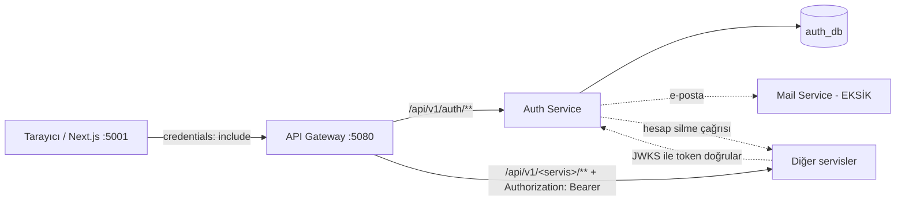

# LTZ: Auth ve API Gateway ile Entegrasyon (Tek Belge, Branch'e Göre Çalışır)

> Tarih: 2026-10-21 · Hazırlayan: Kerem (auth, user, mail) · Kaynak dal: `feature/auth-service`
> **Bu belgeyi okuyan yapay zekâ ajanı (Claude Code, Codex vb.) için talimattır.** İnsanlar da okuyabilir.
> Kural icat etmez; `docs/SECURITY.md`, `docs-auth/servis-sozlesmeleri.md`, `docs/api.md` ve gerçek Auth koduna uyar.
> Teknik ayrıntı için tek kaynak: [`docs/AUTH_SERVICE_ENTEGRASYON_REHBERI.md`](AUTH_SERVICE_ENTEGRASYON_REHBERI.md).

---

## 0. AJAN: ÖNCE BUNU YAP (kişiye değil, branch'e göre çalış)

Bu belgedeki entegrasyon işi için **kullanıcıya "sen kimsin / kimin görevi" diye sorma.** Hangi servisle çalıştığını **git branch'inden** çıkar.

### 0.1 Servisi bul

```bash
git branch --show-current          # Windows PowerShell'de de aynı komut
```

Branch adındaki servis adını bul. Aşağıdaki tabloya göre eşle (büyük/küçük harf önemsiz, `feature/game-service-faz5` gibi sonekler olabilir):

| Branch içinde geçen | Çalışacağın servis | Bölüm |
| --- | --- | --- |
| `auth-service` | auth-service | §5.1 |
| `gateway` | api-gateway | §5.1 |
| `user-service`, `mail-service` | user / mail | §5.1 |
| `game-service`, `library-service`, `review-service` | game / library / review | §5.2 |
| `hardware-service`, `recommendation-service`, `performance-service` | hardware / recommendation / performance | §5.3 |
| `community-service`, `content-service`, `event-service` | community / content / event | §5.4 |
| `social-service`, `messaging-service`, `lfp-service` | social / messaging / lfp | §5.5 |
| `admin-service`, `notification-service` | admin / notification | §5.6 |
| `frontend`, `web` | frontend | §5.7 |

### 0.2 Eşleşme yoksa ya da `main` ise

- `main`, `master`, `develop`, `chore/*` veya tabloyla eşleşmeyen branch'teysen **tek bir soru sor**: *"Hangi servis üzerinde çalışıyoruz?"* Cevaba göre ilerle.
- Branch iki servise birden benziyorsa yine tek soru sor. Tahmin yürütme.
- `main` üzerinde kod yazma; kullanıcıya servisin feature branch'ine geçmesini öner.

### 0.3 Sonra bu sırayla ilerle

1. **§2'yi oku** (herkes için ortak 10 kural, zorunlu).
2. **Yalnız kendi servisinin bölümünü oku** (§5). Frontend ya da istemci kodu yazıyorsan §3'ü de oku.
3. **Kullanıcıya 3–5 satır özet ver:** "Branch `X` → servis `Y`; Auth'tan şunları bekliyor; şu eksikler var; şu adımları yapacağım." Sonra devam et.
4. **Servisini denetle** (aşağıda §0.4) ve eksikleri uygula.
5. **Yalnız kendi servisinde değişiklik yap.** Başka servisin koduna, DB'sine, migration aralığına dokunma; gerekiyorsa kullanıcıya öner. `AGENTS.md` kuralları (commit/push yasağı, ENV onayı, `docs/api.md` kaydı, Türkçe yanıt) aynen geçerlidir.
6. **Olmayan şeyi uydurma.** §4'te EKSİK olarak işaretli yetenekleri (Mail Service, D4 servis kimliği, JWT'de e-posta/durum claim'i, `AccountStatusChanged`, cihaz kimliği) varmış gibi kodlama.

### 0.4 Servisini şu sırayla denetle ve tamamla

| # | Adım | Not |
| --- | --- | --- |
| 1 | **JWT doğrulayıcıyı ekle** (kaynak sunucusu) | RS256, JWKS, `iss`, `aud`, `typ=at+jwt`, `exp`. Örnek kod: rehber §3.4. Ortak Security modülü gelince onun yapılandırması geçerlidir |
| 2 | **`roles` claim'ini yetkiye çevir** | `ROLE_` önekiyle; bkz. rehber §3.4 |
| 3 | **Her endpoint'e açık kural yaz** | `permitAll` / `authenticated` / `hasRole`; geri kalan `denyAll` |
| 4 | **Sahiplik (IDOR/BOLA) kontrolü** | `owner_id == sub`, `userId` yalnız `sub`'dan; gövdeden `userId` alma |
| 5 | **Hesap silme ucu** (veri tutuyorsan) | `DELETE /internal/v1/accounts/{accountId}`, idempotent, kimliksiz açılmaz |
| 6 | **401/403/ProblemDetail** | Tutarlı hata gövdesi; sır/stack trace yok |
| 7 | **Testler** | §2 sonundaki liste; gerçek Auth token'ıyla en az bir entegrasyon testi |
| 8 | **`docs/api.md`** | Endpoint'lerin `Yetkilendirme` alanını gerçeğe göre güncelle |
| 9 | **Rapor** | Yapılanları, yapılamayanları (bekleyen bağımlılık) ve riskleri kullanıcıya bildir |

**ENV:** Ek ENV anahtarı gerekmez. Doğrulayıcı için ortak blokta zaten gelen `AUTH_SERVICE_URL` (JWKS adresi için), `JWT_ISSUER` ve `JWT_AUDIENCE` yeterlidir.
Başka anahtar eklemen gerekirse `AGENTS.md` kuralı geçerli: önce kullanıcıdan onay al.

**İlk kurulum (Auth'u kendi makinende çalıştıracaksan):** `docker compose` üç Auth anahtarını zorunlu tutar (`AUTH_JWT_PRIVATE_KEY`, `AUTH_OTP_HMAC_KEY`, `AUTH_TOTP_ENCRYPTION_KEY`); `.env` dosyanda yoksa **servisin başlamasa bile** `docker compose` hata verir. Kendi anahtarlarını üret: `node ops/generate-auth-dev-keys.mjs` (yalnız eksik/boş olanları doldurur, değerleri ekrana yazmaz, dolu anahtarın üzerine yazmaz). Başkasının `.env` dosyasını **kopyalama**; `.env` kişisel `SONAR_TOKEN` gibi değerler içerir. Bu anahtarlar yerel geliştirme içindir.

Durum işaretleri: **VAR** = kodda var ve test edildi · **SÖZLEŞME** = karar yazıldı, kod yok · **EKSİK** = henüz yok.

---

## 1. Resim: kim kiminle konuşuyor?



- **Auth** kimlik, parola, oturum, rol, 2FA ve hesap durumunun **tek sahibi**. Başka servis Auth'un veritabanına girmez.
- **Tarayıcı** token'ı JavaScript ile görmez. Auth, token'ı **HttpOnly çerezde** tutar; tarayıcı çerezi her isteğe kendisi ekler.
- **Gateway** çerezi okuyup servislere **`Authorization: Bearer <token>`** olarak iletir. **Her servis token'ı kendisi doğrular**, Gateway'e güvenmez.

### 1.1 Neden "çerezi Bearer'a çeviriyoruz"?

Çerez güvenli (XSS çalamaz) ama servisler Bearer bekler. Çerezle gelen isteği Bearer'a çevirince servislerdeki CSRF koruması devre dışı kalır
(Bearer isteği CSRF'den muaf sayılır). Bu yüzden **CSRF kontrolünü Gateway yapar**: durum değiştiren (POST/PUT/PATCH/DELETE) çerezli istekte
`X-XSRF-TOKEN` başlığı `XSRF-TOKEN` çerezine eşit olmalı, `Origin` izinli olmalı. Aksi halde istek servisinize **hiç ulaşmaz** (403).

### 1.2 Gateway'in şu an yaptıkları (VAR, `api-gateway`)

| Özellik | Kural |
| --- | --- |
| CORS | Yalnız `CORS_ALLOWED_ORIGINS` listesindeki tam origin'ler; `*` yasak; `credentials=true` |
| Çerez → Bearer | `/api/v1/**` (Auth hariç) isteğinde `Authorization` yoksa ve erişim çerezi varsa Bearer eklenir |
| CSRF + Origin | Çerezle gelen POST/PUT/PATCH/DELETE'de zorunlu; hata `403` + `CSRF_TOKEN_INVALID` / `ORIGIN_NOT_ALLOWED` |
| Başlık temizliği | İstemciden gelen `X-User-*`, `X-Account-*`, `X-Auth-*`, `X-Internal-*`, `X-Role(s)` silinir; `Forwarded`/`X-Forwarded-*` yalnız `GATEWAY_TRUSTED_PROXIES` ile güvenilen bağlantıdan korunur |
| Hız sınırı | `/api/v1/auth/**` için IP başına dakikada 120 (ayarlanır, JWKS muaf); aşımda `429` + `Retry-After` |

Gateway **yapmaz**: JWT doğrulaması, rol kontrolü, sahiplik kontrolü. Bunlar servislerin işi.

---

## 2. Herkes için ortak kurallar (zorunlu)

1. Token'ı **kendin doğrula**: JWKS `GET <AUTH_SERVICE_URL>/api/v1/auth/.well-known/jwks.json`, yalnız **RS256**, `iss=ltz-auth`, `aud` içinde `ltz-api`, başlık `typ=at+jwt`, `exp` zorunlu.
2. Kullanıcı kimliği **yalnız `sub`** claim'inden gelir (hesap UUID'si). Gövdeden, sorgudan veya `X-User-Id` gibi başlıktan gelen kimliğe **güvenme**.
3. Rol **`roles`** claim'inden gelir, öneksiz: `PLAYER`, `CONTENT_CREATOR`, `GAME_DEVELOPER`, `MODERATOR`, `ADMIN`. Başka rol yok; rol uydurma.
4. **Rol "ne yapabilir" der, "hangi kayda dokunabilir" demez.** Sahiplik kontrolü kendi veritabanında: `kayıt.owner_id == sub`.
5. Varsayılan **reddet**: her endpoint ya açıkça herkese açık ya da açıkça kimlik/rol ister.
6. **401** = kimlik yok/geçersiz, **403** = kimlik var ama yetki yok, **404** = yok ya da güvenli gizleme. Gövde `ProblemDetail`; token/SQL/stack trace yok.
7. Başkasının kaydı için 404 veya 403 ver, ayrıntı sızdırma; serviste tutarlı ol.
8. Hesap **askıya alınır/yasaklanırsa** token en fazla **5 dakika** (access token ömrü) sende geçerli görünür. Durum claim'i ve olay yok; buna göre tasarla.
9. Hesap silinirse Auth sana **`DELETE /internal/v1/accounts/{accountId}`** çağırır. Kişisel veriyi sil/anonimleştir, **idempotent** ol (ikinci çağrı da 2xx). Servis kimliği (D4) gelene kadar bu ucu Gateway'e açma.
10. Auth DB'sine ve başka servisin DB'sine **asla** doğrudan erişme. Sır, token, parola loglama, koda veya belgeye yazma.

**Test listesi (her servis):** token yok → 401 · bozuk/süresi dolmuş → 401 · `alg=none` ve HS256 → 401 · yanlış `iss`/`aud`/`typ` → 401 ·
yetersiz rol → 403 · başkasının kaydı → 404/403 · sahte `X-User-Id` yok sayılır · bilinmeyen `kid` → JWKS bir kez yenilenir sonra 401 ·
silme ucu iki kez çağrılınca ikisi de 2xx · hata gövdesinde token/SQL/stack trace yok.

**Yeni ihtiyaç** (rol, claim, endpoint): kodlamadan önce kullanıcıya bildir; Auth sahibi Kerem'e iletilir. Önce `docs-auth/servis-sozlesmeleri.md` ve `docs/api.md` değişir, sonra kod.

---

## 3. İstemci (frontend ve tarayıcı kodu) Auth ile nasıl konuşur?

Frontend `frontend/src/shared/lib/api/client.ts` içindeki `apiRequest` ile konuşur ve `credentials: "include"` kullanır.

| Adım | İstek | Not |
| --- | --- | --- |
| 1. CSRF çerezi al | `GET /api/v1/auth/csrf` → `204` | Çerez adı `__Host-XSRF-TOKEN` (güvenli ortam) veya `XSRF-TOKEN` (dev'de Secure kapalıysa). JavaScript okuyabilir |
| 2. Kayıt | `POST /api/v1/auth/register` → `202` | Çerezsiz, CSRF gerekmez. E-posta/kullanıcı adı varsa da aynı yanıt |
| 3. E-posta doğrula | `POST /api/v1/auth/email-verification/confirm` | `{email, code, password}` (kayıt parolası da gerekir) |
| 4. Giriş | `POST /api/v1/auth/login` + `X-XSRF-TOKEN: <çerez değeri>` | `status: AUTHENTICATED` → çerezler yazıldı. `MFA_REQUIRED` → `challengeId` ile `POST /login/2fa` |
| 5. Servis çağrısı | `fetch(url, {credentials:"include"})` | Çerez otomatik gider. **POST/PUT/PATCH/DELETE'e `X-XSRF-TOKEN` ekle** |
| 6. 401 gelirse | `POST /api/v1/auth/session/refresh` (+ `X-XSRF-TOKEN`) | Başarılıysa isteği **bir kez** tekrarla; değilse giriş sayfası |
| 7. Çıkış | `POST /api/v1/auth/session/logout` (+ `X-XSRF-TOKEN`) | Çerezler silinir |

Google/Steam girişi: tarayıcıyı `GET /api/v1/auth/oauth/google/start` (veya `steam/start`) adresine yönlendir. Sonuç **`FRONTEND_PUBLIC_URL/auth/callback`**
adresine **URL fragment'i** ile döner: `#status=authenticated`, `#status=mfa_required&challenge=…`, `#status=registration_required&token=…` (yalnız Steam)
veya `#status=email_verification_required&proof=…` (yalnız Steam). Parola sıfırlama bağlantısı `#token=…` taşır; token'ı `reset` gövdesinde gönder. Tam sözleşme: `docs/api.md` → AUTH.

Hata biçimi (`ProblemDetail`): `401 UNAUTHENTICATED`, `403 FORBIDDEN`, `429` (+ `Retry-After`). Gateway'in kendi hataları: `403 CSRF_TOKEN_INVALID`, `403 ORIGIN_NOT_ALLOWED`, `429 RATE_LIMITED`.

> **EKSİK (frontend):** Mevcut `apiRequest` **`X-XSRF-TOKEN` başlığını eklemiyor** ve `features/auth` boş. Auth'a POST atan her çağrı bu haliyle `403` alır.
> Önerilen küçük ek (frontend branch'inde, ayrı PR):
>
> ```ts
> const XSRF_COOKIES = ["__Host-XSRF-TOKEN", "XSRF-TOKEN"];
> function xsrfToken(): string | undefined {
>   for (const name of XSRF_COOKIES) {
>     const hit = document.cookie.split("; ").find((c) => c.startsWith(name + "="));
>     if (hit) return decodeURIComponent(hit.slice(name.length + 1));
>   }
> }
> // apiRequest içinde, GET/HEAD dışındaki isteklerde: headers.set("X-XSRF-TOKEN", xsrfToken() ?? "")
> // (çerez yoksa önce GET /api/v1/auth/csrf çağrılır)
> ```

Token'ı `localStorage`, `sessionStorage` veya IndexedDB'ye **yazma** (SECURITY.md §3).

---

## 4. Eksikler listesi (kim, ne, ne kadar acil)

Öncelik: **K** kritik (prod'u engeller) · **Y** yüksek · **O** orta · **D** düşük. Ayrıntı: `docs-auth/acik-guvenlik-borclari.md`.

| # | Eksik | Sahibi (servis) | Öncelik | Not |
| --- | --- | --- | --- | --- |
| 1 | **Mail Service yok** (doğrulama, sıfırlama, silme onayı, bildirim e-postaları) | mail-service | **K** | Auth'ta `prod` profili bu yüzden bilerek açılmıyor. Dev'de Mailpit ile çalışır |
| 2 | **Servislerde JWT doğrulaması yok** | Her servis | **K** | §0.4 adım 1–4 |
| 3 | **Hedef servislerde silme ucu yok** (`DELETE /internal/v1/accounts/{id}`) | Her veri sahibi servis | **Y** | Yoksa hesap `DELETED` olmaz, kişisel veri Auth'ta kalır |
| 4 | **Servis kimliği (D4) yok** (`svc+jwt`) | auth + ortak Security | **Y** | Admin→Auth ve Auth→servis iç çağrıları buna bağlı |
| 5 | **Frontend CSRF başlığı ve auth sayfaları yok** | frontend | **Y** | §3'teki not |
| 6 | **Silme hedef listesinde `game` ve `admin` yok** | game, admin + auth | **Y** | `accountId` içeren veri tutuyorlarsa listeye eklenmeli (S2) |
| 7 | **Bağımlılık yamaları (Tomcat/Jackson CVE) yalnız auth-service'te** | Parent POM | **Y** | Gateway dahil diğer modüller eski sürümde (B13) |
| 8 | **Durum değişikliği yayılımı yok** (`AccountStatusChanged`, D3) | auth + altyapı | O | Şimdilik en fazla 5 dk gecikme |
| 9 | **İlk ADMIN oluşturma yolu yok** | Proje sahibi | O | Şimdilik elle SQL ile rol verilir (B7) |
| 10 | **Cihaz kimliği yok** (PERF-01 masaüstü cihaz eşleştirme; `SECURITY.md`: cihaz token'ı kullanıcı token'ı değildir) | performance + auth | O | Auth'ta bu yetenek yok, tasarım kararı gerekir |
| 11 | **`UserRegistered` olayı yok** (Auth → User) | auth, user | O | Outbox/User Service yok |
| 12 | Gerçek Google/Steam ile uçtan uca deneme yok | auth | O | Client id/secret gerekli (B14) |
| 13 | Çok örnekli Gateway için ortak hız sınırı (Redis vb.) | api-gateway/altyapı | O | Şimdi örnek başına, bellekte |
| 14 | Anahtar rotasyonu yok (JWT, TOTP, HMAC) | auth | O | S9 |
| 15 | Parola politikası: en az 12, kara liste yok | auth + ürün | O | S10 (NIST: ≥15 + kara liste) |
| 16 | Hesap bağlama/ayırma, BANNED kaldırma, süreli askı, "parola ekle" yok | auth + ürün | D | B8, B10, B11 |
| 17 | Güvenlik olayı saklama süresi ve silme sonrası geri alma kararı yok | hukuk/ürün | D | B9, B17, S1 |
| 18 | Servis başına DB rolü yok (hepsi `ltz_dev`) ve prod dağıtımı (sır yöneticisi, prod compose) tasarlanmadı | altyapı | **Y** | Prod öncesi |
| 19 | Yetkisiz erişim negatif testleri (`SECURITY.md` hedefi 20/20) servislerde yok | Her servis | O | §2 test listesi |

---

## 5. Servis bölümleri (yalnız branch'inden bulduğun bölümü oku)

"Silme hedefi" = hesap silinince Auth bu servisi arar (Auth ayarı `ltz.auth.deletion.targets`: user, mail, library, review, social, messaging, lfp,
community, content, event, hardware, recommendation, performance, notification).

### 5.1 auth, api-gateway, user, mail

| Servis | Durum | Kurallar |
| --- | --- | --- |
| **auth-service** | VAR (dev) | Migration V61–V64 **donuk**, yeni şema V65+. Yeni rol/claim/endpoint önce `docs-auth/servis-sozlesmeleri.md` + `docs/api.md`'de. `prod` Mail adaptörü gelene kadar açılmaz (bilinçli). Prod anahtarları yeni üretilir: `openssl genrsa 3072 \| openssl pkcs8 -topk8 -nocrypt -outform DER \| base64 -w0`. Teknik ayrıntı ve prod listesi: rehber §13 |
| **api-gateway** | VAR (§1.2) | Servislerin yerine JWT doğrulama/rol/sahiplik **yapma**. Yeni özellik eklerken CORS/CSRF/başlık temizliği testlerini koru. Hız sınırı bellekte, `GATEWAY_TRUSTED_PROXIES` yük dengeleyici arkasında ayarlanır |
| **user-service** | İSKELET | Profil sahibi. Parola/refresh token **tutma**. `UserRegistered` olayı henüz yok (EKSİK #11). Steam/Discord bağlantısı (USER-07) bu servisin; Auth'un Steam **girişi** ile karışmasın, Steam kimlik kanıtını **üretme**. Silme hedefi |
| **mail-service** | İSKELET | Auth 3 port ile çağırır: doğrulama kodu, parola sıfırlama, silme onayı (+ MAIL-03 bildirimleri). Token **üretme**, loglama, düz metin saklama. Silme hedefi |

### 5.2 game, library, review

| Servis | Auth'tan beklenen | Yapılacaklar |
| --- | --- | --- |
| **game-service** | GAME-07 yönetim: `ADMIN`. GAME-12 geliştirici: `GAME_DEVELOPER` | Katalog okuma herkese açıksa açıkça `permitAll`. **Oyun bazlı geliştirici sahipliği Game DB'sinde** (Auth oyun yetkisi taşımaz). Auth hazır olunca yalnız yapılandırma (jwks/issuer/audience) ve `roles` → yetki dönüştürücü değişir; gerçek Auth token'ıyla entegrasyon testi yaz. Silme hedefi **değil**; `accountId` tutuyorsa (sahiplik, audit) kullanıcıya bildir (EKSİK #6) |
| **library-service** | `sub` | `userId = sub`, gövdede `userId` alanı yok. `(userId, gameId)` benzersiz; `gameId` Game Service ile doğrulanır. Başkasının koleksiyonu 404/403. Silme hedefi |
| **review-service** | `sub`; silme/moderasyon için `MODERATOR`/`ADMIN` | Başkası adına inceleme yok; düzenle/sil `owner == sub`. Moderatör işlemi audit'li. Silme hedefi: içerik/puan için silme-anonimleştirme kuralını belirle |

### 5.3 hardware, recommendation, performance

| Servis | Auth'tan beklenen | Yapılacaklar |
| --- | --- | --- |
| **hardware-service** | `sub`; yorum moderasyonu admin-service'e | Kendi donanım profilini silme (HW-16) `owner == sub`. Silme hedefi |
| **recommendation-service** | `sub` | Kullanıcıya özel öneri verisi için silme ucu. Silme hedefi |
| **performance-service** | `sub`; **cihaz kimliği EKSİK** (#10) | Kullanıcı verisini silme (PERF-20, PWEB-10). Cihaz token'ı kullanıcı oturum token'ı **değildir**; kullanıcı JWT'sini cihaz kimliği gibi kullanma, tasarım için kullanıcıya bildir. Silme hedefi |

### 5.4 community, content, event

| Servis | Auth'tan beklenen | Yapılacaklar |
| --- | --- | --- |
| **community-service** | `sub`; moderasyon kararları admin-service'ten | Gönderi/yorum yalnız sahibi düzenler-siler (COM-03/08). Silme hedefi |
| **content-service** | Yayın yetkisi `ADMIN` veya `CONTENT_CREATOR` (CONT-05/17); kaldırma `MODERATOR` | Normal `PLAYER` haber yayımlayamaz; rol kontrolü **sunucuda**. Silme hedefi |
| **event-service** | `sub` | Katılım/ceza kaydı `userId` ile; mükerrer katılım DB kısıtıyla. Silme hedefi |

### 5.5 social, messaging, lfp

| Servis | Auth'tan beklenen | Yapılacaklar |
| --- | --- | --- |
| **social-service** | `sub` | Arkadaşlık, davet kodu, engelleme `userId` ile; başka kullanıcı adına işlem yok. Silme hedefi |
| **messaging-service** | `sub` | Sohbet erişimi yalnız üyelere (MSG-14); engelleme social'dan (MSG-15). Silme hedefi |
| **lfp-service** | `sub` | İlanı yalnız sahibi günceller/siler (LFP-18). Silme hedefi |

### 5.6 admin, notification (ortak servisler)

| Servis | Notlar |
| --- | --- |
| **admin-service** | Auth'un `/api/v1/auth/admin/**` uçlarını **kullanıcı token'ıyla** çağırır (yalnız `ADMIN`). Servis kimlikli iç uç D4 gelince (#4). Denetim kaydında `accountId` tutuyorsa silme listesi kararı (#6). Bu ortak servisi değiştirmeden önce kullanıcıya sorumluluğun kimde olduğunu sor (`AGENTS.md` §1) |
| **notification-service** | Silme hedefi. E-posta bildirimi Mail Service'ten, uygulama içi bildirim bu serviste kalır. Ortak servis: değiştirmeden önce kullanıcıya sor |

### 5.7 frontend

`apiRequest` + `credentials: "include"` doğru. EKSİK: `X-XSRF-TOKEN` (§3), `features/auth` ekranları (giriş, kayıt, 2FA, `/auth/callback`, parola sıfırlama `#token=…`, hesap silme).

---

## 6. İletişim kuralları (kim kime, nasıl?)

| Durum | Ne yapılır |
| --- | --- |
| Yeni **rol** gerekiyor | Kullanıcı Kerem'e iletir. Rol eklemek Auth'ta migration (V65+) ve `docs/api.md` güncellemesidir; ajan rol uydurmaz |
| Auth **claim**/endpoint değişikliği isteği | Önce `docs-auth/servis-sozlesmeleri.md` + `docs/api.md` AUTH kaydı değişir, sonra kod; Kerem onaylar |
| Başka servisin API'si | `docs/api.md` içindeki o servisin bölümü okunur; değişiklik gerekiyorsa sahibine bildirilmesi önerilir |
| Silme ucu hazır | Kerem'e bildirilir: Auth ayarına eklenir, görev kuyruğu otomatik çalışır |
| Servis kimliği (D4) | Ortak Security güncellemesiyle birlikte kararlaştırılır; o zamana kadar iç uçları Gateway'e açma |
| ENV anahtarı ekleme/değiştirme | Onay ister (`docs/SECURITY.md`, `AGENTS.md`); önce `.env.example` önerisi |
| Migration | Yalnız kendi aralığın; uygulanmış dosya değişmez (`docs/decisions/migrations.md`) |
| Şüphe | "Bu bilgiyi token'dan mı alıyorum?" Cevap hayırsa dur ve kullanıcıya sor |

---

## 7. Sık yaşanan sorunlar

| Belirti | Sebep | Çözüm |
| --- | --- | --- |
| Auth'a POST atınca `403 CSRF_TOKEN_INVALID` | `X-XSRF-TOKEN` başlığı yok / çerezle eşleşmiyor | §3, önce `GET /api/v1/auth/csrf` |
| Tarayıcıda CORS hatası | Origin `CORS_ALLOWED_ORIGINS` listesinde değil | `.env`'de listeye ekleyin (tam origin, `*` yok) |
| Servisim 401 veriyor ama giriş yapılmış | Gateway'den değil doğrudan çağrılıyor (çerez Bearer'a çevrilmedi) | Gateway üzerinden çağır veya `Authorization: Bearer` ver |
| Token geçerli ama `aud` hatası | `JWT_AUDIENCE` farklı | Auth ile aynı değer (`ltz-api`) |
| Auth `prod` profilinde açılmıyor | Mail Service adaptörü yok (bilinçli) | Bekleyen iş #1 |
| Çok istekte `429` | Gateway Auth hız sınırı | `Retry-After` kadar bekle; dev'de `GATEWAY_AUTH_RATE_LIMIT_PER_MINUTE` artırılır |
| Eski token'lar bir anda geçersiz | Auth JWT anahtarı değişti | Yeniden giriş yap |
