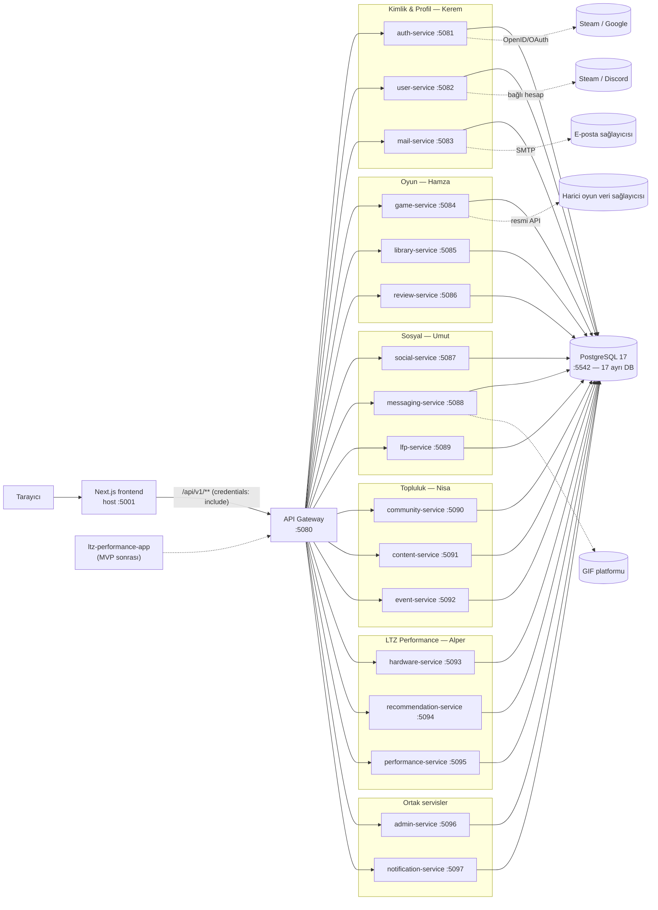
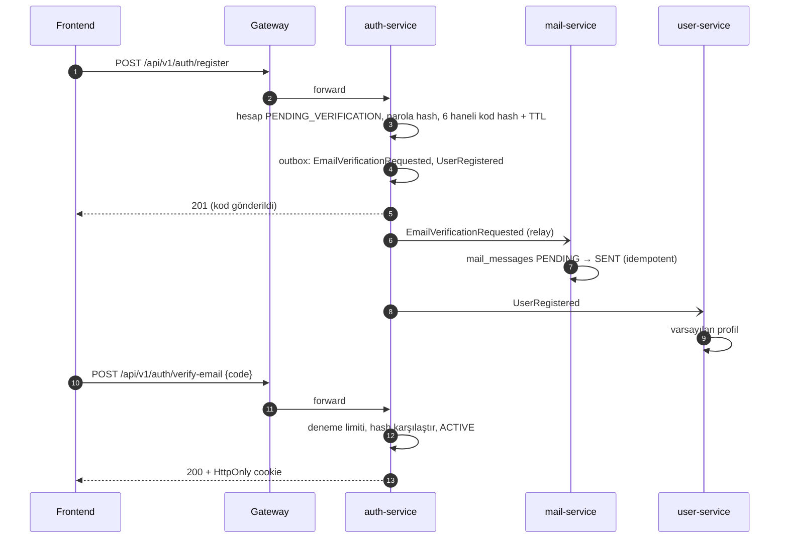
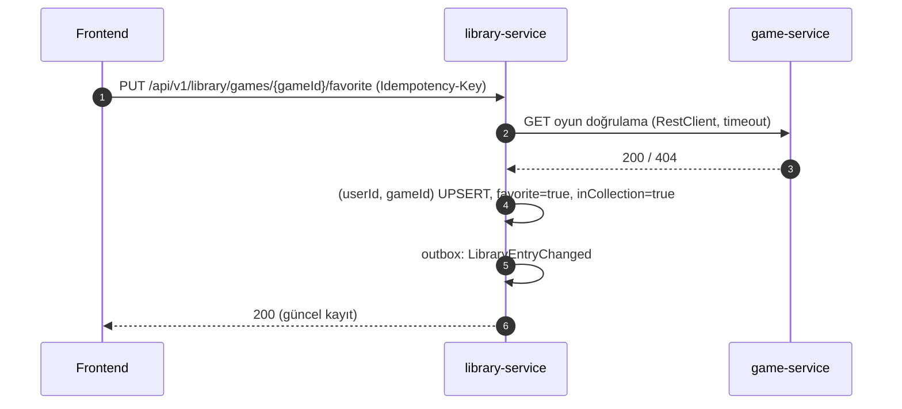
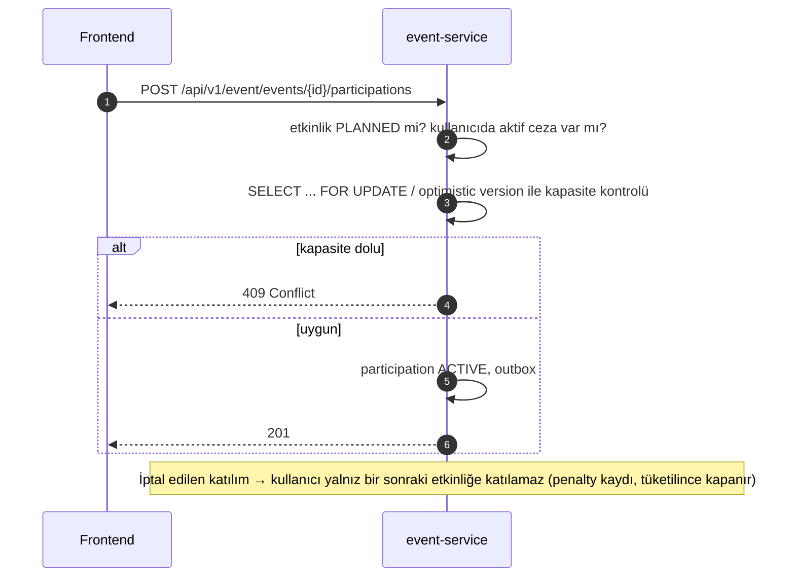
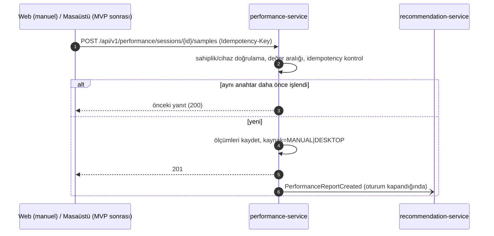
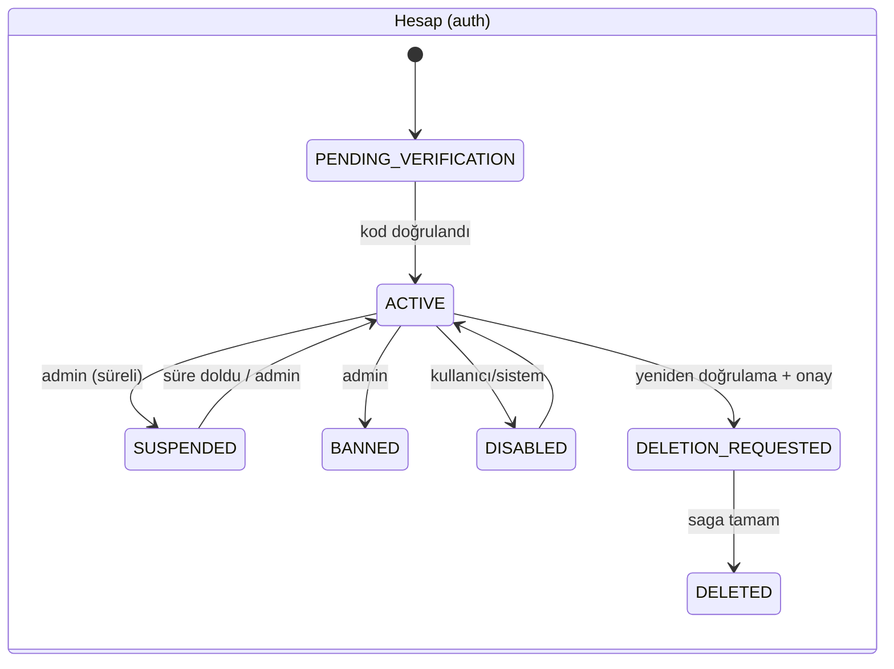

# LTZ (LobbyTwoZero) — Mimari

> Tarih: 2026-10-20
>
> Durum: **Mevcut altyapı + hedef mimari önerisi.** `[MEVCUT]` etiketli bölümler repodaki kodla doğrulanmıştır. `[ÖNERİ]` etiketli bölümler henüz uygulanmamıştır; servis sahibi ve ekip onayıyla kesinleşir. `[KARAR BEKLİYOR]` açık bir karardır.
>
> Kaynak önceliği: **repo kodu > `docs/servis-gereksinimleri/` > `docs/gereksinimler/` (docx)**. Docx'teki MSSQL, React+Vite ve Java 21 ifadeleri geçersizdir; social-service içindeki mesajlaşma ve LFP ayrı servislere bölünmüştür.
>
> İlgili belgeler: [SECURITY.md](SECURITY.md), [database.md](database.md), [er-diagram.md](er-diagram.md), [folder-structure.md](folder-structure.md), [web-rules.md](web-rules.md).

## 1. Teknoloji yığını `[MEVCUT]`

| Katman | Teknoloji |
| --- | --- |
| Backend | Java 25, Spring Boot 4.1.1 (parent), Maven multi-module (`backend/pom.xml`, groupId `com.ltz`) |
| Gateway | Spring Cloud Gateway Server Web MVC (`spring-cloud-starter-gateway-server-webmvc`) |
| Servisler arası HTTP | Spring `RestClient` (`spring-boot-starter-restclient`), timeout ENV ile |
| Güvenlik kütüphaneleri | `spring-boot-starter-security`, `oauth2-resource-server`, jjwt 0.13.0 (henüz yapılandırılmadı) |
| Veri | PostgreSQL 17 (`postgres:17-alpine`), Spring Data JPA, Flyway (+ `flyway-database-postgresql`); servis başına sürüm aralıkları [decisions/migrations.md](decisions/migrations.md) |
| API dokümanı | springdoc-openapi 3.1.1 (`SWAGGER_ENABLED`) |
| Gözlemlenebilirlik | Spring Boot Actuator (`health,info`, probes) |
| Frontend | Next.js 16.4.2, React 19.3.0, TypeScript 5, Tailwind 4, next-intl 4 (TR/EN), React Compiler |
| Test | JUnit/Spring Boot Test, JaCoCo 0.8.15 (≥ %80), Vitest 5, Testing Library, Playwright |
| Kalite | `pre-push/` (manuel), SonarQube (`sonarqube/`, isteğe bağlı, hedef A) |
| Çalışma ortamı | Docker Compose (`ltz_network`), `ops/env.*` ile profil yönetimi |

## 2. Topoloji



- Portlar DEV host portlarıdır (`.env.example`) ve yalnız `127.0.0.1`'e bağlıdır. Container içi port tüm servislerde `BACKEND_INTERNAL_PORT=8080`'dir.
- Container içi adresler: `http://<servis>-service:8080` (`<SVC>_SERVICE_URL`).
- Frontend Compose'da değildir; host üzerinde `npm run dev` ile çalışır.

## 3. Servis sahipliği ve sorumluluk sınırları

| Servis | DB | Sahip | Gateway path | Sorumluluk | Görevler |
| --- | --- | --- | --- | --- | --- |
| auth-service | auth_db | Kerem | `/api/v1/auth/**` | Kayıt, giriş, e-posta kodu, 2FA, Steam/Google giriş, JWT/refresh, roller, hesap durumu, güvenlik olayları, hesap silme | AUTH-01..17 |
| user-service | user_db | Kerem | `/api/v1/user/**` | Profil, avatar/kapak, gizlilik, bağlı hesaplar (Steam/Discord), onboarding, tercihler, oyuncu arama, profil özetleri | USER-01..13 |
| mail-service | mail_db | Kerem | `/api/v1/mail/**` | Şablonlar, kalıcı kuyruk, SMTP, retry, durum, idempotency, geçmiş | MAIL-01..16 |
| game-service | game_db | Hamza | `/api/v1/game/**` | Kanonik oyun kataloğu, Steam indeksi, zenginleştirme, sync, popülerlik, geliştirici içerikleri, batch özet | GAME-01..26 |
| library-service | library_db | Hamza | `/api/v1/library/**` | Kişisel koleksiyon, favori, bitirilen, istatistik, gizlilik | LIB-01..18 |
| review-service | review_db | Hamza | `/api/v1/review/**` | Puan, inceleme, beğeni, rapor, ortalama/özet puan | REV-01..15 |
| social-service | social_db | Umut | `/api/v1/social/**` | Arkadaşlık, istekler, davet kodu, engelleme, sosyal gizlilik | SOC-01..15 |
| messaging-service | messaging_db | Umut | `/api/v1/messaging/**` | Birebir/grup sohbet, mesaj, okundu, tepki, medya, gerçek zamanlı | MSG-01..27 |
| lfp-service | lfp_db | Umut | `/api/v1/lfp/**` | Oyun arkadaşı ilanları, filtre, süre, durum | LFP-01..18 |
| community-service | community_db | Nisa | `/api/v1/community/**` | Gönderi, yorum, beğeni, repost, forum/konu, rapor | COM-01..21 |
| content-service | content_db | Nisa | `/api/v1/content/**` | Haber, duyuru, kullanıcı içeriği, taslak/yayın, kategori | CONT-01..19 |
| event-service | event_db | Nisa | `/api/v1/event/**` | Etkinlik, katılım, kapasite, ceza, turnuva, oylama, hatırlatma | EVT-01..24 |
| hardware-service | hardware_db | Alper | `/api/v1/hardware/**` | Donanım profilleri, ürün kataloğu, karşılaştırma, donanım yorumları, kampanyalar | HW-01..17 |
| recommendation-service | recommendation_db | Alper | `/api/v1/recommendation/**` | Kişisel öneri, uyumluluk, tahmini FPS, öneri nedeni/geri bildirim, Python algoritmalı yardımcı | REC-01..23 |
| performance-service | performance_db | Alper | `/api/v1/performance/**` | Cihaz referansı (kimlik/token/iptal Auth'ta), performans oturumu, ölçümler, rapor, istatistik, senkronizasyon | PERF-01..22 |
| admin-service | admin_db | Ortak (sahipsiz) | `/api/v1/admin/**` | Kullanıcı yönetimi orkestrasyonu, moderasyon kuyruğu, istatistik, audit | FR-ADM-01..08 |
| notification-service | notification_db | Ortak (sahipsiz) | `/api/v1/notification/**` | Uygulama içi bildirim, okunmamış, tercihler, duyuru dağıtımı | FR-NOT-01..07 |
| LTZ Performance Web | — | Alper | — | `frontend/src/features/{performance,hardware,recommendation}` | PWEB-01..10 |

**Hardware uygulaması (2026-10-21, LTZ-ALP-HW-01):** Profil/bileşen yönetimi ve owner
istatistikleri api → application → domain/repository katmanlarında uygulanmıştır.
V1/V2 yalnız hardware_db şemasını tanımlar. Mutasyonlar parent profil satırını kilitler
ve istemcinin profileVersion değerini doğrular; detail/stats REPEATABLE_READ snapshot kullanır.
İş API'leri protected/owner'dır. Üretimde henüz Auth adapter'ı yoktur: kimlik taşıyan
header/cookie/token işlenmez, istekler reddedilir. Typed actor yalnız testlerde enjekte
edilerek yerel sahiplik kuralları sınanır; bu gerçek JWT/E2E doğrulaması değildir.
CSRF korunur, JSON mutasyonları 16 KiB ile sınırlıdır. Health probe dışında public iş API'si yoktur.
HW-10 kapsamında katalog yönetimi uygulandı: typed actor okumaları ve ayrıca
hardware:catalog:write uygulama izni isteyen mutasyonlar. Gerçek Auth rol/claim
eşlemesi ertelenmiş durumda. Arşivleme referansları korur; gerekçeli append-only
audit hardware_db transaction'ına katılır, aktör başına yönetim yazma sınırı uygulanır.
HW-11 parametrik model/kategori/üretici/teknik alan aramasını; HW-14 yetkili kişi
tarafından kaynak/gözlem/fiyat/geçerlilik bilgisiyle girilen kampanyaları sunar.
Harici fiyat API'si veya scraping yoktur; kaynak URL'ye sunucudan istek atılmaz.
V3/V4/V5 yalnız hardware_db'yi genişletir. Yerel uygulama 134 testle PASS;
HW-02 final pre-push PASS (%98,02); Sonar A/A/A + Quality Gate PASS.
Gerçek Auth/E2E DEFERRED_AUTH. HW-03 kapsamında V6 profile/alan/kategori gizliliği
ve üç karşılaştırma endpoint'i ile owner-only batch teknik veri sözleşmesi eklendi.
Non-owner paylaşım hem yerel kuralları hem HardwareVisibilityPolicy güvenilir dış
kararını gerektirir; production adapter sözleşme yokken deny eder. User/Social gerçek
adapter ve Performance/Recommendation gerçek tüketici E2E akışları kullanıcı onayıyla
DEFERRED_CONTRACT / NOT_VERIFIED; test mock'u canlı entegrasyon sayılmaz.
Batch en fazla 20 profil / toplam 200 istenen satır; dört sınırlı sorgu ve
REPEATABLE_READ ile sayfalı teknik DTO döndürür. Profil/bileşen karşılaştırması
owner-only, katalog karşılaştırması aktif aynı kategori modelleridir; FPS/benchmark
ve öneri uydurulmaz. HW-04 V8/V9 yorum/rapor/source moderasyonunu ekler: owner
yorum mutasyonları, SQL audience/engel filtreli sayfalama/AVG, doğal rapor tekilliği,
hardware:reviews:moderate uygulama izni ve gerekçeli immutable audit.
ReviewAudiencePolicy üretimde başkalarının UGC'sini deny eder. HIDE/RESTORE yalnız
kaynak hedefinde uygulanır; merkezi Admin case/kuyruk/rol/hesap yönetimi kurulmaz.
ContentReported ve HardwareReviewModerated v1 kayıtları aynı DB transaction'ında
bounded PENDING outbox'a yazılır; gerçek Admin/Notification/User-Social kontratı
ve E2E açık kullanıcı onayıyla DEFERRED_CONTRACT / NOT_VERIFIED. Relay/broker veya
uydurma URL/service-token açılmaz. Kaynak DTO'ları teslim edilmediğini açıklar.
239 hardware test / %98,66 PASS. Nihai tüm backend full dev 257 test / %95,98,
18 HTTP PASS ve SAFE TO COMMIT; Sonar A/A/A + Quality Gate PASS, açık issue/hotspot 0.
Gerçek Auth ve consumer bağlantıları doğrulanmadığından production-ready değildir.
HW-05/HW-06 açık onaylı stateless owner preview ekler; donanımı/izni kaydetmez.
HW-07 profil/cihaz izni ve generation, ayrı AuthenticatedHardwareDevice +
hardware:sync:write, deny eden HardwareSyncDevicePolicy ve idempotent snapshot
altyapısını V10 ile ekler. Parent profil kilidi/version owner/revoke/apply
yarışını seri hale getirir. Yalnız DESKTOP_SYNC kümesi yenilenir; MANUAL kayıtlar,
profil kökeni ve gizlilik korunur. Receipt 24 saat/profil başına 500, sequence
kalıcı anti-replay korumasıdır; iptal sonrası cached receipt bile reddedilir.
Gerçek Auth cihaz credential/scope, PERF-01 cihaz sahipliği/iptal kontratı ve
desktop E2E açık kullanıcı onayıyla DEFERRED_AUTH / DEFERRED_CONTRACT / NOT_VERIFIED.
Hardware içinde eşleştirme servisi, credential üretimi veya uydurma dış URL yoktur.
Production policy deny, izin veren kimlik ve policy yalnız testlerdedir.
MVP sonrası gerçek masaüstü istemcisi bu görevde geliştirilmez.
HW-05 nihai kalite: 293 hardware test/%98,75; full dev 311 backend test/%96,51,
18 HTTP PASS/SAFE TO COMMIT. Sonar A/A/A + gate PASS; açık issue/hotspot 0/0.
Toplu 46 API/17 alt görev envanteri docs-hardware/reports/HARDWARE_SERVICE_FINAL_REPORT.md
içindedir; gerçek Auth/consumer/cihaz E2E eksikleri production hazırlığı olarak gösterilmez.

HW-05 sonrası kullanıcı onaylı geliştirme temizliği: yukarıdaki V1–V10 referansları
özelliklerin önceki teslim tarihçesidir. Güncel hardware şeması 7 ilişkili CREATE
migration'ıyla boş DB'de kurulur (V1 profil/gizlilik, V2 katalog, V3 bileşen,
V4 kampanya, V5 yorum, V6 rapor/outbox, V7 sync). ALTER TABLE/INDEX yoktur;
ilişkiler, constraint/index/trigger davranışı ve API/iş kuralları korunur.
Eski history ile yükseltme yoktur; uygulama DB/volume resetini kullanıcı yapar.
[Güncel karar ve test kanıtı](../docs-hardware/progress/hardware-migration-cleanup.md).

Kurallar:

- **Ayrı arama, medya veya moderasyon servisi yoktur.** Arama her servisin kendi verisinde yapılır; moderasyon kaynak servis + admin-service iş birliğidir; medya depolama kararı bekleniyor.
- Ortak servislerde (admin, notification) değişiklik yapmadan önce ekiple koordinasyon gerekir.
- Bir servis başka servisin DB'sine erişmez; ihtiyaç API veya event ile karşılanır.

## 4. Gateway `[MEVCUT]`

- Route tanımı `backend/services/api-gateway/src/main/resources/application.properties` içinde `spring.cloud.gateway.server.webmvc.routes[i]` biçimindedir; `Path=/api/v1/<servis>/**` → `${<SVC>_SERVICE_URL}`.
- Path yeniden yazma (StripPrefix) **yoktur**; servis controller'ları tam path'i (`/api/v1/hardware/...`) karşılamalıdır.
- `[ÖNERİ]` Gateway'e eklenecekler: CORS (`CORS_ALLOWED_ORIGINS`), JWT ön doğrulaması, istek boyutu limiti, rate limit, `X-Request-Id` üretimi/aktarımı, client'tan gelen iç kimlik header'larının silinmesi. Hepsi **NOT IMPLEMENTED**.
- Servisler JWT'yi kendileri de doğrular (resource server) — Gateway tek güven noktası değildir.

> Not: Hamza'nın dosyasındaki `GET /api/games/...` örnekleri gerçek Gateway prefix'ine göre `/api/v1/game/...` olarak uyarlanmalıdır.

## 5. Servis iç katmanları `[MEVCUT iskelet]`

17 iş servisinin hepsinde aynı paket iskeleti `.gitkeep` ile kurulmuştur (`com.ltz.<servis>`; ayrıntı: [folder-structure.md](folder-structure.md)):

```text
com.ltz.<servis>
├── api/              # controller, dto/request, dto/response, exception (ProblemDetail)
├── application/      # service (use case, transaction), port, mapper, saga
├── domain/           # entity, enums, event, exception
└── infrastructure/   # client (+dto), config, messaging/inbox, messaging/outbox, persistence/repository, security
```

- Controller → application service → domain/repository. Controller'da iş mantığı ve doğrudan repository kullanımı yoktur.
- Entity API'ye dönmez; DTO (Java `record`) kullanılır (NFR-MAINT). Dönüşüm `application/mapper` içindedir.
- Başka servis çağrısı `infrastructure/client/<Hedef>Client` adapter'ı üzerinden yapılır; application katmanı `application/port` arayüzüne bağımlıdır (test edilebilirlik).
- Çok adımlı dağıtık akışlar `application/saga`, event yayınlama/tüketme `infrastructure/messaging/{outbox,inbox}` içindedir.
- `[MEVCUT]` Gerçek kod: `*Application.java`, `contextLoads` testleri ve `game-service/.../infrastructure/config/RestClientSettingsTest.java`.

## 6. Servisler arası iletişim

### 6.1 Senkron — RestClient `[MEVCUT altyapı / ÖNERİ kullanım]`

Kullanım koşulu: **çağıranın yanıtı hemen gerekiyorsa** ve hedef servis kısa sürede cevap verebiliyorsa.

| Çağıran → Hedef | Amaç |
| --- | --- |
| library → game | Oyunun var olduğunu doğrulama, `POST /api/v1/game/.../batch` ile toplu özet |
| review → game | Oyun doğrulama |
| recommendation → game, library, review, hardware, performance, social, event | Öneri girdileri (batch, sayfalı) |
| lfp → game | İlan oyun doğrulaması |
| event → game | Etkinliğin oyun bağlantısı (EVT-17) |
| community → game | Oyuna bağlı gönderi (COM-14) |
| messaging → social | Engelleme kontrolü (MSG-15) |
| lfp → social | Engelleme kontrolü (LFP-17) |
| user → library, review | Profil özetleri (USER-12) için sayaçlar (alternatif: event ile önbellek) |
| admin → auth, review, community, content, ... | Moderasyon/hesap durumu komutları |
| auth → mail | Doğrulama kodu / sıfırlama e-postası talebi (veya outbox event) |

Kurallar: timeout ENV'den (`3000 ms` / `5000 ms`), `redirects=dont-follow`, non-idempotent POST otomatik retry yok, döngüsel bağımlılık yok, N+1 yerine batch. Hedef servis kapalıysa çağıran servis **anlamlı hata/degradasyon** sunar (ör. öneri ekranı kısmi veriyle).

### 6.2 Asenkron — Outbox / Inbox `[ÖNERİ]`

Bir servisteki değişikliğin diğer servisleri **sonradan** etkilemesi gerektiğinde kullanılır.

- Üretici, iş verisi ile aynı transaction'da `outbox_events` tablosuna yazar.
- Relay (scheduler) bekleyen event'leri tüketicilere iletir. Mesaj aracısı (RabbitMQ/Kafka) Compose'da **yoktur**; ilk aşamada relay RestClient ile tüketicinin iç endpoint'ine (`POST /internal/events`) teslim eder. Broker eklemek `[KARAR BEKLİYOR]`.
- Tüketici `inbox_events` tablosunda `eventId` ile tekilleştirir (en az bir kez teslim + idempotent işleme).
- Event zarfı: `eventId (uuid)`, `eventType`, `eventVersion`, `occurredAt (UTC)`, `producer`, `aggregateId`, `payload` (en az gerekli alan, kişisel veri minimum).
- İç endpoint'ler Gateway'de route edilmez ve servisler arası kimlik doğrulaması ister.

### 6.3 Event kataloğu `[ÖNERİ]`

| Event | Üretici | Tüketiciler | Amaç |
| --- | --- | --- | --- |
| `UserRegistered` | auth | user, notification, mail | Profil oluşturma, hoş geldin |
| `EmailVerificationRequested` | auth | mail | 6 haneli kod e-postası (kod hash'i değil, gönderim için tek seferlik içerik) |
| `PasswordResetRequested` | auth | mail | Sıfırlama e-postası |
| `AccountStatusChanged` | auth | user, messaging, social, lfp, community, notification, mail | Askı/yasak sonrası görünürlük ve oturum etkisi |
| `AccountDeleted` | auth | tüm veri sahibi servisler | Kişisel veri silme/anonimleştirme |
| `ProfileUpdated` | user | social, messaging, community (ad/avatar önbelleği) | Görünen ad/avatar senkronu |
| `GameCatalogChanged` | game | library, review, recommendation | Arşivleme/birleştirme (LIB-17) |
| `LibraryEntryChanged` | library | recommendation, user | Öneri girdisi, profil sayacı |
| `ReviewChanged` | review | game (popülerlik), recommendation, user | Puan özeti, öneri |
| `FriendRequestSent` | social | notification | Alıcıya "arkadaşlık isteği" bildirimi (SOC-13; outbox'a yazılıyor, teslim bekliyor) |
| `FriendRequestAccepted` | social | notification | İsteği gönderene "kabul edildi" bildirimi (SOC-13; outbox'a yazılıyor, teslim bekliyor) |
| `FriendshipChanged` | social | messaging, recommendation, notification | Sohbet izni, arkadaş önerisi (`change`: ADDED/REMOVED; SOC-13) |
| `UserBlocked` / `UserUnblocked` | social | messaging, lfp, community, notification | Engelleme etkisi (SOC-09/10; outbox'a yazılıyor, teslim bekliyor). Engellenen kullanıcıya bildirim gitmez; notification bu olayla engellenenden bildirim üretmeyi durdurur |
| `MessageSent` | messaging | notification | Mesaj bildirimi (içerik önizlemesi gizliliğe bağlı) |
| `PostCreated` / `CommentCreated` / `PostLiked` | community | notification | Topluluk bildirimleri |
| `ContentPublished` / `ContentRemoved` | content | notification | Haber/duyuru bildirimi |
| `EventCreated` / `EventUpdated` / `EventCancelled` / `EventReminderDue` | event | notification, mail, recommendation | Hatırlatma, iptal bildirimi |
| `HardwareProfileChanged` | hardware | recommendation | Uyumluluk yeniden hesaplama |
| `PerformanceReportCreated` | performance | recommendation | Tahmini FPS modeline girdi |
| `ContentReported` | review, community, content, hardware, lfp | admin | Moderasyon kuyruğu |
| `ModerationActionTaken` | admin | ilgili kaynak servis, notification | Gizleme/kaldırma uygulaması |
| `AnnouncementPublished` | admin/content | notification | Platform duyurusu |

### 6.4 Saga kullanımı `[ÖNERİ]`

Çok adımlı ve birden fazla servisin verisini değiştiren akışlarda **koreografi tabanlı Saga** (event + telafi) kullanılır. Spring `@Transactional` yalnız tek servis DB'sini kapsar.

| Akış | Adımlar | Telafi |
| --- | --- | --- |
| Kayıt | auth hesap (`PENDING_VERIFICATION`) → `UserRegistered` → user profil oluşturur | Profil oluşturulamazsa retry; kalıcı hata → auth hesabı işaretler/temizler |
| Hesap silme | auth `DELETION_REQUESTED` → `AccountDeleted` → her servis siler/anonimleştirir ve onay event'i döner | Eksik onaylar izlenir, yeniden denenir; auth `DELETED`'a ancak tümü tamamlanınca geçer |
| Moderasyon | admin karar → `ModerationActionTaken` → kaynak servis gizler → notification | Kaynak servis başarısızsa admin kaydı `PENDING_APPLY` kalır |
| Etkinlik iptali | event `CANCELLED` → notification + mail | Bildirim başarısızlığı iptali geri almaz |

## 7. Örnek akışlar

### 7.1 Kayıt ve e-posta doğrulama kodu



### 7.2 Favoriye ekleme (otomatik koleksiyon — LIB-15)



### 7.3 Etkinliğe katılım ve ceza (EVT-08..13)



### 7.4 Performans verisi kabulü (PERF-17/18)



## 8. Durum makineleri `[ÖNERİ]`



| Kaynak | Durumlar | Kurallar |
| --- | --- | --- |
| Etkinlik (event) | `PLANNED → ACTIVE → COMPLETED`, `PLANNED/ACTIVE → CANCELLED` | Katılım yalnız `PLANNED`'da; kapasite eşzamanlı istekte korunur |
| Katılım (event) | `ACTIVE → CANCELLED_BY_USER` / `CANCELLED_BY_EVENT` / `ATTENDED` | Kullanıcı iptali → bir sonraki etkinlik için ceza |
| LFP ilanı | `OPEN → FULL → CLOSED`, `OPEN → EXPIRED` (zamanlayıcı) | Süre dolunca otomatik `EXPIRED` |
| Mail | `PENDING → PROCESSING → SENT`, `PROCESSING → FAILED → PENDING` (retry), `FAILED` (kalıcı) | Idempotency anahtarı tekil |
| İçerik (content) | `DRAFT → PUBLISHED → REMOVED`, `PUBLISHED → ARCHIVED` | Kullanıcı ön onaysız yayımlar; moderatör kaldırır |
| Gönderi/inceleme | `VISIBLE → HIDDEN (moderasyon) → VISIBLE`, `VISIBLE → DELETED` | Gizlenen içerik sayaçlardan çıkar |
| Rapor | `OPEN → IN_REVIEW → RESOLVED / REJECTED` | Karar gerekçeli ve audit'li |
| Arkadaşlık isteği | `PENDING → ACCEPTED / REJECTED / CANCELLED` | Kendine istek yok; engelliyse istek yok |
| Performans oturumu | `ACTIVE → COMPLETED`, `ACTIVE → ABANDONED` | Kapalı oturuma ölçüm eklenmez |
| Oyun senkronu (game) | `syncStatus`: `PENDING → SYNCED / FAILED / STALE` | `metadataCompleteness`: `INDEX_ONLY → PARTIAL → FULL` |

## 9. Gerçek zamanlı iletişim `[KARAR BEKLİYOR]`

- Mesajlaşma (MSG-09) ve bildirimler için WebSocket veya SSE seçilecektir.
  - **WebSocket:** çift yönlü, yazıyor göstergesi/okundu için uygun; Gateway Web MVC üzerinden proxy desteği doğrulanmalıdır.
  - **SSE:** tek yönlü, HTTP üzerinden basit; gönderim normal POST ile yapılır.
- Karar verilene kadar istemci kısa aralıklı polling ile çalışabilir; karar `docs/decisions/` altına ADR olarak yazılır.

## 10. Recommendation ve Python algoritmaları `[KARAR BEKLİYOR]`

- REC-20 kural tabanlı motor Java içinde başlar. REC-21/22 Python algoritmaları gerektirir; **ayrı bir AI mikroservisi açılmaz** ve **yerel LLM çalıştırılmaz**.
- Seçenekler: (a) recommendation-service container'ına Python çalışma zamanı + süreç çağrısı, (b) aynı servis sınırında yardımcı (sidecar) süreç. Karar ADR ile verilir; API sözleşmesi değişmez.
- Öneri çıktısı her zaman **neden** bilgisi (REC-17) taşır ve kullanıcı adına otomatik işlem yapmaz.

## 11. Güvenlik sınırları (özet)

Ayrıntı [SECURITY.md](SECURITY.md):

- Dış dünya → yalnız Gateway (production'da TLS arkasında).
- Gateway → servisler: iç ağ, fakat servisler JWT'yi yeniden doğrular.
- Servis → servis: RestClient + servis kimliği (model `[KARAR BEKLİYOR]`), iç endpoint'ler Gateway'de yayımlanmaz.
- Servis → DB: yalnız kendi DB'si; production'da servis başına DB kullanıcısı.
- Harici sağlayıcılar: yalnız resmi API, timeout, rate limit, şema doğrulama.

## 12. Gözlemlenebilirlik `[MEVCUT + ÖNERİ]`

- `[MEVCUT]` `/actuator/health` (liveness/readiness probes), `/actuator/info`; detaylar kapalı. Pre-push health kontrolü yapar.
- `[ÖNERİ]` Gateway'de `X-Request-Id` üretimi ve tüm servislerde log MDC'ye aktarımı; yapılandırılmış (JSON) log; kişisel veri maskeleme.

## 13. Kalite hedefleri

| Hedef | Kaynak |
| --- | --- |
| 50 sanal kullanıcıda API P95 ≤ 2 sn | H-09 |
| Yerel katalog sorguları p95 ≤ 300 ms | Hamza GAME-25 |
| 20/20 yetkisiz erişim testi 401/403 | H-12 |
| Tüm istemci trafiği Gateway üzerinden | H-13 |
| Backend satır kapsamı ≥ %80 (JaCoCo) | pre-push |
| SonarQube notu A | servis-gereksinimleri |

## 14. Riskler ve açık konular

| Risk / konu | Etki | Önerilen yaklaşım |
| --- | --- | --- |
| 17 servis + tek PostgreSQL instance | Bağlantı/bellek baskısı | `DB_POOL_MAX_SIZE=3`, servis başına izleme |
| Broker yok | Event teslimi RestClient relay'e bağlı | Outbox + inbox + retry; ihtiyaç ölçülünce broker ADR |
| Gerçek zamanlı yöntem belirsiz | Mesajlaşma UX'i | ADR, geçici polling |
| Medya depolama belirsiz | Avatar, gönderi, mesaj medyası | ADR: yerel volume vs. obje depolama; imzalı URL |
| Servisler arası kimlik modeli belirsiz | İç endpoint güvenliği | ADR: servis JWT'si veya paylaşılan sır + ağ izolasyonu |
| Python algoritma çalışma zamanı | recommendation dağıtımı | ADR (§10) |
| Docx ile kod arasında teknoloji farkı | Yanlış uygulama | Kod ve servis-gereksinimleri önceliklidir |
| Ortak servislerin (admin, notification) sahibi yok | Koordinasyon eksikliği | Değişiklik öncesi ekip bildirimi |
| Hamza dosyasındaki `/api/games` path'leri | Gateway ile uyumsuzluk | `/api/v1/game/...` |

Kararlar `docs/decisions/` altına `NNNN-baslik.md` (ADR) olarak kaydedilir; klasör şu an boştur.
